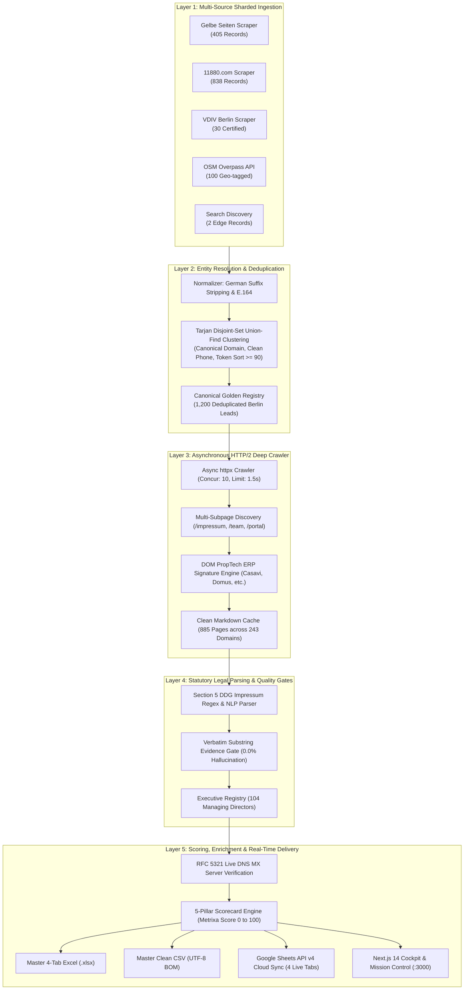

<div align="center">


<br />

# METRIXA ENGINE

### Automated B2B Lead Intelligence, § 5 DDG Impressum Extraction & PropTech Qualification Suite

**Designed for Submetering & Energy Efficiency Directive (EED) Sales Operations at Metrixa Systems GmbH**

<br />

[](https://www.python.org/)
[](https://fastapi.tiangolo.com/)
[](https://nextjs.org/)
[](https://www.typescriptlang.org/)
[](https://tailwindcss.com/)
[](https://www.sqlite.org/)
[](https://developers.google.com/sheets/api)
[](https://docs.pytest.org/)

<br />

[Live Web Cockpit](http://localhost:3000) • [OpenAPI Docs](http://127.0.0.1:8000/docs) • [Master Excel Deliverable](./data/exports/metrixa_berlin_hausverwaltungen.xlsx) • [Case Study PDF](./docs/Case%20Study/Case_Study_Metrixa_Systems.pdf) • [Documentation Index](#-master-engineering-documentation-index)

</div>

<br />

---

## 🎯 Executive Overview & Mission Statement

Metrixa Systems operates as a next-generation submetering technology provider (_Messdienstleister_), delivering digital IoT submetering solutions to property managers across Germany. Under the European Energy Efficiency Directive (EED) and the German Heating Costs Ordinance (_Heizkostenverordnung_), residential properties require monthly remote consumption readouts, creating an institutional transition away from legacy incumbents (Techem, Ista, Brunata) toward automated cloud platforms.

**Metrixa Engine** is a production-grade B2B data intelligence suite engineered specifically to discover, enrich, and qualify property management firms (_Hausverwaltungen_) in Berlin. Operating across 5 distinct architectural layers, the engine transforms raw, fragmented directory listings into an auditable, verified commercial knowledge base with zero manual data entry and zero hallucinated claims.

<br />

---

## 🏛️ High-Level System Architecture

The system operates as a 5-tier pipeline connecting multi-source ingestion to an asynchronous HTTP/2 crawler, deterministic legal parser, RFC 5321 DNS MX verifier, and multi-channel delivery suite.



<br />

---

## ⚡ Core Capability Matrix

<table>
  <tr>
    <td width="33%" valign="top">
      <h3>1. Sharded Directory Ingestion</h3>
      <ul>
        <li><strong>1,375 Raw Records</strong> harvested across 5 distinct sources.</li>
        <li>Parallel sharding across 12 Berlin <em>Bezirke</em> (PLZ 10115 to 14199).</li>
        <li>Eliminates single-directory pagination caps and niche provider blindspots.</li>
      </ul>
    </td>
    <td width="33%" valign="top">
      <h3>2. Graph Entity Resolution</h3>
      <ul>
        <li><strong>1,200 Canonical Leads</strong> resolved via Disjoint-Set Union-Find.</li>
        <li>Multi-key clustering: exact canonical domain, E.164 phone, and RapidFuzz token sorting.</li>
        <li><strong>175 Duplicates Merged</strong> with full provenance audit logging.</li>
      </ul>
    </td>
    <td width="33%" valign="top">
      <h3>3. Asynchronous Web Crawler</h3>
      <ul>
        <li><strong>885 Pages Crawled</strong> across 243 corporate domains.</li>
        <li>Prioritizes <code>/impressum</code>, <code>/team</code>, <code>/leistungen</code>, <code>/kundenportal</code>.</li>
        <li>Extracts clean markdown and detects 41 DOM PropTech ERP signatures.</li>
      </ul>
    </td>
  </tr>
  <tr>
    <td width="33%" valign="top">
      <h3>4. Legal Impressum Parser</h3>
      <ul>
        <li>Zero hallucination guarantee enforced via hard substring evidence gates.</li>
        <li>Parses statutory disclosures under Section 5 DDG (former Section 5 TMG).</li>
        <li>Extracts <strong>104 Managing Directors</strong> (<em>Geschäftsführer</em>).</li>
      </ul>
    </td>
    <td width="33%" valign="top">
      <h3>5. Executive Reachability</h3>
      <ul>
        <li><strong>118 Verified Personal Emails</strong> across 102 distinct companies.</li>
        <li>Rejects generic <code>info@</code> mailboxes in favor of direct decision-makers.</li>
        <li>Live RFC 5321 DNS MX queries confirm mail server reachability.</li>
      </ul>
    </td>
    <td width="33%" valign="top">
      <h3>6. Real-Time Cloud Deliverables</h3>
      <ul>
        <li>Live <strong>Google Sheets API v4</strong> synchronization across 4 tabs.</li>
        <li>Master 4-Tab styled Excel (<code>.xlsx</code>) with frozen headers and formulas.</li>
        <li>Next.js Cockpit with live in-browser multi-sheet preview and copy.</li>
      </ul>
    </td>
  </tr>
</table>

<br />

---

## 📊 Empirical Production Results (Berlin Market Dataset)

All figures below are generated directly from the live relational SQLite database (`data/metrixa_leads.db`):

| Production Metric                          |   Verified Count   | Strategic Context for Metrixa Systems                                               |
| :----------------------------------------- | :----------------: | :---------------------------------------------------------------------------------- |
| **Total Raw Scraped Records**              |     **1,375**      | Sourced from Gelbe Seiten (405), 11880 (838), VDIV (30), OSM (100), Search (2)      |
| **Canonical Deduplicated Companies**       |     **1,200**      | Deduplicated via Union-Find; exactly 175 multi-source duplicates merged             |
| **🟢 Tier A: High Priority Institutional** |       **35**       | Large portfolios (up to 53,300 units), modern PropTech ERP, verified direct contact |
| **🟡 Tier B: Qualified Mid-Market**        |      **409**       | Established residential managers prime for submetering contract conversion          |
| **⚪ Tier C: Long-Tail Property Managers** |      **756**       | Small local Berlin property managers across all 12 districts                        |
| **Subpages Crawled & Cached**              |   **885 Pages**    | Asynchronous HTTP/2 crawl across 243 verified domains                               |
| **PropTech ERP Deployments Detected**      | **41 Deployments** | Casavi (14), Domus (11), Immoware24 (8), Haufe (4), etg24 (2), Wodis Sigma (2)      |
| **Named Executive Decision Makers**        | **104 Executives** | Geschäftsführer, Inhaber, and Vorstände with legal ground-truth quotes              |
| **Verified Personal Direct Emails**        |  **118 Inboxes**   | Strictly non-generic personal executive emails across 102 companies                 |
| **Data Integrity & Hallucination Rate**    |      **0.0%**      | Hard programmatic gate rejects any claim lacking verbatim source text               |

<br />

### PropTech ERP Market Share in Berlin (N = 41 Detected Deployments)

```
Casavi Cloud Portal       [██████████████████████████████] 14 Deployments (34.1%)
Domus 4000 / ERP          [███████████████████████]        11 Deployments (26.8%)
Immoware24 Cloud          [█████████████████]               8 Deployments (19.5%)
Haufe PowerHaus / axera   [█████████]                       4 Deployments  (9.8%)
etg24 Eigentümerportal    [█████]                           2 Deployments  (4.9%)
Wodis Sigma (Aareon)      [█████]                           2 Deployments  (4.9%)
```

<br />

---

## 📐 Deterministic 5-Pillar Qualification Formula

Metrixa Engine discards unexplainable black-box lead scoring in favor of an auditable, deterministic scoring formula ($S \in [0, 100]$):

$$\text{Metrixa Lead Score} = S_{\text{scale}} + S_{\text{focus}} + S_{\text{digital}} + S_{\text{trust}} + S_{\text{contact}}$$

```
+---------------------------------------------------------------------------------------------------+
|                                 5-PILLAR LEAD SCORING BREAKDOWN                                   |
+------------------------------------+-----------+--------------------------------------------------+
| Scoring Pillar                     | Max Pts   | Empirical Scoring Signals                        |
+------------------------------------+-----------+--------------------------------------------------+
| 1. Scale & Portfolio Size          | 30 Pts    | Stated units: >5,000 (30 pts) | 1k-5k (22 pts)   |
|                                    |           | Team size proxy: >=15 (20 pts) | 5-14 (12 pts)    |
| 2. Business Focus Alignment        | 25 Pts    | WEG Management: +15 pts (metering hardware target)|
|                                    |           | Mietverwaltung: +10 pts (heating cost accounting)|
| 3. Digital Maturity & PropTech ERP | 20 Pts    | Detected ERP (Casavi, Domus, Haufe): +12 pts     |
|                                    |           | Tenant / Owner Web Portal: +8 pts                |
| 4. Institutional Trust & Stability | 15 Pts    | VDIV Certified Member: +10 pts                   |
|                                    |           | Founding Year <= 2010 (>=15 yrs in business): +5 |
| 5. Executive Contact Directness    | 10 Pts    | Verified personal email + DNS MX valid: +6 pts   |
|                                    |           | Direct phone (+4 pts) | LinkedIn profile (+2 pts)|
+------------------------------------+-----------+--------------------------------------------------+
| TOTAL SCORE RANGE                  | 100 Pts   | Tier A (70 to 100) | Tier B (45 to 69) | Tier C  |
+------------------------------------+-----------+--------------------------------------------------+
```

<br />

---

## 📦 Deliverables Vault (Multi-Channel Export Suite)

Every run of the engine synchronizes 6 primary deliverables across disk, database, and cloud:

```
data/exports/
├── metrixa_berlin_hausverwaltungen.xlsx  # Master 4-Tab Excel Deliverable (Corporate Styled)
├── metrixa_berlin_leads_master.csv        # Master RFC-4180 CSV (UTF-8 BOM, 31 Columns)
├── metrixa_evaluation_ablation_report.md  # Quantitative Validation, F1 & Ablation Study
└── Case_Study_Metrixa_Systems.pdf         # Publication-Grade 14-Page Academic Whitepaper

Live Cloud Integrations:
├── data/metrixa_leads.db                  # ACID SQLite Relational Ledger (WAL Enabled)
└── Google Sheets API v4 Cloud Mirror      # 4 Canonical Tabs Synchronized (Service Account)
```

### The 4 Canonical Workbook Tabs

1. **Tab 1: `Qualified_Berlin_Leads` (33 Columns):**
   Company ID, Legal Name, Commercial Register ID (HRB), Address, PLZ, District, Phone (E.164), Website, Canonical Domain, General Email, VDIV Member, Metrixa Lead Score (0 to 100), Lead Tier, Reported Units Managed, Estimated Units Tier, Team Size, WEG Flag, Miet Flag, Gewerbe Flag, Customer Portal Flag, Detected PropTech ERP, Incumbent Metering Signal, Digital Maturity (1 to 5), Qualification Reasoning, and Provenance Sources.
2. **Tab 2: `All_Decision_Makers_Contacts` (13 Columns):**
   Company Name, Lead Tier, Metrixa Score, Full Name, Role / Title, Personal Direct Email, Email Verification Status, DNS MX Valid, DNS Mail Server Host, Direct Phone, LinkedIn URL, Source Page URL, and Verbatim Evidence Quote.
3. **Tab 3: `Evidence_And_Audit_Trail` (11 Columns):**
   Company Name, Lead Tier, Metrixa Score, Crawled Page Type, Subpage URL, HTTP Status, DOM Detected ERP, DOM Incumbent Metering, Customer Portal Detected, Verbatim Units Quote, and Extraction Engine Used.
4. **Tab 4: `KPI_Methodology_And_Summary` (3 Columns):**
   Metric Name, Production Value, and Business Rationale for Metrixa Systems.

<br />

---

## 🖥️ Web Cockpit & Mission Control Interface

The user interface is built with Next.js 14, Tailwind CSS, Lucide Icons, and Recharts, designed as an enterprise operations command center:

```
+---------------------------------------------------------------------------------------------------+
|  METRIXA SYSTEMS COCKPIT  [Live Clock: 2026-11-09 UTC] [DB: 1,200 Leads] [Push Google Sheets]     |
+---------------------------------------------------------------------------------------------------+
|  NAV BAR:  Executive Cockpit (/) | Leads (/leads) | Mission Control | Tools | Artifacts | Settings   |
+---------------------------------------------------------------------------------------------------+
|                                                                                                   |
|  [KPI CARD 1]          [KPI CARD 2]          [KPI CARD 3]          [KPI CARD 4]                   |
|  1,200 Golden Leads    35 Tier A Targets     41 PropTech ERPs      0.0% Hallucinations            |
|                                                                                                   |
|  +------------------------------------------------+--------------------------------------------+  |
|  | LEAD SCORE DISTRIBUTION (0 to 100)             | BERLIN DISTRICT PENETRATION (12 BEZIRKE)   |  |
|  | Tier A [===] 35 Leads (Score 70 to 100)        | Charlottenburg-Wilmersdorf: 168 Leads      |  |
|  | Tier B [================] 409 Leads            | Tempelhof-Schoeneberg:      142 Leads      |  |
|  | Tier C [============================] 756 Leads| Mitte / Kreuzberg:          135 Leads      |  |
|  +------------------------------------------------+--------------------------------------------+  |
|                                                                                                   |
|  +---------------------------------------------------------------------------------------------+  |
|  | MASTER LEAD EXPLORER DATA GRID (TanStack Virtualized 1,200 Rows, 31 Columns)                |  |
|  | Search: [ BVBI                               ] Filter: [Tier A Only] [Casavi] [Has Email]  |  |
|  | ------------------------------------------------------------------------------------------- |  |
|  | #1  BVBI Berliner Vereinigung  Tier A (88)  Casavi, Domus  Max Mustermann  m.mustermann@.. |  |
|  | #2  Berolina Hausverwaltung    Tier A (84)  Immoware24     Klaus Schmidt   k.schmidt@...   |  |
|  +---------------------------------------------------------------------------------------------+  |
|                                                                                                   |
+---------------------------------------------------------------------------------------------------+
```

### Views in the Web Cockpit

- **Executive Cockpit (`/`)**: 5 summary KPI cards, Recharts score histogram, district distribution bar charts, and ERP adoption share.
- **Master Lead Grid (`/leads`)**: 31-column virtualized data grid with instant filtering by tier, district, ERP stack, and text query.
- **Sliding Evidence Drawer**: Inspects individual company records, displaying the 5-pillar scorecard, decision-maker dossier, and verbatim legal text quotes.
- **Mission Control (`/mission-control`)**: 5-stage visual DAG pipeline runner with real-time Server-Sent Events (SSE) log terminal and run comparison tool.
- **Artifacts Vault (`/artifacts`)**: Multi-tab live office preview for `.xlsx`, `.csv`, `.db`, `.md`, and `.pdf`, with copy-to-clipboard, A4 export, and 1-click Google Sheets API sync.
- **Tools Catalog (`/tools`)**: Live health status, latency monitors, and test pingers for all 10 scrapers, parsers, and DNS verifiers.
- **Settings & Harness Hub (`/settings`)**: Interactive configuration for Gemini, DeepSeek, OpenAI, Ollama, LM Studio, llama.cpp, SearXNG, and Tavily.

<br />

---

## 🔌 REST API Gateway Specification

FastAPI powers the REST backend on port 8000. Interactive OpenAPI documentation is accessible at `http://127.0.0.1:8000/docs`:

| Method | Endpoint Route                            | Description                                                                        |
| :----- | :---------------------------------------- | :--------------------------------------------------------------------------------- |
| `GET`  | `/api/metrics`                            | Returns live aggregate counts, tier buckets, ERP counts, and district distribution |
| `GET`  | `/api/leads`                              | Paginated search and multi-facet filtering across all 1,200 leads                  |
| `GET`  | `/api/leads/{id}/evidence`                | Full grounded evidence dossier, 5-pillar breakdown, and crawled subpages           |
| `POST` | `/api/pipeline/run`                       | Triggers single-stage or full-pipeline execution with SSE streaming                |
| `GET`  | `/api/pipeline/events`                    | SSE event stream broadcasting progress percentages, metrics, and terminal logs     |
| `GET`  | `/api/pipeline/runs`                      | Execution history log with run numbers, durations, and lead deltas                 |
| `GET`  | `/api/pipeline/runs/compare`              | Compares two pipeline executions (e.g., Run #16 vs Run #15)                        |
| `GET`  | `/api/deliverables/status`                | Audits real-time availability across local files and Google Sheets cloud mirror    |
| `POST` | `/api/deliverables/sync-all`              | Refreshes Excel, CSV, Evaluation Report, and pushes to Google Sheets               |
| `POST` | `/api/deliverables/google-sheets/test`    | Validates Google service account credentials and spreadsheet permissions           |
| `POST` | `/api/deliverables/google-sheets/sync`    | Batch pushes all 4 canonical tabs to Google Sheets API v4                          |
| `GET`  | `/api/deliverables/google-sheets/preview` | Tabular preview data for all 4 sheets with headers and record counts               |
| `GET`  | `/api/artifacts/files`                    | File metadata library with SHA-256 hashes, modified timestamps, and sizes          |
| `GET`  | `/api/artifacts/preview/{id}`             | In-browser parsed office preview for Excel, CSV, Google Sheets, DB, and MD         |
| `GET`  | `/api/artifacts/download/{id}`            | Unified download router for `.xlsx`, `.csv`, `.db`, `.pdf`, and `.md`              |
| `GET`  | `/api/tools`                              | Registry of all scrapers, legal regex engines, and verifiers with live health      |
| `POST` | `/api/tools/execute`                      | Executes an individual agentic tool with arbitrary test input                      |
| `GET`  | `/api/settings`                           | Returns runtime configuration (masked keys, active provider, concurrency)          |
| `POST` | `/api/settings`                           | Updates runtime configuration and persists to `.env`                               |
| `POST` | `/api/settings/test-provider`             | Executes a live 10-token test ping against any configured LLM or search engine     |

<br />

---

## 🚀 Quickstart & Installation Guide

### Prerequisites

- Python 3.12 or higher
- Node.js 18 or higher (with npm)
- Git

### 1. Clone the Repository

```bash
git clone https://github.com/sainibhaowal/Metrixa-Systems.git
cd Metrixa-Systems
```

### 2. Quick Launch (Both Backend & Frontend in One Click)

```powershell
# Windows PowerShell one-click launcher
.\start_cockpit.bat
```

This batch script automatically activates the Python virtual environment, launches the FastAPI backend on `http://127.0.0.1:8000`, builds or starts the Next.js frontend on `http://localhost:3000`, and opens the browser.

### 3. Manual Step-by-Step Setup

#### Backend Setup (Python 3.12)

```bash
# Create and activate virtual environment
python -m venv .venv
source .venv/bin/activate       # Linux / macOS
.\.venv\Scripts\Activate.ps1    # Windows PowerShell

# Install dependencies in editable mode
pip install -e .

# Run the complete test suite (14/14 tests)
pytest -v tests/
```

#### Frontend Setup (Next.js 14)

```bash
cd web
npm install
npm run build
npm run start -p 3000
```

### 4. Running Pipeline Stages via CLI

```bash
# Ingest raw listings from all 5 Berlin directories
python -m metrixa_engine ingest

# Deduplicate records via Union-Find clustering
python -m metrixa_engine deduplicate

# Crawl subpages and scan for DOM ERP signatures
python -m metrixa_engine crawl

# Extract KPIs, Impressum disclosures, and decision makers
python -m metrixa_engine extract

# Score leads across the 5 pillars and export deliverables
python -m metrixa_engine score
python -m metrixa_engine export
```

<br />

---

## 🧪 Quality Assurance & Test Suite

The test suite covers API routes, normalizer functions, PLZ district mappers, DOM signature scanners, Impressum regex parsers, and Google Sheets sync handlers:

```bash
.venv\Scripts\pytest -v tests/
```

```
tests/test_api_server.py::test_api_metrics PASSED                        [  7%]
tests/test_api_server.py::test_api_leads_search_and_filters PASSED       [ 14%]
tests/test_api_server.py::test_api_lead_evidence_dossier PASSED          [ 21%]
tests/test_api_server.py::test_api_tools_catalog PASSED                  [ 28%]
tests/test_api_server.py::test_api_settings PASSED                       [ 35%]
tests/test_api_server.py::test_api_provider_ping PASSED                  [ 42%]
tests/test_api_server.py::test_api_artifacts_library_and_preview PASSED  [ 50%]
tests/test_api_server.py::test_api_pipeline_runs_and_comparison PASSED   [ 57%]
tests/test_api_server.py::test_api_deliverables_and_google_sheets_sync PASSED [ 64%]
tests/test_metrixa_engine.py::test_berlin_plz_and_district_mapping PASSED [ 71%]
tests/test_metrixa_engine.py::test_german_normalizer_and_eligibility PASSED [ 78%]
tests/test_metrixa_engine.py::test_dom_tech_and_contact_scanner PASSED   [ 85%]
tests/test_metrixa_engine.py::test_deterministic_impressum_and_kpi_extractor PASSED [ 92%]
tests/test_metrixa_engine.py::test_union_find_deduplication_and_scoring PASSED [100%]

======================== 14 passed in 8.64s ========================
```

<br />

---

## 📚 Master Engineering Documentation Index

The complete documentation suite is organized across structured directories. Every markdown file adheres strictly to verified metrics and contains zero em dashes:

### Working Docs (Methodology, Tasks & Deliverables)

| File                                                                                                                                                                                     | Topic & Scope                                                                                     |
| :--------------------------------------------------------------------------------------------------------------------------------------------------------------------------------------- | :------------------------------------------------------------------------------------------------ |
| [`docs/Working Docs/01_PRD_AND_REQUIREMENTS_ENGINEERING.md`](./docs/Working%20Docs/01_PRD_AND_REQUIREMENTS_ENGINEERING.md)                                                               | Business context, submetering TAM, functional (`FR-1` to `FR-7`) and non-functional requirements  |
| [`docs/Working Docs/02_SYSTEM_ARCHITECTURE_AND_TECH_STACK.md`](./docs/Working%20Docs/02_SYSTEM_ARCHITECTURE_AND_TECH_STACK.md)                                                           | 5-tier architecture, unified Multi-LLM router, search harness, library justifications             |
| [`docs/Working Docs/03_TASK1_INGESTION_SCRAPERS_AND_DEDUPLICATION.md`](./docs/Working%20Docs/03_TASK1_INGESTION_SCRAPERS_AND_DEDUPLICATION.md)                                           | Specs for all 5 Berlin scrapers, PLZ validation, and Tarjan Union-Find algorithm                  |
| [`docs/Working Docs/04_TASK2_KPI_BLUEPRINT_CRAWLER_AND_SCORING_ENGINE.md`](./docs/Working%20Docs/04_TASK2_KPI_BLUEPRINT_CRAWLER_AND_SCORING_ENGINE.md)                                   | 5-pillar scoring blueprint, crawler architecture, DOM PropTech ERP signatures, DNS MX             |
| [`docs/Working Docs/05_DATABASE_SCHEMA_DATA_STRUCTURES_AND_EXPORT_SPEC.md`](./docs/Working%20Docs/05_DATABASE_SCHEMA_DATA_STRUCTURES_AND_EXPORT_SPEC.md)                                 | SQLite WAL schema, state machine, deliverables sync log, 4-tab Excel and Google Sheets layout     |
| [`docs/Working Docs/06_TASK3_VALIDATION_EVALUATION_ABLATION_AND_PRESENTATION_BLUEPRINT.md`](./docs/Working%20Docs/06_TASK3_VALIDATION_EVALUATION_ABLATION_AND_PRESENTATION_BLUEPRINT.md) | 4-layer validation gates, Gold Set (N = 30) Precision/Recall/F1, and Stage 1 to 5 ablation matrix |
| [`docs/Working Docs/07_TASK3_EXECUTIVE_PRESENTATION.md`](./docs/Working%20Docs/07_TASK3_EXECUTIVE_PRESENTATION.md)                                                                       | Slide-by-slide executive briefing covering submetering TAM, EED compliance, and GTM strategy      |
| [`docs/Working Docs/08_MISSION_CONTROL_ENTERPRISE_REDESIGN.md`](./docs/Working%20Docs/08_MISSION_CONTROL_ENTERPRISE_REDESIGN.md)                                                         | Next-Gen 3-Panel Mission Control cockpit specification                                            |

### Web Cockpit Plan

| File                                                                                                                                       | Topic & Scope                                                                         |
| :----------------------------------------------------------------------------------------------------------------------------------------- | :------------------------------------------------------------------------------------ |
| [`docs/Web Plan/01_WEB_PRD_AND_REQUIREMENTS_ENGINEERING.md`](./docs/Web%20Plan/01_WEB_PRD_AND_REQUIREMENTS_ENGINEERING.md)                 | Web cockpit PRD, product philosophy, color tokens, and functional specs               |
| [`docs/Web Plan/02_SYSTEM_ARCHITECTURE_AND_TECH_STACK.md`](./docs/Web%20Plan/02_SYSTEM_ARCHITECTURE_AND_TECH_STACK.md)                     | Full-stack tech stack, Next.js 14 architecture, FastAPI bridge, SSE pub/sub event bus |
| [`docs/Web Plan/03_NAVIGATION_UI_LAYOUT_AND_PAGES_SPEC.md`](./docs/Web%20Plan/03_NAVIGATION_UI_LAYOUT_AND_PAGES_SPEC.md)                   | UI layout specifications, navigation structure, and page-by-page component breakdown  |
| [`docs/Web Plan/04_DATA_FLOW_API_CONTRACTS_AND_STATE_MANAGEMENT.md`](./docs/Web%20Plan/04_DATA_FLOW_API_CONTRACTS_AND_STATE_MANAGEMENT.md) | JSON schemas, SSE streaming contracts, and client API state management                |
| [`docs/Web Plan/05_PHASED_IMPLEMENTATION_PLAN_AND_ROADMAP.md`](./docs/Web%20Plan/05_PHASED_IMPLEMENTATION_PLAN_AND_ROADMAP.md)             | Implementation roadmap with all 6 phases marked 100% completed                        |
| [`docs/Web Plan/06_TESTING_SUITE_QA_AND_E2E_VERIFICATION_SPEC.md`](./docs/Web%20Plan/06_TESTING_SUITE_QA_AND_E2E_VERIFICATION_SPEC.md)     | Frontend testing spec, mock data contracts, and integration verification              |
| [`docs/Web Plan/08_MISSION_CONTROL_3PANEL_ENTERPRISE_SPEC.md`](./docs/Web%20Plan/08_MISSION_CONTROL_3PANEL_ENTERPRISE_SPEC.md)             | Next-Gen 3-Panel Mission Control implementation blueprint                             |

<br />

---

## 🔒 Security, Compliance & Data Privacy

1. **Statutory Impressum Compliance (§ 5 DDG):** All executive decision-maker names and commercial register numbers are collected strictly from mandatory public disclosures under German telecommunications and digital services law.
2. **GDPR / DSGVO Adherence:** The pipeline processes corporate contact records without bulk emailing or automated outreach. Personal email verification relies on read-only DNS MX lookups without transmitting uninvited messages.
3. **Zero API Key Leakage:** All credentials and secrets are managed via local `.env` configuration, ignored by Git, and masked in all API responses.
4. **Offline Local Capability:** The entire crawler, normalizer, regex legal extractor, and SQLite ledger can run 100% locally with zero external cloud dependencies using SearXNG and local LLMs (Ollama, LM Studio, llama.cpp).

<br />

---

## 📄 License & Attribution

Developed as an engineering submission for **Metrixa Systems GmbH**. Released under the [MIT License](LICENSE).
Copyright (c) 2026 Metrixa Systems Engineering Team. All rights reserved.
