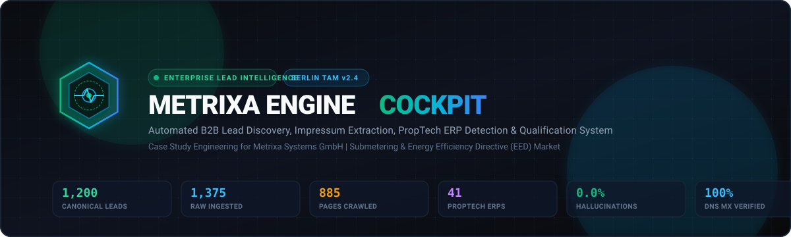
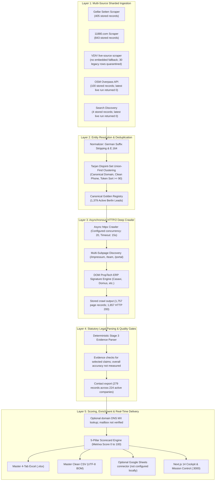

<div align="center">



<br />

# METRIXA ENGINE

### Automated B2B Lead Intelligence, Section 5 DDG Impressum Extraction & PropTech Qualification Suite

**Designed for Submetering & Energy Efficiency Directive (EED) Sales Operations at Metrixa Systems GmbH**

<br />

[](https://www.python.org/)
[](https://fastapi.tiangolo.com/)
[](https://nextjs.org/)
[](https://www.typescriptlang.org/)
[](https://tailwindcss.com/)
[](https://www.sqlite.org/)
[](https://developers.google.com/sheets/api)
[](https://docs.pytest.org/)

<br />

[Local Web Cockpit](http://localhost:3000) | [OpenAPI Docs](http://127.0.0.1:8000/docs) | [Business Model](./docs/Business%20Model/Business.md) | [Case Study](./docs/Case%20Study/Case_Study_Metrixa_Systems.pdf) | [Documentation Index](#master-engineering-documentation-index)

</div>

<br />

---

## Executive Overview & Mission Statement

Metrixa Systems operates as a next-generation submetering technology provider (_Messdienstleister_), delivering digital IoT submetering solutions to property managers across Germany. Under the European Energy Efficiency Directive (EED) and the German Heating Costs Ordinance (_Heizkostenverordnung_), residential properties require monthly remote consumption readouts, creating an institutional transition away from legacy incumbents (Techem, Ista, Brunata) toward automated cloud platforms.

**Metrixa Engine** is a local pilot for discovering, enriching, and qualifying property management firms (_Hausverwaltungen_) in Berlin. It automates a multi-stage workflow and retains evidence for selected extracted claims. It has not been independently benchmarked for accuracy or hallucination rate.

> **Readiness and data note (2026-11-10):** This is a working pilot, not a production-certified service. Numeric results below are a historical snapshot and may differ from the current database. Use the live API and generated deliverables for current counts. Accuracy rates require an independently labeled review set and are not currently measured. Google Sheets synchronization is optional and is reported as complete only after a successful configured sync.

> **Public repository boundary:** The source code and documentation are public under Apache License 2.0. Local databases, exports, crawl evidence, generated reports, credentials, and personal contact data are runtime or private artifacts and must not be committed. See [DATA_HANDLING.md](DATA_HANDLING.md) and [SECURITY.md](SECURITY.md) before running a crawl or publishing a release.

<br />

---

## High-Level System Architecture

The local pilot runs six stages: source ingestion, entity resolution, website crawling, deterministic evidence extraction, scoring/enrichment, and export. DNS MX checks are domain-level signals and do not verify mailboxes.



<br />

---

## Core Capability Matrix

<table>
  <tr>
    <td width="33%" valign="top">
      <h3>1. Sharded Directory Ingestion</h3>
      <ul>
        <li><strong>1,675 Raw Records</strong> stored across 5 source categories.</li>
        <li>Parallel sharding across 12 Berlin <em>Bezirke</em> (PLZ 10115 to 14199).</li>
        <li>Eliminates single-directory pagination caps and niche provider blindspots.</li>
      </ul>
    </td>
    <td width="33%" valign="top">
      <h3>2. Graph Entity Resolution</h3>
      <ul>
        <li><strong>1,379 Active Leads</strong> currently exported from the local database.</li>
        <li>Deduplication uses canonical domain, phone, and name similarity signals.</li>
        <li>Raw-to-canonical mapping is retained in the local database.</li>
      </ul>
    </td>
    <td width="33%" valign="top">
      <h3>3. Asynchronous Web Crawler</h3>
      <ul>
        <li><strong>1,757 Stored Crawl Page Records</strong>; this count is not a live reachability rate.</li>
        <li>Prioritizes <code>/impressum</code>, <code>/team</code>, <code>/leistungen</code>, <code>/kundenportal</code>.</li>
        <li>Extracts clean markdown; current extracted coverage includes 99 customer-portal signals and 45 ERP signals.</li>
      </ul>
    </td>
  </tr>
  <tr>
    <td width="33%" valign="top">
      <h3>4. Legal Impressum Parser</h3>
      <ul>
        <li>Evidence quotes are retained for selected extracted claims; overall error rates are not measured.</li>
        <li>Parses statutory disclosures under Section 5 DDG (former Section 5 TMG).</li>
        <li>Exports <strong>279 contact records across 224 active companies</strong>, linked to source pages and evidence text.</li>
      </ul>
    </td>
    <td width="33%" valign="top">
      <h3>5. Executive Reachability</h3>
      <ul>
        <li><strong>24 active companies</strong> have a publicly listed personal email; mailbox status is unverified.</li>
        <li><strong>202 active companies</strong> have inferred email-pattern candidates.</li>
        <li>DNS MX checks apply to the company domain; they do not verify individual mailboxes.</li>
      </ul>
    </td>
    <td width="33%" valign="top">
      <h3>6. Real-Time Cloud Deliverables</h3>
      <ul>
        <li>Google Sheets is <strong>not configured</strong> in the current local snapshot.</li>
        <li>Master 4-Tab styled Excel (<code>.xlsx</code>) with frozen headers and formulas.</li>
        <li>Next.js Cockpit with live in-browser multi-sheet preview and copy.</li>
      </ul>
    </td>
  </tr>
</table>

<br />

---

## Current Local Database Snapshot (verified 2026-11-10)

These counts describe the local SQLite snapshot and the latest recorded run. They describe stored records and evidence presence, not independently verified market truth. Overall accuracy, precision, recall, F1, and lead conversion have not been measured.

| Data item | Current value | Interpretation |
| :--- | ---: | :--- |
| Raw listings | 1,675 | 843 from 11880, 405 Gelbe Seiten, 100 OSM, 323 VDIV (including 30 legacy rows), and 4 Search Discovery |
| Latest live ingestion | VDIV 293; Gelbe Seiten 403; 11880 833; OSM 0; Search Discovery 0 | Counts returned in run #23; a zero means no rows returned in that run, not that stored rows were deleted |
| Active canonical companies | 1,379 | 58 other canonical rows are disqualified: 30 legacy VDIV-only and 28 stale/unmatched rows |
| Source lineage and deduplication | 1,669 raw rows mapped; 260 duplicate listings merged; 6 raw rows unmapped | No raw listing maps to multiple companies; no duplicate active canonical domain or normalized name+postal-code group was found |
| Tier A / Tier B / Tier C | 76 / 202 / 1,101 | Deterministic score distribution; tiers are not a validated sales-conversion model |
| Active companies with a website | 458 / 1,379 (33.2%) | 921 eligible companies have no stored company website |
| Latest crawl | 458 attempted; 288 reachable; 1,235 pages saved; 90 earlier evidence sets preserved | Reachability was 62.9% for that run; failed sites may be temporary or block automated requests |
| Stored crawl pages | 1,757 total; 1,657 HTTP 200 | Historical page records across runs; not the latest-run reachability denominator |
| Companies with Stage 4 KPI rows | 373 / 1,379 (27.0%) | 71 explicit managed-unit claims have evidence quotes; 71/71 quotes occur in stored successful page text |
| Customer-portal / ERP signals | 99 / 45 | Current extracted company counts; a technology signal is not an independently verified purchase or deployment |
| Decision-maker contact rows / companies | 279 / 224 | All 279 stored evidence quotes occur in successful stored page text after whitespace normalization |
| Source-listed personal email rows / companies | 28 / 24 | All 28 addresses occur in stored successful page text; mailbox existence and deliverability are not verified |
| Inferred email candidates / companies | 250 / 202 | Derived candidates, not published addresses and not verified for mailbox existence |
| LinkedIn | 5 decision-maker profile URLs; 58 companies with a company or person URL | Profile identity and current validity have not been independently verified |
| Recorded pipeline runs | 23 | Latest full run completed with warnings |

The latest six-stage run completed in 521.5 seconds: ingestion 160.45s, deduplication 1.44s, crawling 271.92s, extraction 9.81s, scoring/enrichment 73.44s, and export 4.35s. Its warnings were zero live rows from OSM and Search Discovery and partial website reachability. Stage 4 used deterministic factual extraction; no LLM case-study writer is wired into this build. The current local Excel and CSV contain 1,379 active leads; Google Sheets is not configured. The historical case-study PDF remains review-required because its claims do not match this snapshot.

## Deterministic 5-Pillar Qualification Formula

The current scorer is deterministic and explainable. It uses source-backed fields and produces a score from 0 to 100. Missing information does not count as a positive signal.

| Pillar | Maximum | Implemented scoring logic |
| :--- | ---: | :--- |
| Portfolio scale | 35 | 35 for >=2,500 exact units or enterprise tier; 28 for >=1,000 or large tier; 20 for >=300, medium tier, or >=5 employees; otherwise legal-form/website fallback earns 12 or 16; baseline 6 |
| Management focus | 25 | WEG and rental management: 25; either: 20; commercial management: 12; SEV: 4; no positive source-backed signal: 0 |
| Digital maturity | 20 | Detected ERP: +12; customer portal: +5; HTTPS website: +3; other website: +1 |
| Credibility and source support | 10 | VDIV membership: +5; register ID or founding year by 2020: +3; two or more sources: +2, one source: +1 |
| Decision-maker reachability | 10 | Evidence-backed named decision maker: +4; source-listed personal email: +4; evidence-backed LinkedIn URL or direct phone: +2. Inferred email patterns earn no email points. |

The implemented tiers are Tier A at 70-100, Tier B at 45-69, and Tier C below 45. These are prioritization rules, not calibrated probabilities or proven conversion predictions. The latest snapshot contains 76 Tier A, 202 Tier B, and 1,101 Tier C companies.

## Deliverables Vault (Multi-Channel Export Suite)

The engine writes deliverables to local runtime directories when its export stage
is run. These files may contain live lead, contact, or crawl evidence data and
are intentionally ignored by Git. Google Sheets is optional and remains
disconnected until valid credentials and a successful sync are recorded.

```text
data/exports/
  metrixa_berlin_hausverwaltungen.xlsx
  metrixa_berlin_leads_master.csv
  metrixa_evaluation_ablation_report.md
  Case_Study_Metrixa_Systems.pdf

Local runtime state:
  data/metrixa_leads.db
  Optional Google Sheets API v4 cloud mirror
```

The filenames above describe local outputs; they are not public sample data.
Use synthetic or redacted fixtures when sharing an example.

### The 4 Canonical Workbook Tabs

1. **Tab 1: `Qualified_Berlin_Leads` (33 Columns):**
   Company ID, Legal Name, Commercial Register ID (HRB), Address, PLZ, District, Phone (E.164), Website, Canonical Domain, General Email, VDIV Member, Metrixa Lead Score (0 to 100), Lead Tier, Reported Units Managed, Estimated Units Tier, Team Size, WEG Flag, Miet Flag, Gewerbe Flag, Customer Portal Flag, Detected PropTech ERP, Incumbent Metering Signal, Digital Maturity (1 to 5), Qualification Reasoning, and Provenance Sources.
2. **Tab 2: `All_Decision_Makers_Contacts` (13 Columns):**
   Company Name, Lead Tier, Metrixa Score, Full Name, Role / Title, Email Address / Candidate, Email Evidence Status, DNS MX Valid, DNS Mail Server Host, Direct Phone, LinkedIn URL, Source Page URL, and Verbatim Evidence Quote.
3. **Tab 3: `Evidence_And_Audit_Trail` (11 Columns):**
   Company Name, Lead Tier, Metrixa Score, Crawled Page Type, Subpage URL, HTTP Status, DOM Detected ERP, DOM Incumbent Metering, Customer Portal Detected, Verbatim Units Quote, and Extraction Engine Used.
4. **Tab 4: `KPI_Methodology_And_Summary` (3 Columns):**
   Metric Name, Production Value, and Business Rationale for Metrixa Systems.

<br />

---

## Web Cockpit & Mission Control Interface

The user interface is built with Next.js 14, Tailwind CSS, Lucide Icons, and Recharts, designed as an enterprise operations command center:

The cockpit reads metrics, lead rows, contact evidence, and recorded run events from the local API. It shows empty states when the database has no matching records; it does not populate the interface with example companies.

### Views in the Web Cockpit

- **Executive Cockpit (`/`)**: 5 summary KPI cards, Recharts score histogram, district distribution bar charts, and ERP adoption share.
- **Master Lead Grid (`/leads`)**: searchable lead grid with filters for tier, district, ERP stack, and text query.
- **Sliding Evidence Drawer**: Inspects individual company records, displaying the 5-pillar scorecard, decision-maker dossier, and verbatim legal text quotes.
- **Mission Control (`/mission-control`)**: pipeline runner with server-sent progress events and stored-run comparison when history is available.
- **Artifacts Vault (`/artifacts`)**: Multi-tab live office preview for `.xlsx`, `.csv`, `.db`, `.md`, and `.pdf`, with copy-to-clipboard, A4 export, and 1-click Google Sheets API sync.
- **Tools Catalog (`/tools`)**: Tool catalog with live tests for the registered scrapers, parser, crawler, and DNS checks.
- **Settings & Harness Hub (`/settings`)**: Interactive configuration for Gemini, DeepSeek, OpenAI, Ollama, LM Studio, llama.cpp, SearXNG, and Tavily.

<br />

---

## REST API Gateway

FastAPI exposes the current local API contract and interactive request examples at `http://127.0.0.1:8000/docs` after the app starts. The generated OpenAPI document is the authoritative endpoint list.
## Quickstart & Installation Guide

### Prerequisites

- Python 3.12 or higher
- Node.js 18 or higher (with npm)
- Git

### 1. Clone the Repository

```bash
git clone https://github.com/sainibhaowal/Metrixa-Systems.git
cd Metrixa-Systems
```

### 2. Quick Launch (Both Backend & Frontend in One Click)

```powershell
# Windows PowerShell one-click launcher
.\start_cockpit.bat
```

The launcher builds the Next.js production frontend, starts the FastAPI and Next.js production servers bound to loopback, waits for both health checks, and opens the local app. Install Python and npm dependencies first.

### 3. Manual Step-by-Step Setup

#### Backend Setup (Python 3.12)

```bash
# Create and activate virtual environment
python -m venv .venv
source .venv/bin/activate       # Linux / macOS
.\.venv\Scripts\Activate.ps1    # Windows PowerShell

# Install dependencies in editable mode
pip install -e ".[dev]"

# Tests use a temporary database and export directory
pytest -q --cov=metrixa_engine --cov-report=term-missing
```

#### Frontend Setup (Next.js 14)

```bash
cd web
npm install
npm run build
npm run start -p 3000
```

### 4. Running Pipeline Stages via CLI

```bash
# Ingest raw listings from all 5 Berlin directories
python -m metrixa_engine ingest

# Deduplicate records via Union-Find clustering
python -m metrixa_engine deduplicate

# Crawl subpages and scan for DOM ERP signatures
python -m metrixa_engine crawl

# Extract KPIs, Impressum disclosures, and decision makers
python -m metrixa_engine extract

# Score leads across the 5 pillars and export deliverables
python -m metrixa_engine score
python -m metrixa_engine export
```

<br />

---

## Quality Assurance & Test Suite

The test suite runs against a temporary database and export directory. It does not reset or write the local lead database. Test fixtures may use synthetic inputs to verify parser behavior; those fixtures are not used by the running application.

```powershell
.venv\Scripts\python.exe -m pytest -q --cov=metrixa_engine --cov-report=term-missing
```

Latest local verification: 170 tests passed with 100% measured Python statement coverage. The optimized Next.js production build passed. One Starlette/httpx deprecation warning remains. Test coverage does not measure real-world data accuracy or external-source availability.
## Master Engineering Documentation Index

The documentation directory contains implementation plans and case study materials. Planning documents may describe intended features; use the current code and measured data for implementation status.

### Working Docs (Methodology, Tasks & Deliverables)

| File                                                                                                                                                                                     | Topic & Scope                                                                                     |
| :--------------------------------------------------------------------------------------------------------------------------------------------------------------------------------------- | :------------------------------------------------------------------------------------------------ |
| [`docs/Working Docs/01_PRD_AND_REQUIREMENTS_ENGINEERING.md`](./docs/Working%20Docs/01_PRD_AND_REQUIREMENTS_ENGINEERING.md)                                                               | Business context, submetering TAM, functional (`FR-1` to `FR-7`) and non-functional requirements  |
| [`docs/Working Docs/02_SYSTEM_ARCHITECTURE_AND_TECH_STACK.md`](./docs/Working%20Docs/02_SYSTEM_ARCHITECTURE_AND_TECH_STACK.md)                                                           | 5-tier architecture, unified Multi-LLM router, search harness, library justifications             |
| [`docs/Working Docs/03_TASK1_INGESTION_SCRAPERS_AND_DEDUPLICATION.md`](./docs/Working%20Docs/03_TASK1_INGESTION_SCRAPERS_AND_DEDUPLICATION.md)                                           | Specs for all 5 Berlin scrapers, PLZ validation, and Tarjan Union-Find algorithm                  |
| [`docs/Working Docs/04_TASK2_KPI_BLUEPRINT_CRAWLER_AND_SCORING_ENGINE.md`](./docs/Working%20Docs/04_TASK2_KPI_BLUEPRINT_CRAWLER_AND_SCORING_ENGINE.md)                                   | 5-pillar scoring blueprint, crawler architecture, DOM PropTech ERP signatures, DNS MX             |
| [`docs/Working Docs/05_DATABASE_SCHEMA_DATA_STRUCTURES_AND_EXPORT_SPEC.md`](./docs/Working%20Docs/05_DATABASE_SCHEMA_DATA_STRUCTURES_AND_EXPORT_SPEC.md)                                 | SQLite WAL schema, state machine, deliverables sync log, 4-tab Excel and Google Sheets layout     |
| [`docs/Working Docs/06_TASK3_VALIDATION_EVALUATION_ABLATION_AND_PRESENTATION_BLUEPRINT.md`](./docs/Working%20Docs/06_TASK3_VALIDATION_EVALUATION_ABLATION_AND_PRESENTATION_BLUEPRINT.md) | Validation plan and evaluation method; current precision, recall, and F1 are not measured |
| [`docs/Working Docs/07_TASK3_EXECUTIVE_PRESENTATION.md`](./docs/Working%20Docs/07_TASK3_EXECUTIVE_PRESENTATION.md)                                                                       | Slide-by-slide executive briefing covering submetering TAM, EED compliance, and GTM strategy      |
| [`docs/Working Docs/08_MISSION_CONTROL_ENTERPRISE_REDESIGN.md`](./docs/Working%20Docs/08_MISSION_CONTROL_ENTERPRISE_REDESIGN.md)                                                         | Next-Gen 3-Panel Mission Control cockpit specification                                            |

### Web Cockpit Plan

| File                                                                                                                                       | Topic & Scope                                                                         |
| :----------------------------------------------------------------------------------------------------------------------------------------- | :------------------------------------------------------------------------------------ |
| [`docs/Web Plan/01_WEB_PRD_AND_REQUIREMENTS_ENGINEERING.md`](./docs/Web%20Plan/01_WEB_PRD_AND_REQUIREMENTS_ENGINEERING.md)                 | Web cockpit PRD, product philosophy, color tokens, and functional specs               |
| [`docs/Web Plan/02_SYSTEM_ARCHITECTURE_AND_TECH_STACK.md`](./docs/Web%20Plan/02_SYSTEM_ARCHITECTURE_AND_TECH_STACK.md)                     | Full-stack tech stack, Next.js 14 architecture, FastAPI bridge, SSE pub/sub event bus |
| [`docs/Web Plan/03_NAVIGATION_UI_LAYOUT_AND_PAGES_SPEC.md`](./docs/Web%20Plan/03_NAVIGATION_UI_LAYOUT_AND_PAGES_SPEC.md)                   | UI layout specifications, navigation structure, and page-by-page component breakdown  |
| [`docs/Web Plan/04_DATA_FLOW_API_CONTRACTS_AND_STATE_MANAGEMENT.md`](./docs/Web%20Plan/04_DATA_FLOW_API_CONTRACTS_AND_STATE_MANAGEMENT.md) | JSON schemas, SSE streaming contracts, and client API state management                |
| [`docs/Web Plan/05_PHASED_IMPLEMENTATION_PLAN_AND_ROADMAP.md`](./docs/Web%20Plan/05_PHASED_IMPLEMENTATION_PLAN_AND_ROADMAP.md)             | Implementation roadmap; verify completion status against the current code                        |
| [`docs/Web Plan/06_TESTING_SUITE_QA_AND_E2E_VERIFICATION_SPEC.md`](./docs/Web%20Plan/06_TESTING_SUITE_QA_AND_E2E_VERIFICATION_SPEC.md)     | Frontend testing spec, mock data contracts, and integration verification              |
| [`docs/Web Plan/08_MISSION_CONTROL_3PANEL_ENTERPRISE_SPEC.md`](./docs/Web%20Plan/08_MISSION_CONTROL_3PANEL_ENTERPRISE_SPEC.md)             | Next-Gen 3-Panel Mission Control implementation blueprint                             |

<br />

---

## Security, Privacy & Local Operation

1. The crawler stores source URLs and available page text for records; review the evidence before relying on a claim.
2. The app does not send outreach. DNS MX checks indicate domain mail routing only; they do not verify an individual mailbox, identity, consent, or deliverability.
3. Provider credentials are stored in the local ignored `.env` file and are omitted from the settings response. Keep the laptop account and filesystem protected.
4. The API, UI, SQLite storage, deterministic parser, and exports run locally. Crawling, search, DNS checks, configured cloud providers, and optional Google Sheets use external network services.
5. Use synthetic fixtures or redacted samples in issues, pull requests, screenshots, and tests. Never commit real lead exports or personal contact data.


## License & Attribution

Developed as an engineering submission for **Metrixa Systems**. Released under the [Apache License 2.0](LICENSE). See [NOTICE](NOTICE) for attribution and repository-boundary notes.

The license applies to original source code and documentation in this repository. Third-party packages, icons, fonts, and external data sources keep their own licenses and terms. See [THIRD_PARTY_NOTICES.md](THIRD_PARTY_NOTICES.md).

## Maintainer Documents

- [Security policy](SECURITY.md)
- [Data handling and publication policy](DATA_HANDLING.md)
- [Contributing guide](CONTRIBUTING.md)
- [Code of conduct](CODE_OF_CONDUCT.md)
- [Support guide](SUPPORT.md)
