# 07 — Task 3 Deliverable: Executive Methodology, Architecture & Validation Presentation

**Candidate:** Ravinder
**Role Applied For:** AI Agent Builder @ **Metrixa Systems GmbH**
**Case Study Deliverables:**
1. **Master Excel / Google Sheets Workbook:** [`data/exports/metrixa_berlin_hausverwaltungen.xlsx`](../data/exports/metrixa_berlin_hausverwaltungen.xlsx) *(4 Tabs: `Qualified_Berlin_Leads`, `All_Decision_Makers_Contacts`, `Evidence_And_Audit_Trail`, `KPI_Methodology_And_Summary`)*
2. **Master CSV Export:** [`data/exports/metrixa_berlin_leads_master.csv`](../data/exports/metrixa_berlin_leads_master.csv)
3. **Quantitative Evaluation & Ablation Report:** [`data/exports/evaluation_ablation_report.md`](../data/exports/evaluation_ablation_report.md)
4. **Production Software Repository:** `metrixa-engine` (`src/metrixa_engine/` + `docs/01`–`07` + `tests/`)

---

## Slide 1 — Executive Summary & Results at a Glance

Instead of manually copying companies into a spreadsheet or building a fragile one-off script, I engineered **Metrixa Engine v1.0**: a production-grade, stateful 6-stage Python AI Agent & Lead-Enrichment Pipeline backed by **SQLite (WAL mode)**.

| Pipeline Metric | Live Result | Engineering Highlight |
| :--- | :---: | :--- |
| **Raw Berlin Listings Scraped (Task 1)** | **1,371** | Sharded across 5 sources (*Gelbe Seiten, 11880.com, VDIV Berlin-Brandenburg, OpenStreetMap Overpass API, Search Discovery*) & 24 Berlin *Bezirke/Ortsteile* |
| **Deduplicated Berlin *Hausverwaltungen* (Task 1)** | **1,199** | Removed **172** duplicate & non-eligible records via Canonical Domain, E.164 Phone, RapidFuzz (`TokenSortRatio`), and `Union-Find` clustering |
| **Corporate Websites & *Impressum* Pages Crawled (Task 2)** | **866 Pages** *(242 Domains)* | Async HTTP/2 crawler prioritizing `/`, `/impressum`, `/team`, `/leistungen`, `/referenzen`, `/kundenportal` + Cloudflare XOR email-protection decoder |
| **🟢 Tier A (`Score 70–100`) High-Priority Leads** | **33** | Institutional/mid-sized Berlin *WEG* & *Miet* managers (`1,000–53,300` units) with PropTech portals/ERPs and direct decision-maker contacts |
| **🟡 Tier B (`Score 45–69`) Qualified Mid-Market Leads** | **409** | Established Berlin residential property managers ready for outbound sequences |
| **⚪ Tier C (`Score < 45`) Long-Tail / Small Leads** | **757** | Smaller local property managers across Berlin |
| **Named Decision-Makers Extracted (Bonus)** | **118 Contacts** *(101 Firms)* | Legally mandated *Geschäftsführer*, *Inhaber*, *Vorstand*, and *Prokuristen* extracted from § 5 DDG *Impressum* & `/team` pages |
| **Personal Decision-Maker Emails (`Non-info@`) (Bonus)** | **99 Firms** | Strictly separated from `info@` inboxes and verified against live **DNS `MX` servers** (`dnspython`) |
| **Unverified / Hallucinated Claims** | **0.0%** | Enforced via mandatory verbatim `evidence_quote` substring verification against crawled HTML |

---

## Slide 2 — System Architecture: The 6-Stage Autonomous Pipeline

```mermaid
flowchart LR
    subgraph S1["Stage 1: Multi-Source Berlin Scrapers"]
        A1["Gelbe Seiten (District Shards)"]
        A2["11880.com (+ CF Email XOR Decoder)"]
        A3["VDIV Berlin-Brandenburg"]
        A4["OpenStreetMap Overpass API"]
        A5["SearXNG / Meta-Search / Tavily"]
    end

    subgraph S2["Stage 2: Entity Resolution"]
        B1["Domain + E.164 Phone + PLZ Blocking"]
        B2["RapidFuzz + Union-Find Clustering"]
    end

    subgraph S3["Stage 3: Website & Impressum Crawler"]
        C1["Priority Subpage Router\n(/impressum, /team, /leistungen)"]
        C2["DOM PropTech / ERP Scanner\n(Casavi, Domus, Immoware24, Haufe)"]
    end

    subgraph S4["Stage 4: Multi-LLM + German Legal Extractor"]
        D1["Unified LLM Router\n(llama.cpp / LM Studio / NIM / DeepSeek / Gemini)"]
        D2["Anti-Hallucination Evidence Gate"]
    end

    subgraph S5["Stage 5: Contact & Scoring Engine"]
        E1["DNS MX Verifier + Personal Email Resolver"]
        E2["0-100 Metrixa Lead Scorer (Tier A/B/C)"]
    end

    subgraph S6["Stage 6: Auditable Deliverables"]
        F1["4-Tab Excel (.xlsx) & Google Sheet"]
        F2["Gold-Set Eval & Ablation Report"]
    end

    S1 --> S2 --> S3 --> S4 --> S5 --> S6
```

---

## Slide 3 — Task 1: Multi-Source Discovery & Entity Deduplication

### Why Single-Source Scraping Fails in Berlin
Any single directory caps pagination or misses specialized *WEG-Verwaltung* and *Mietverwaltung* firms. We combined **5 complementary sources** and sharded queries across **all Berlin *Bezirke*** (`PLZ 10115–14199`):
1. **Gelbe Seiten (`405` listings):** Multi-keyword + 23 Berlin district shards + base64 `data-webseitelink` decoding.
2. **11880.com (`835` listings):** HTML card + JSON-LD extraction + custom **Cloudflare `/cdn-cgi/l/email-protection` XOR hex decoder** that unlocked corporate emails and domains hidden from standard scrapers.
3. **VDIV Berlin-Brandenburg (`30` flagship members):** Certified professional property managers.
4. **OpenStreetMap Overpass API (`100` geospatial nodes):** `office=property_management` within Berlin's bounding box.
5. **Search Discovery (`SearXNG` / Native Meta-Search / `Tavily`):** Long-tail web discovery.

### Entity Resolution & Deduplication (`Union-Find` + `RapidFuzz`)
* Standardized German legal forms (`GmbH & Co. KG`, `GmbH`, `UG`, `AG`, `e.K.`), transliterated umlauts (`ä→ae`, `ß→ss`), normalized phones to `E.164` (`+4930...`), and extracted canonical domains (`tldextract`).
* Clustered **1,371 raw records** into **1,199 unique Berlin property management companies** (`167` duplicates merged, `6` non-Berlin/cleaning noise records disqualified).

---

## Slide 4 — Task 2: Qualifying KPI Framework & Lead Scoring for Metrixa Systems

As a **metering service provider (*Messdienstleister*)**, Metrixa Systems' contract value and sales velocity depend on **5 Qualification Pillars**:

1. **Portfolio Scale (`Max 35 pts`):**
   * Extracted explicit managed unit counts (*Wohneinheiten*) where published (e.g., *Stadt und Land*: `53,300` units; *Velero Immobilien*: `24,000` units; *Kremer Hausverwaltung*: `11,500` units; *dydo Immobilien*: `5,000` units; *Wohnungsbaugenossenschaft Humboldt-Universität*: `3,400` units; *Zenveo*: `1,000` units).
   * Where exact units are not published on the website, inferred **`Estimated Portfolio Size Tier`** (`<250`, `250-1,000`, `1,000-5,000`, `5,000+`) from employee headcount (~350 units per *Objektbetreuer*), VDIV membership, and corporate legal structure (`GmbH`/`AG` vs. `e.K.`).
2. **Asset & Management Focus (`Max 25 pts`):**
   * Boolean flags for **`Manages WEG (Condos)`**, **`Manages Mietverwaltung (Rentals)`**, **`Manages Commercial (Gewerbe)`**, and **`Manages SEV`**. Multi-family residential (*WEG* + *Mietverwaltung*) is the core target for annual *Heizkostenabrechnung* under *HeizkV*.
3. **Digital Maturity & PropTech ERP Stack (`Max 20 pts`):**
   * Raw DOM/HTML scanner detects **Online Customer Portals (`Kundenportal`)** and PropTech/ERP signatures (**`Casavi`, `Domus`, `Immoware24`, `Haufe PowerHaus / axera`, `etg24`, `Wodis`**) plus incumbent metering signals (**`Techem`, `Ista`, `Brunata`, `Kalorimeta`**).
   * Property managers already using **Casavi** or **Immoware24** are digital-first buyers primed to adopt smart submetering.
4. **Professional Credibility (`Max 10 pts`):**
   * **VDIV Membership**, Commercial Register ID (**`HRB / HRA`**), and **Founding Year**.
5. **Decision-Maker Reachability (`Max 10 pts`):**
   * Named *Geschäftsführer* + Verified/MX-Valid Personal Email + LinkedIn / Direct Phone.

---

## Slide 5 — Bonus Task: Decision-Maker & Personal Email Resolution

To find the right contact person with a **personal email address (not `info@`)**:
1. **Exploiting German § 5 DDG *Impressum* Law:** Every commercial German website must legally name its authorized representatives (*Vertretungsberechtigte Geschäftsführer / Vorstand / Inhaber*). Our crawler automatically discovers `/impressum` and `/team` pages and extracts full names and roles with verbatim evidence quotes.
2. **Strict Separation of `info@` vs. Personal Emails:**
   * Generic prefixes (`info@`, `kontakt@`, `service@`, `verwaltung@`, `office@`, `mail@`) are routed strictly to the `General Company Email` column.
   * Only personal executive emails (e.g., `gabriele.reymer@...`, `wolfgang.kremer@...`, `guido.koenig@plusvalore.de`, `thomas.schwarz@...`, `oliver.ackermann@...`) populate the **`Personal / Direct Email (Bonus)`** column.
3. **Live DNS `MX` Record Verification (`dnspython`):**
   * Every corporate domain is checked against live DNS Mail Exchange (`MX`) servers (`216` active corporate mail servers verified) and clearly tagged as `PUBLIC_DIRECT_VERIFIED` or `PATTERN_MX_VERIFIED`.

---

## Slide 6 — Data Validation, Anti-Hallucination & Stage Ablation Study

### 4-Layer Validation Gate
* **Layer 1 (Geography):** `95.4%` strict 5-digit Berlin PLZ (`10115–14199`) mapped to all 12 official Berlin *Bezirke*.
* **Layer 2 (Anti-Hallucination Evidence Gate):** Every extracted unit count and *Geschäftsführer* name is programmatically verified as a literal substring of the crawled webpage text (`100.0%` grounded quote match, **`0.0%` hallucination rate**).
* **Layer 3 (Inbox Separation):** `100.0%` of the personal email column is non-generic (`0` `info@` addresses leaked into the personal column).
* **Layer 4 (DNS `MX` Network Check):** Live DNS `MX` resolution confirms active corporate mail servers.

### Live Stage-by-Stage Pipeline Ablation Table
| Pipeline Stage | Unique Berlin Leads | Corporate Websites | KPIs Populated | Named Decision Maker | Personal Email (`Non-info@`) |
| :--- | :---: | :---: | :---: | :---: | :---: |
| **Baseline:** Single Directory (*Gelbe Seiten Raw*) | 405 (uncleaned) | 35.1% | 0.0% | 0.0% | 0.0% |
| **Stage 1+2:** 5 Scrapers + Union-Find Deduplication | **1,199 Unique** | 20.2% | 2.5% | 0.0% | 0.0% |
| **Stage 3:** + Async Website/*Impressum* Crawler + DOM ERP Scanner | 1,199 Unique | 20.2% | 3.2% | ~18.0% | 1.0% |
| **Stage 4:** + Multi-LLM & German *Impressum* Extractor | 1,199 Unique | 20.2% | **100.0%** | **8.4% (101 Firms)** | 1.0% |
| **Stage 5 (Full Metrixa Engine):** + DNS `MX` & Contact Enricher + Scorer | **1,199 Scored** | **20.2% (242)** | **100.0%** | **101 Firms (118 Contacts)** | **99 Firms (`MX` Verified)** |
