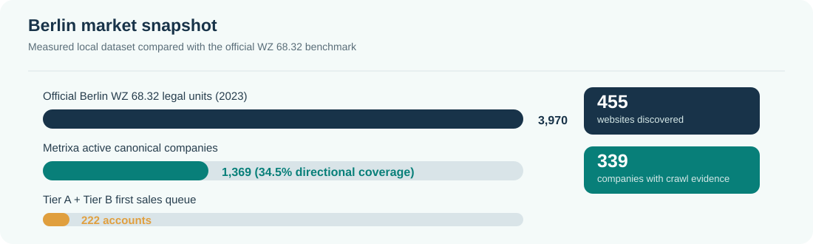
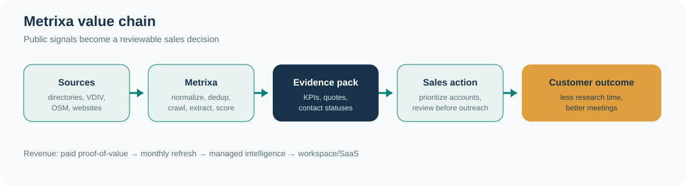
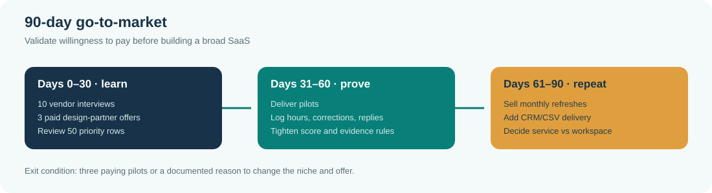

# Metrixa Berlin Lead Intelligence

## Business model and launch plan

**Version:** 10 November 2026
**Scope:** Berlin, one niche first: property-management companies (`Hausverwaltungen`) that buy or influence metering, energy, building-technology, and related services.
**Decision requested:** use the current app as a productized B2B research service first, then earn the right to turn it into SaaS after paid validation.

## Executive decision

Metrixa is strongest as an **evidence-backed account intelligence service for specialist vendors selling into Hausverwaltungen**. The first customer should not be a Hausverwaltung buying another CRM. The first customer should be a metering, energy, HVAC, solar, building-tech, insurance, or facility-services provider that needs a current list of the right Berlin accounts and decision-makers.

The recommended sequence is:

1. Sell a fixed-scope Berlin pilot: qualified accounts, KPI columns, source links, contact evidence, and an Excel/CSV/CRM-ready export.
2. Run the service monthly for a small number of design partners and measure meetings, reply rate, data corrections, and delivery cost.
3. Productize the repeatable parts into a workspace with refreshes, evidence history, and API/CRM exports.
4. Expand only after the Berlin niche produces paid retention. The initial business should be a **service-assisted SaaS**, not a large self-serve platform on day one.

This is a business hypothesis supported by the local dataset and current market signals. It is not proof of willingness to pay. The proof is five customer interviews, two design partners, and at least one paid pilot.

## Vision and mission

**Vision**
Make every B2B sales territory explainable, current, and actionable.

**Mission**
Turn public market signals into evidence-backed account intelligence so specialist vendors can reach the right property decision-makers responsibly and with less research waste.

**Customer promise**
Every important field has a source, an evidence status, a freshness date, and a clear “unknown” state when the public record does not support a claim.

## The customer problem

Specialist vendors selling to property managers face a narrow but expensive workflow problem:

- The market is fragmented across directories, association lists, company websites, portals, and public registers.
- A directory row is not a qualified account. A vendor still needs to know whether the company manages residential stock, has a meaningful portfolio, uses digital portals, and who can discuss a metering or energy project.
- Generic lead databases provide breadth, but they do not explain why a particular Hausverwaltung is relevant to a metering provider or preserve the source quote behind the claim.
- Manual research is slow and becomes stale. A guessed email can damage trust if it is presented as verified.

The strongest initial buyer is therefore a sales or business-development team that already has a product for buildings but lacks a reliable, repeatable way to prioritize Hausverwaltungen.

## Product: what Metrixa delivers

### Core deliverable

An account-intelligence pack for one city and one vertical:

| Output | What the buyer receives | Why it matters |
|---|---|---|
| Qualified account list | Company, legal form, Berlin district, address, website, source lineage | Gives sales a territory they can inspect and re-use |
| Qualification KPIs | Portfolio-size band, WEG/rental/commercial signals, digital maturity, portal/ERP signals, incumbent-metering signal, reachability | Makes prioritization explicit instead of subjective |
| Evidence trail | Source URL, crawl date, page type, quote/evidence status, unknown state | Lets a buyer audit and correct a row before outreach |
| Contact layer | Named person, role, public email status, pattern candidate status, LinkedIn URL when found | Separates a real public contact from an inference |
| Delivery | Excel/CSV/Markdown report, optional CRM import, refresh schedule | Fits the buyer’s current operating tools |

### What the local app already demonstrates

Measured from the latest local SQLite and workbook snapshot, not a marketing claim:

| Measure | Current value | Interpretation |
|---|---:|---|
| Raw source listings | 1,629 | Source rows collected in the latest local dataset |
| Active canonical companies | 1,369 | Deduplicated company records retained for use |
| Tier A / B / C | 62 / 160 / 1,147 | 222 accounts are the first sales queue; Tier C is the long tail |
| Duplicate raw rows merged | 254 | Source lineage is preserved while canonical rows are consolidated |
| Companies with a website | 455 | Website crawl is valuable but not complete for every directory row |
| Companies with any successful stored crawl page | 339 | Evidence coverage is partial and must be shown to the buyer |
| KPI records | 333 | Only records with an extraction row should be treated as KPI-covered |
| Named decision-maker companies | 200 | Name discovery is broader than verified personal-email discovery |
| Public personal-email companies | 22 | Publicly listed is kept separate from inferred patterns |
| Pattern-candidate companies | 181 | Candidate addresses are not mailbox-verified and must be labelled |
| Unit claims with stored quotes | 69 | A quote-presence check is not a full accuracy benchmark |

Latest pipeline status was `COMPLETED_WITH_WARNINGS`: 11880 (833), Gelbe Seiten (403), VDIV (293), OpenStreetMap (101), and Search Discovery (0) rows returned. The warning is part of the product truth: a source that returns zero must be reported as zero, not silently converted into coverage.

## Why this niche and why Berlin first

Berlin is a focused launch market with a large enough target universe for a pilot and a clear geographic boundary for quality control. The official Berlin statistical register recorded **3,970 legal units in WZ 68.32 (“administration of real estate for third parties”) in 2023**, with 14,926 people and approximately €2.429 billion in turnover. This is a market benchmark, not a claim that every unit is an ideal Hausverwaltung buyer. [Amt für Statistik Berlin-Brandenburg, Unternehmensregister 2023](https://download.statistik-berlin-brandenburg.de/1d1de24751e082a0/4d6df7bf7311/SB_D02-01-00_2023j01_BE.pdf)

The current dataset has 1,369 canonical companies. Compared with the 3,970 official WZ 68.32 legal units, this is roughly 34.5% of the benchmark universe. That ratio is a directional coverage check only: classifications, branches, inactive records, and directory inclusion rules are not perfectly comparable.

Industry pressure supports a sales-efficiency product. VDIV’s 2025 Branchenbarometer reports 1,072 participating companies, 94.6% with WEG administration as their core activity, an average of 1,841 managed units, and 70% reporting overload; 63.2% said they were separating from particularly time-intensive portfolios. These signals point to a sector that values efficiency and selective growth, but they do not by themselves prove demand for Metrixa. [VDIV Branchenbarometer 2025](https://vdiv.de/presse/details/vdiv-deutschland-veröffentlicht-branchenbarometer-2025-immobilienverwaltungen-zwischen-wachstum-transformation-und-fachkräftemangel)

For metering and energy use cases, the German Heating Cost Ordinance requires newly installed consumption-recording equipment to be remotely readable and requires older systems to be upgraded or replaced on the regulation’s timetable. That creates a relevant trigger for suppliers, while still requiring legal and commercial review of each outreach campaign. [HeizkostenV §5](https://www.gesetze-im-internet.de/heizkostenv/__5.html)

## Positioning

> **Metrixa is the evidence layer between public company signals and a specialist sales team’s next account.**

### Differentiation hypothesis

Generic data vendors and directories already provide broad company records. North Data describes public company information from registers and filings; Kompass offers global B2B company and decision-maker data; Gelbe Seiten provides local directory discovery. They are credible adjacent tools, but none of those public product descriptions is a direct substitute for a Berlin Hausverwaltung list designed around a metering vendor’s qualification logic, source quotes, crawl freshness, deduplication lineage, and explicit unknowns. This is a positioning hypothesis to test in interviews, not a claim that no competitor exists. [North Data](https://www.northdata.com/), [Kompass](https://de.solutions.kompass.com/), [Gelbe Seiten](https://www.gelbeseiten.de/)

| Alternative | Strength | Metrixa’s narrow advantage | Risk |
|---|---|---|---|
| Manual research / agency | Flexible, human judgment | Repeatable pipeline, reusable evidence, refreshable export | Human QA still needed for top accounts |
| Directory-only lists | Broad discovery | Qualification KPIs and source lineage | Directory coverage changes and may be incomplete |
| Generic data vendors | Scale, enrichment, integrations | City + niche scoring and evidence-aware statuses | Vendors have more breadth and mature distribution |
| CRM built-in lists | Operational workflow | Better source context and vertical qualification | CRM integration must be earned and maintained |
| In-house data engineering | Full control | Faster initial vertical workflow and simple delivery | Customer may eventually build this internally |

## Business model

### Recommended offer ladder

Prices below are **planning hypotheses**, not observed market prices. Test them with paid conversations and record the hours, correction rate, and customer outcome for each pilot.

| Offer | Scope | Planning price | Success condition |
|---|---|---:|---|
| Berlin proof-of-value | 100–250 priority accounts, KPI columns, evidence trail, contact statuses, one review call | €1,500–€3,000 one-off | Buyer confirms at least 20 rows are outreach-ready and uses the list |
| Monthly territory refresh | New/changed accounts, crawl refresh, dedup and evidence changes, CSV/XLSX export | €750–€1,500/month | Data corrections and refresh time are predictable |
| Managed account research | Custom segment, contact review, CRM import, monthly prioritization workshop | €2,000–€5,000/month | Buyer books meetings or saves measurable research time |
| Workspace/SaaS later | Shared account view, saved filters, evidence history, exports, API | €299–€999/month per workspace | Five paying design partners use the product without hand-holding |

The first commercial motion is a **paid proof-of-value**. A free sample can be limited to 10 rows; giving away the full dataset makes it difficult to learn willingness to pay and creates an expectation that research is free.

### Revenue scenarios

These are transparent scenarios, not forecasts:

| Scenario | Paying customers | Monthly price/customer | MRR | Annualized recurring revenue |
|---|---:|---:|---:|---:|
| First signal | 3 | €1,000 | €3,000 | €36,000 |
| Repeatable niche | 10 | €1,250 | €12,500 | €150,000 |
| Berlin category leader | 25 | €1,500 | €37,500 | €450,000 |

The 222 Tier A/B companies in the current dataset are a sales queue, not a forecast. At a hypothetical 2–5% paid-pilot conversion, that queue would produce 4–11 pilots. At a €2,000 pilot hypothesis, that is €8,000–€22,000 in one-off pilot revenue. Validate the conversion rate before using it in a financial plan.

### Unit economics to measure

Track the following for every delivery:

`gross margin = (customer price – direct delivery cost) / customer price`

`direct delivery cost = research hours × loaded hourly cost + paid data/API costs + review cost`

Initial planning assumptions for the first five pilots: 8–12 hours for the first report, 2–4 hours for a monthly refresh, and a loaded internal cost of €30–€45/hour. These are deliberately ranges. The target is to reduce refresh work through stable source adapters and evidence reuse; do not promise a margin until the time log supports it.

## KPI framework for the business

### Customer value KPIs

| KPI | Definition | Why it matters | Guardrail |
|---|---|---|---|
| Outreach-ready account rate | Priority rows with a current source URL, score, and usable company contact path | Measures practical usefulness | Exclude rows with stale or blocked evidence |
| Evidence coverage | Priority rows with a quote or source-backed signal for the claimed KPI | Protects trust | Unknown is better than an invented value |
| Contact quality rate | Publicly listed relevant contact / all contact rows | Distinguishes sourced people from patterns | Pattern candidates stay clearly labelled |
| Correction rate | Customer-confirmed corrections / reviewed rows | Shows whether scoring and extraction improve | Review top accounts before outreach |
| Time-to-first-list | Hours from brief to first usable export | Measures speed advantage over manual research | Include human QA time |
| Meeting yield | Qualified meetings attributed to delivered accounts / contacted accounts | Connects data to customer value | Attribute with a simple CRM campaign |

### Metrixa operating KPIs

- **Source return rate:** rows returned by each adapter per run; alert on unexpected zero.
- **Dedup merge precision:** sampled merged pairs that are truly the same company.
- **Crawl success rate:** successful pages / attempted pages, split by domain and status code.
- **Quote presence:** evidence text still present at review time; this is not accuracy by itself.
- **Unknown rate:** share of fields intentionally left unknown; a rise can signal either better honesty or weaker source coverage.
- **False-contact rate:** contacts corrected by human review; this must trend down.
- **Freshness:** median days since the source page was checked.

### Commercial guardrails

- Bounce and complaint rate must be monitored before any outreach automation.
- Keep a suppression/opt-out list and an audit record for each contact source.
- Do not represent MX checks as mailbox verification.
- Do not send automated email from the app without a reviewed campaign and a lawful basis.

## Go-to-market plan

### ICP for the first sales motion

Start with vendors that have all three characteristics:

1. They sell a service that becomes more valuable as a Hausverwaltung’s managed-unit count grows (metering, energy billing, HVAC, solar, building controls, facility service, insurance, or related software).
2. They sell in Berlin or can service Berlin operationally.
3. They already have at least one salesperson or founder doing account research manually.

### Acquisition channels

1. **Founder-led outreach:** show a 10-row sample from a public source, explain every status, and offer a paid proof-of-value.
2. **Industry partnerships:** VDIV events, energy and building-tech associations, CRM/outbound agencies, and local property-tech communities.
3. **Proof-led content:** publish one anonymized “how a Berlin Hausverwaltung was qualified” example with the source trail and the unknowns.
4. **Referral loop:** after a successful pilot, ask for one adjacent vendor referral and one correction to improve the model.

### 90-day plan

| Period | Work | Exit criterion |
|---|---|---|
| Days 0–30 | Interview 10 vendors; offer 3 paid design-partner pilots; review 50 priority rows manually | One ICP and one paid pilot with a written success metric |
| Days 31–60 | Deliver pilots; log hours, corrections, replies and meetings; tighten score weights and evidence statuses | Two references and a repeatable delivery checklist |
| Days 61–90 | Sell monthly refreshes; add CSV/CRM export; publish an anonymized case study; decide service vs workspace roadmap | Three recurring customers or a clear reason to change the niche |

## Operations and technical product roadmap

### Current operating flow

### Product roadmap

**Now: reliable local delivery**

- Keep SQLite, workbook exports, evidence trail, and human review visible.
- Treat source failures, stale pages, and pattern emails as first-class statuses.
- Add a repeatable “review the top 50 accounts” checklist before every customer delivery.

**Next: service-assisted workspace**

- Saved campaigns per vendor and niche.
- Evidence history and field-level change log.
- CSV/CRM export with suppression list support.
- Run-level monitoring for zero-result sources, crawl failures, and duplicate spikes.

**Later: SaaS**

- Multi-tenant accounts, permissions, billing, API quotas, retention policies, and audit logs.
- A customer-facing correction workflow that feeds reviewed labels back into scoring.
- Only add automation where the evidence and legal basis are explicit.

## Data quality and compliance design

The product must make uncertainty visible. A source-listed personal email, a generic inbox, a pattern candidate, and an MX-confirmed domain are different states and must never be collapsed into “verified.” The current app already exposes these distinctions; the business process must preserve them in the customer export.

Public information is not automatically free of legal obligations. The EU GDPR recognises legitimate interest as a possible legal basis only after a context-specific balancing assessment, and the data subject can object to direct marketing. German UWG §7 restricts unsolicited electronic advertising and requires a practical opt-out address. Before selling or automating outreach, obtain a German privacy review, document source purpose and retention, respect directory terms and robots rules, and keep a suppression list. [GDPR Article 6 and Recital 47](https://eur-lex.europa.eu/legal-content/EN/TXT/?qid=1721794415877&uri=CELEX%3A32016R0679), [German UWG §7](https://www.gesetze-im-internet.de/uwg_2004/__7.html?Tag=outbound+marketing)

## What success would look like

Within 90 days, a credible result is not “the app found every company.” It is:

- one clearly defined ICP;
- three paying pilots or a documented reason the price/value proposition failed;
- a measured delivery cost and refresh cost;
- a reviewed sample with low false-contact and correction rates;
- two customer references;
- a monthly refresh that a buyer actually uses;
- a defensible evidence trail for every high-priority account.

## Recommendation

Proceed with a **Berlin-first, metering/energy-vendor-focused productized research service**. Keep the app as the delivery engine and evidence system. Do not market it as a universal lead database, do not claim 100% accuracy, and do not sell generated emails as verified contacts. The best route to a durable SaaS is to first prove that a specialist vendor will pay repeatedly for a smaller, fresher, more explainable list than a generic database provides.

## Case-study alignment

| Heidi task | Metrixa evidence in the submission |
|---|---|
| Task 1: find Berlin Hausverwaltungen | `metrixa_berlin_hausverwaltungen.xlsx`, `metrixa_berlin_leads_master.csv`, source lineage and deduped canonical rows |
| Task 2: define and fill KPIs | `KPI_Methodology_And_Summary` worksheet, score pillars, evidence statuses, and unknown values |
| Bonus: relevant contacts | `All_Decision_Makers_Contacts` worksheet with public vs pattern-candidate labels |
| Task 3: explain approach | `Heidi_Lead_Research_Approach.pdf`, this business model, and the live coverage report |

## Sources and evidence notes

- Berlin official business register benchmark: [Rechtliche Einheiten und Niederlassungen in Berlin 2023](https://download.statistik-berlin-brandenburg.de/1d1de24751e082a0/4d6df7bf7311/SB_D02-01-00_2023j01_BE.pdf).
- Berlin official business statistics: [Unternehmen and register methodology](https://www.statistik-berlin-brandenburg.de/wirtschaft/volkswirtschaft/unternehmen/).
- Industry pressure and portfolio statistics: [VDIV Branchenbarometer 2025](https://vdiv.de/presse/details/vdiv-deutschland-veröffentlicht-branchenbarometer-2025-immobilienverwaltungen-zwischen-wachstum-transformation-und-fachkräftemangel).
- Remote-reading regulation: [HeizkostenV §5](https://www.gesetze-im-internet.de/heizkostenv/__5.html).
- Adjacent data alternatives: [North Data](https://www.northdata.com/), [Kompass](https://de.solutions.kompass.com/), [Gelbe Seiten](https://www.gelbeseiten.de/).
- Outreach guardrails: [GDPR](https://eur-lex.europa.eu/legal-content/EN/TXT/?qid=1721794415877&uri=CELEX%3A32016R0679) and [UWG §7](https://www.gesetze-im-internet.de/uwg_2004/__7.html?Tag=outbound+marketing).

**Evidence boundary:** the local counts are measured from the current SQLite/workbook snapshot. They describe coverage and stored signals, not accuracy, recall, precision, conversion, or deliverability. Those outcomes require an independently labelled sample and customer feedback.
