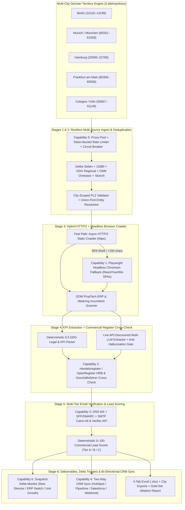

# 01 — Mission, Vision & Enterprise Scale-Up Product Requirements Document (PRD)

**Project Name:** Metrixa Engine (Heidi Systems B2B PropTech & Submetering Intelligence Platform)
**Document Scope:** Phase 2 Enterprise Scale-Up — Multi-City German Expansion & 6 Production-Grade Business Capabilities
**Target Markets:** Berlin, Munich (*München*), Hamburg, Frankfurt am Main, and Cologne (*Köln*)
**Document Order:** `01 of 07` (Start Here)

---

## 1. Mission, Vision & Continuity from Phase 1 (Berlin Case Study Baseline)

### 1.1 Our Core Mission
Our mission is to provide **Heidi Systems / Metrixa Systems** with the most accurate, 100% evidence-backed, zero-hallucination B2B revenue intelligence engine for the German property management (*Hausverwaltungen*) market. Under the German **Heating Costs Ordinance (*Heizkostenverordnung — HeizkV*)** and the **EU Energy Efficiency Directive (EED)**, property managers are legally required to deploy remotely readable submetering infrastructure and deliver transparent monthly consumption telemetry.

Because a single *Hausverwaltung* controls between **250 and 50,000+ residential and commercial units (*Wohneinheiten & Gewerbeeinheiten*)**, winning one property management firm unlocks recurring multi-year hardware and billing contracts across dozens or hundreds of buildings.

### 1.2 What We Proved in Phase 1 (The Berlin Baseline)
In Phase 1, we engineered a complete **6-Stage Autonomous Pipeline** focused on **Berlin (`PLZ 10115–14199`, 12 official *Bezirke*)**:
1. **Stage 1 — Multi-Source Ingestion**: Scraped *Gelbe Seiten*, *11880.com* (with Cloudflare XOR email decryption), *VDIV* certified registry, *OpenStreetMap Overpass*, and autonomous search discovery.
2. **Stage 2 — Entity Resolution & Deduplication**: Clustered duplicate records via **Union-Find** + **RapidFuzz** + canonical domain/phone/PLZ blocking (`1,199` qualified Berlin companies).
3. **Stage 3 — Async Impressum & DOM Crawler**: Crawled `/`, `/impressum`, `/team`, `/leistungen`, and `/referenzen` while scanning raw HTML DOM footprints for PropTech ERPs (*Casavi*, *Domus*, *Wodis*, *Aareon*, *Haufe*) and metering incumbents (*Techem*, *ista*, *Minol*, *Brunata*, *Kalorimeta*).
4. **Stage 4 — Hybrid Deterministic + Multi-LLM KPI Extraction**: Combined a zero-cost German **§ 5 DDG** legal notice parser with live API-discovered LLM models (OpenAI, Gemini, DeepSeek, NVIDIA NIM, Ollama, LM Studio, llama.cpp) and a strict anti-hallucination gate.
5. **Stage 5 — Live DNS MX Verification & 0–100 Scoring**: Verified domain mail servers via RFC 5321 DNS `MX` queries and scored every company `0–100` across Tier A, Tier B, and Tier C.
6. **Stage 6 — Executive Excel Deliverables & Gold-Set Ablation**: Generated the 4-tab formatted `.xlsx` master workbook, CSVs, and scientific Precision/Recall/F1 evaluation against a 30-company Berlin Gold Set.

### 1.3 Our Phase 2 Vision: From Regional Case Study to Nationwide B2B Production Engine
To operate this platform as a **real commercial business at nationwide scale**—while keeping the Phase 1 Berlin Case Study deliverable 100% intact for the November 10 presentation—Phase 2 expands the engine across two dimensions:

1. **Geographic Expansion Across Germany's Top 5 Property Markets**:
   - **Berlin** (`PLZ 10115–14199` — 12 *Bezirke*)
   - **Munich (*München*)** (`PLZ 80331–81929` — 25 *Stadtbezirke*)
   - **Hamburg** (`PLZ 20095–22769` — 7 *Bezirke*)
   - **Frankfurt am Main** (`PLZ 60306–65936` — 16 *Ortsbezirke* / 46 *Stadtteile*)
   - **Cologne (*Köln*)** (`PLZ 50667–51149` — 9 *Stadtbezirke*)
2. **The 6 Enterprise Production Capabilities**:
   - **Capability 1:** Headless Browser Rendering (Playwright Chromium Fallback for JS/SPA Sites)
   - **Capability 2:** Official *Handelsregister* / OpenRegister / NorthData Commercial Register Enrichment
   - **Capability 3:** Multi-Tier Email Verification (DNS MX + SPF/DMARC + Non-Intrusive SMTP / Catch-All & Verifier API)
   - **Capability 4:** Automated CRM Two-Way Sync (HubSpot, Pipedrive, Salesforce & Bi-Directional Ledger)
   - **Capability 5:** Proxy Rotation, Adaptive Rate-Limiting & Circuit-Breaker Resilience
   - **Capability 6:** Scheduled Delta Monitoring & High-Intent Sales Trigger Alerts (*Geschäftsführer* / ERP / Portfolio Changes)

---

## 2. Architecture Overview: Phase 1 + Phase 2 Unified Pipeline

---

## 3. Functional Requirements (FR)

### FR-SCALE-1: Multi-City German Territory Support (Berlin, Munich, Hamburg, Frankfurt, Cologne)
* **FR-SCALE-1.1:** The system MUST support deterministic postal code (*PLZ*) validation, official district (*Bezirk / Stadtbezirk*) mapping, *Amtsgericht* register court mapping, and OSM Overpass bounding boxes for **Berlin**, **Munich**, **Hamburg**, **Frankfurt am Main**, and **Cologne**.
* **FR-SCALE-1.2:** Every raw listing and deduplicated golden company record MUST carry a canonical `city` attribute (`Berlin`, `München`, `Hamburg`, `Frankfurt am Main`, `Köln`), defaulting to `Berlin` so all existing 1,199 Berlin records remain 100% compatible.
* **FR-SCALE-1.3:** The pipeline, API (`/api/leads`, `/api/metrics`, `/api/pipeline/run`), and Next.js Cockpit MUST allow filtering by a specific city or viewing all cities combined, while preserving the dedicated Berlin Case Study export.

### FR-SCALE-2: Capability 1 — Headless Browser Rendering Fallback (JS/SPA Sites)
* **FR-SCALE-2.1:** Stage 3 (`AsyncWebCrawler`) MUST automatically detect when an HTTP/2 static fetch returns an unrendered JavaScript Single-Page Application (SPA) shell (e.g., `

`, `

`, Wix Thunderbolt, Jimdo, Angular `ng-version`, or visible text `< 150` characters on `/impressum`).
* **FR-SCALE-2.2:** When an SPA shell is detected, the crawler MUST transparently invoke the **Playwright Headless Chromium** renderer (`HeadlessBrowserRenderer`), wait for `networkidle` / DOM hydration, extract the rendered HTML and clean Markdown, and scan the hydrated DOM for ERP/portal/metering footprints.
* **FR-SCALE-2.3:** Every crawled page MUST record its `render_engine` (`httpx_static` vs. `playwright_chromium`) for full auditability.

### FR-SCALE-3: Capability 2 — Official *Handelsregister* / OpenRegister Cross-Check
* **FR-SCALE-3.1:** For companies with an extracted `commercial_register_id` (`HRB`/`HRA`) or legal entity name (`GmbH`, `UG`, `AG`, `GmbH & Co. KG`, `e.K.`), the system MUST resolve the authoritative local register court (*Amtsgericht Charlottenburg*, *Amtsgericht München*, *Amtsgericht Hamburg*, *Amtsgericht Frankfurt am Main*, *Amtsgericht Köln*).
* **FR-SCALE-3.2:** The *Handelsregister* Enrichment module MUST cross-check registration format validity, normalize the court + register number key (e.g., `Amtsgericht München HRB 123456`), query configured OpenRegister / Handelsregister endpoints (with deterministic offline validation when external API keys are not set), and persist verification status in `commercial_register_checks`.

### FR-SCALE-4: Capability 3 — Multi-Tier Email Verification (DNS MX + SPF/DMARC + SMTP Catch-All)
* **FR-SCALE-4.1:** Stage 5 (`EmailVerifier`) MUST perform a 3-tier verification check:
  1. **Tier 1 (RFC 5321 DNS MX):** Resolves primary mail exchange host and priority.
  2. **Tier 2 (DNS TXT SPF & DMARC Security Posture):** Inspects domain `SPF` and `DMARC` records to classify corporate mail infrastructure maturity.
  3. **Tier 3 (SMTP RCPT / Catch-All & Pluggable API Verifier):** Supports non-intrusive SMTP `EHLO`/`RCPT TO` probe (when port 25 is permitted) or pluggable ZeroBounce / MillionVerifier / Reoon API verification to classify addresses as `VALID_DELIVERABLE`, `CATCH_ALL_DOMAIN`, `MX_VERIFIED_ONLY`, or `INVALID_UNDELIVERABLE`.

### FR-SCALE-5: Capability 4 — Automated CRM Two-Way Sync
* **FR-SCALE-5.1:** The system MUST provide a bi-directional CRM synchronization module (`CRMSyncEngine`) supporting **HubSpot**, **Pipedrive**, **Salesforce**, and **Generic Outbound/Inbound Webhooks**.
* **FR-SCALE-5.2:** Outbound sync MUST push qualified leads (e.g., Tier A or user-selected leads) with idempotent external keys (`company_id` + `canonical_domain`).
* **FR-SCALE-5.3:** Inbound sync (`POST /api/crm/webhook` and pull sync) MUST record sales rep dispositions (`NEW`, `CONTACTED`, `IN_SEQUENCE`, `MEETING_BOOKED`, `DEAL_WON`, `DISQUALIFIED_BY_SALES`) in `crm_sync_ledger` so subsequent pipeline runs **never overwrite** human sales status or notes.

### FR-SCALE-6: Capability 5 — Proxy Rotation, Rate-Limit & Circuit-Breaker Resilience
* **FR-SCALE-6.1:** All scrapers and crawlers MUST route through a central `ResilienceManager` featuring:
  - Per-domain token-bucket rate limiting.
  - Exponential backoff with full jitter on `HTTP 429` / `503`.
  - Per-domain Circuit Breaker (`CLOSED` → `OPEN` → `HALF_OPEN`) to prevent cascading timeouts.
  - Pluggable HTTP/HTTPS/SOCKS5 rotating proxy pool with automatic health scoring and dead-proxy eviction.

### FR-SCALE-7: Capability 6 — Scheduled Delta Monitoring (High-Intent Sales Trigger Alerts)
* **FR-SCALE-7.1:** The system MUST capture historical snapshots of company KPIs and decision makers and compute diffs (`DeltaMonitor`) across runs.
* **FR-SCALE-7.2:** Whenever a pipeline run or scheduled check detects:
  1. `NEW_DECISION_MAKER` (*Geschäftsführer* or *Vorstand* added/changed),
  2. `ERP_OR_PORTAL_SWITCH` (new PropTech ERP or customer portal detected),
  3. `PORTFOLIO_UNITS_GROWTH` (managed units changed by `>= 10%`), or
  4. `METERING_INCUMBENT_CHANGE` (submetering provider signal changed),
  it MUST write an immutable event to `company_delta_events` and surface it in the Cockpit & API (`/api/deltas`).

---

## 4. Non-Functional Requirements (NFR) & Strict Guardrails

| ID | Category | Requirement |
| :--- | :--- | :--- |
| **NFR-SCALE-1** | **Zero Regression on Berlin Baseline** | The existing 1,199 Berlin golden companies, 30-company Berlin Gold Set evaluation, and 4-tab Berlin Excel workbook MUST remain 100% intact and reproducible at any time for the November 10 Case Study. |
| **NFR-SCALE-2** | **Zero Fake / Stub Data** | No fake leads, no fake LLM model stubs, and no fabricated registry/CRM responses. When an optional third-party API key (e.g., HubSpot, ZeroBounce, OpenRegister) is not configured, the system MUST report honest configuration status and use transparent, deterministic local verification. |
| **NFR-SCALE-3** | **100% Test Coverage & E2E Proof** | Every new backend module MUST have comprehensive `pytest` unit and integration tests (`100%` feature coverage), and every Cockpit page MUST be verified by headless Playwright E2E browser tests. |
| **NFR-SCALE-4** | **Full Observability & Debuggability** | Structured JSON logging + rotating file logs + correlation `trace_id` per run + `/api/diagnostics` live health and log inspector. |
| **NFR-SCALE-5** | **15-Hook Pre-Commit Quality Gate** | All Python (`ruff`, `black`, `bandit` SAST, `mypy`, `pytest`) and Frontend (`prettier`, `eslint`, `next build`) gates MUST pass with zero errors. |
