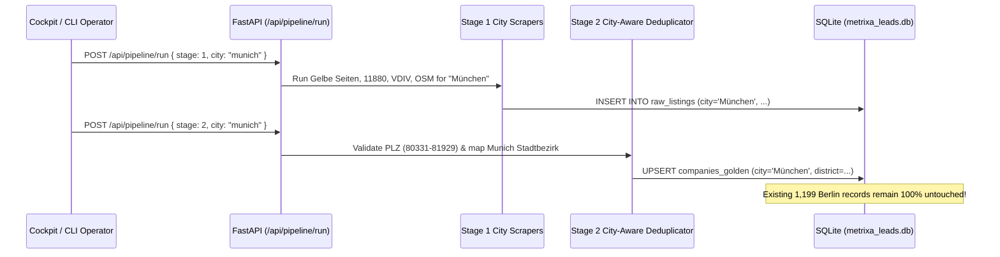

# 02 — Multi-City German Expansion Architecture (Berlin, Munich, Hamburg, Frankfurt, Cologne)

**Project Name:** Metrixa Engine (Heidi Systems B2B PropTech & Submetering Intelligence Platform)
**Document Scope:** Deterministic Postal Code (*PLZ*), Official District (*Bezirk*), Register Court (*Amtsgericht*), and Multi-Source Discovery Architecture Across Germany's Top 5 Property Markets
**Document Order:** `02 of 07`

---

## 1. Strategic Rationale: Why These 5 German Metropolises?

In Germany, multi-family residential (*WEG-Verwaltung* & *Mietverwaltung*) and commercial property management (*Gewerbeverwaltung*) is heavily concentrated in the **Big 5 ("A-Städte") metropolitan markets**:
1. **Berlin** (~2.0M apartments, >85% tenant-occupied, massive *Mietverwaltung* & *WEG* density)
2. **Munich (*München*)** (~820k apartments, highest property values in Germany, dense *WEG-Verwaltung* concentration)
3. **Hamburg** (~980k apartments, strong long-established *Zinshaus* & *WEG* management firms)
4. **Frankfurt am Main** (~430k apartments + Rhine-Main commercial & high-rise residential towers)
5. **Cologne (*Köln*)** (~570k apartments, largest property market in North Rhine-Westphalia)

Together, these 5 cities represent the highest-value B2B target universe for **Heidi Systems / Metrixa Systems**.

---

## 2. Deterministic City Registry & Postal Code (*PLZ*) Architecture

Every German postal code (*Postleitzahl — PLZ*) is a 5-digit string. A production system must **never** rely on loose substring matching (which accidentally ingests neighboring towns or unrelated streets). Instead, we define a strict, deterministic `CITY_REGISTRY` in `src/heidi_engine/config.py`:

### 2.1 Master City Specification Table

| City ID | Canonical German Name | Valid `PLZ` Ranges | Official Districts (*Bezirke / Stadtbezirke*) | Authoritative *Amtsgericht* (Register Court) | Regional VDIV Association | OSM Overpass Bounding Box `(S, W, N, E)` |
| :--- | :--- | :--- | :--- | :--- | :--- | :--- |
| `berlin` | **Berlin** | `10115` – `14199` | **12 *Bezirke*** (Mitte, Friedrichshain-Kreuzberg, Pankow, Charlottenburg-Wilmersdorf, Spandau, Steglitz-Zehlendorf, Tempelhof-Schöneberg, Neukölln, Treptow-Köpenick, Marzahn-Hellersdorf, Lichtenberg, Reinickendorf) | Amtsgericht Charlottenburg | VDIV Berlin-Brandenburg | `(52.338, 13.088, 52.675, 13.761)` |
| `munich` | **München** | `80331` – `81929` | **25 *Stadtbezirke*** (Altstadt-Lehel, Ludwigsvorstadt-Isarvorstadt, Maxvorstadt, Schwabing-West, Au-Haidhausen, Sendling, Sendling-Westpark, Schwanthalerhöhe, Neuhausen-Nymphenburg, Moosach, Milbertshofen-Am Hart, Schwabing-Freimann, Bogenhausen, Berg am Laim, Trudering-Riem, Ramersdorf-Perlach, Obergiesing-Fasangarten, Untergiesing-Harlaching, Thalkirchen-Obersendling-Forstenried-Fürstenried-Solln, Hadern, Pasing-Obermenzing, Aubing-Lochhausen-Langwied, Allach-Untermenzing, Feldmoching-Hasenbergl, Laim) | Amtsgericht München | VDIV Bayern | `(48.061, 11.360, 48.248, 11.722)` |
| `hamburg` | **Hamburg** | `20095` – `21149`, `22041` – `22769` | **7 *Bezirke*** (Hamburg-Mitte, Altona, Eimsbüttel, Hamburg-Nord, Wandsbek, Bergedorf, Harburg) | Amtsgericht Hamburg | VDIV Nord | `(53.395, 9.730, 53.739, 10.325)` |
| `frankfurt` | **Frankfurt am Main** | `60306` – `60599`, `65929` – `65936` | **16 *Ortsbezirke*** (Innenstadt I–IV,bornheim/Ostend, Sachsenhausen, Westend/Bockenheim, Nordend, Mitte-West, Nord-West, Nord-Ost, Ost, Kalbach-Riedberg, Harheim, Nieder-Erlenbach, Bergen-Enkheim, Höchst) | Amtsgericht Frankfurt am Main | VDIV Hessen | `(50.015, 8.472, 50.226, 8.800)` |
| `cologne` | **Köln** | `50667` – `51149` | **9 *Stadtbezirke*** (Innenstadt, Rodenkirchen, Lindenthal, Ehrenfeld, Nippes, Chorweiler, Porz, Kalk, Mülheim) | Amtsgericht Köln | VDIV NRW | `(50.830, 6.772, 51.085, 7.162)` |

---

## 3. Exact `PLZ`-to-District Deterministic Mapping Rules

### 3.1 Berlin (`10115` – `14199`)
- Preserves the exact 190+ `PLZ`-to-*Bezirk* lookup dictionary already validated in `src/heidi_engine/config.py` (`BERLIN_PLZ_TO_DISTRICT`).

### 3.2 Munich / *München* (`80331` – `81929`)
- `80331–80539`: Altstadt-Lehel
- `80335–80469`: Ludwigsvorstadt-Isarvorstadt / Schwanthalerhöhe
- `80634–80689`: Neuhausen-Nymphenburg / Laim
- `80796–80809`: Maxvorstadt / Schwabing-West / Schwabing-Freimann
- `80933–80999`: Milbertshofen-Am Hart / Moosach / Feldmoching-Hasenbergl / Allach-Untermenzing
- `81241–81249`: Pasing-Obermenzing / Aubing-Lochhausen-Langwied
- `81369–81379`: Sendling / Sendling-Westpark / Thalkirchen-Obersendling-Forstenried-Fürstenried-Solln / Hadern
- `81475–81479`: Thalkirchen-Obersendling-Forstenried-Fürstenried-Solln
- `81539–81549`: Obergiesing-Fasangarten / Untergiesing-Harlaching / Ramersdorf-Perlach
- `81667–81679`: Au-Haidhausen / Bogenhausen / Berg am Laim
- `81735–81739`: Ramersdorf-Perlach
- `81825–81829`: Trudering-Riem
- `81925–81929`: Bogenhausen

### 3.3 Hamburg (`20095` – `22769`)
- `20095–20539`, `21107–21149`, `22111–22119`: Hamburg-Mitte
- `21029–21039`: Bergedorf
- `21073–21079`: Harburg
- `20249–20259`, `22523–22529`: Eimsbüttel
- `22297–22419`, `22301–22339`: Hamburg-Nord
- `22041–22089`, `22143–22179`, `22359–22399`: Wandsbek
- `22547–22769`: Altona

### 3.4 Frankfurt am Main (`60306` – `60599`, `65929` – `65936`)
- `60306–60314`: Innenstadt
- `60316–60322`: Nordend / Westend
- `60323–60325`: Westend
- `60326–60327`: Gallus / Gutleutviertel
- `60385–60389`: Bornheim / Ostend / Seckbach
- `60431–60439`: Dornbusch / Eschersheim / Heddernheim / Kalbach-Riedberg
- `60486–60489`: Bockenheim / Rödelheim / Hausen
- `60528–60599`: Sachsenhausen / Niederrad / Schwanheim
- `65929–65936`: Höchst / Unterliederbach / Sossenheim

### 3.5 Cologne / *Köln* (`50667` – `51149`)
- `50667–50679`: Innenstadt
- `50733–50739`: Nippes
- `50765–50769`: Chorweiler
- `50823–50829`: Ehrenfeld
- `50858–50939`: Lindenthal
- `50968–50999`: Rodenkirchen
- `51061–51069`: Mülheim
- `51103–51109`: Kalk
- `51143–51149`: Porz

---

## 4. Multi-City Pipeline Execution & Isolation Guarantee

### 4.1 Protecting the Berlin Case Study Baseline
1. **Default Scope = `Berlin`**: Whenever a pipeline stage or export is triggered without an explicit `city` parameter, it defaults to `Berlin` so the Case Study baseline behavior is 100% unchanged.
2. **City-Scoped Deduplication Blocking**: Stage 2 (`EntityDeduplicator`) partitions postal-code and street-address blocking by `city`, while still linking multi-branch national property managers via `canonical_domain`.
3. **City Filter in Cockpit & API**:
   - `GET /api/cities` returns live record counts, qualified counts, Tier A counts, and unit totals per city (`Berlin`, `München`, `Hamburg`, `Frankfurt am Main`, `Köln`).
   - `GET /api/leads?city=München` filters the Lead Explorer by city and updates the District dropdown dynamically to that city's official *Bezirke / Stadtbezirke*.
   - `GET /api/export/excel?city=Berlin` exports the exact Berlin Case Study workbook, while `GET /api/export/excel?city=ALL` exports the nationwide multi-city master workbook.
