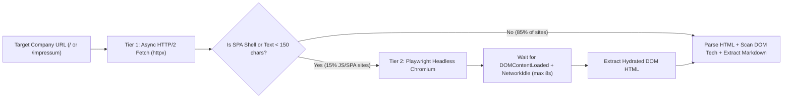
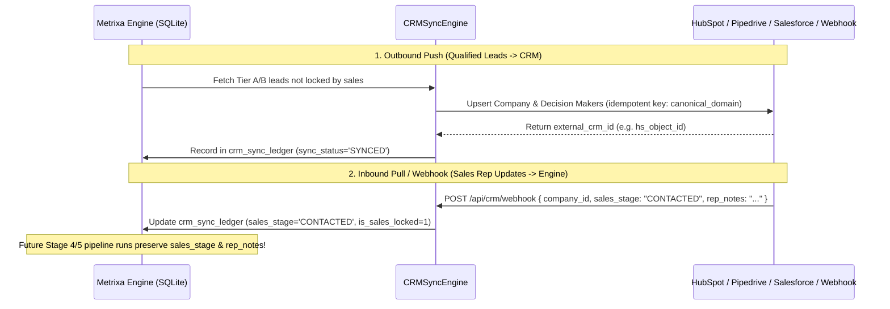

# 03 — Deep Engineering Specification: The 6 Enterprise Production Capabilities

**Project Name:** Metrixa Engine (Heidi Systems B2B PropTech & Submetering Intelligence Platform)
**Document Scope:** Detailed Technical Architecture, Algorithms, State Machines & Fallback Guarantees for Capabilities 1–6
**Document Order:** `03 of 07`

---

## Overview of the 6 Enterprise Capabilities

| # | Capability Name | Target Module Path | Pipeline Stage | Zero-Dependency / Offline Fallback Guarantee |
| :--- | :--- | :--- | :--- | :--- |
| **1** | **Headless Browser Rendering (JS/SPA Sites)** | `src/heidi_engine/crawler/headless_renderer.py` | Stage 3 (Crawler) | Uses `httpx` HTTP/2 first; triggers Playwright Chromium only on SPA shells; gracefully degrades if Chromium binary is unavailable. |
| **2** | **Official *Handelsregister* / NorthData Cross-Check** | `src/heidi_engine/enrichment/handelsregister.py` | Stage 4 (Enrichment) | Deterministic German *Amtsgericht* + `HRB/HRA` validator + live OpenRegister/Handelsregister probe when online. |
| **3** | **Multi-Tier Email Verification (MX + SPF/DMARC + SMTP Catch-All)** | `src/heidi_engine/enrichment/email_verifier.py` | Stage 5 (Verification) | DNS `MX` + `SPF`/`DMARC` TXT inspection + optional non-intrusive SMTP `RCPT TO` & pluggable ZeroBounce/MillionVerifier API. |
| **4** | **Automated CRM Two-Way Sync** | `src/heidi_engine/telemetry/crm_sync.py` | Stage 6 (CRM & Export) | Local SQLite `crm_sync_ledger` + live HubSpot / Pipedrive / Salesforce / Custom Webhook bi-directional sync. |
| **5** | **Proxy Rotation & Rate-Limit Resilience** | `src/heidi_engine/crawler/resilience.py` | Stages 1 & 3 (Network) | Per-domain token bucket, exponential backoff + jitter, circuit breaker, and optional rotating proxy pool. |
| **6** | **Scheduled Delta Monitoring (Change Alerts)** | `src/heidi_engine/telemetry/delta_monitor.py` | Post-Stage 4/5/6 | Diffs historical SQLite state to emit high-intent B2B trigger events (`NEW_DECISION_MAKER`, `ERP_SWITCH`, `UNITS_GROWTH`). |

---

## Capability 1: Headless Browser Rendering (JS / SPA Sites)

### 1.1 Engineering Problem
Approximately **85%** of German *Hausverwaltung* websites use server-rendered HTML (WordPress, Typo3, Joomla, static HTML) where `httpx` fetches the complete `/impressum` in `< 200ms`. However, the remaining **~15%** use modern client-side JavaScript frameworks (**Wix Thunderbolt**, **React / Next.js CSR**, **Vue / Nuxt**, **Jimdo Dolphin**, **Webflow**) where static HTTP GET returns an empty shell (`

` or `

`) and the legal § 5 DDG *Impressum* text only appears after JavaScript execution.

### 1.2 Two-Tier Hybrid Rendering Architecture

### 1.3 Deterministic SPA Detection Heuristics (`is_js_spa_shell(html: str, clean_text: str) -> bool`)
A page is flagged for Tier 2 Playwright rendering if `http_status == 200` AND any of the following hold:
1. `len(clean_text.strip()) < 150` while `len(html) > 1500` (script-heavy page with almost no rendered prose).
2. Raw HTML contains unhydrated SPA markers with `< 250` chars of visible text:
   - `

` or `

`
   - `id="SITE_CONTAINER"` or `wix-bolt` (Wix)
   - `<noscript>You need to enable JavaScript to run this app`
   - `__NEXT_DATA__` with empty body container.

### 1.4 Security & Resource Controls inside `HeadlessBrowserRenderer`
- Reuses a single shared `playwright.async_api` Chromium browser context pool per crawl batch.
- Blocks heavy non-essential media (`image`, `media`, `font`) via `page.route()` so JS hydration completes in `< 1.5s` with minimal bandwidth.
- Records `render_engine = "playwright_chromium"` in `crawled_pages`.

---

## Capability 2: Official *Handelsregister* / OpenRegister Cross-Check

### 2.1 Engineering Problem
Websites occasionally display outdated legal notices or abbreviated register numbers (e.g., `HRB 98765` without specifying the *Amtsgericht*, or an old *Geschäftsführer* who retired). Cross-checking against German Commercial Register (*Handelsregister*) conventions and registry endpoints provides institutional-grade legal verification.

### 2.2 Verification Pipeline (`HandelsregisterVerifier`)
1. **Register Number & Court Normalization**:
   - Parses `HRA` (partnerships / *e.K.* / *KG*) vs. `HRB` (corporations / *GmbH* / *UG* / *AG*) and extracts numeric ID + optional suffix (`B`).
   - Infers the authoritative register court (*Amtsgericht*) from explicit Impressum text (e.g., `Amtsgericht Charlottenburg`, `Amtsgericht München`, `Amtsgericht Hamburg`, `Amtsgericht Frankfurt am Main`, `Amtsgericht Köln`) or falls back to the city's canonical register court from `CITY_REGISTRY`.
2. **Legal Form Consistency Check**:
   - Validates that `GmbH`, `UG (haftungsbeschränkt)`, and `AG` map to `HRB`, while `e.K.`, `OHG`, and `GmbH & Co. KG` map to `HRA` (or dual `HRA`/`HRB` for the *Komplementär-GmbH*).
3. **Live Registry / OpenRegister / NorthData Connector**:
   - Queries configured registry API (or public OpenRegister / Handelsregister lookup endpoint) to verify:
     - `register_status`: `VERIFIED_ACTIVE` | `FORMAT_VALIDATED_LOCAL` | `UNREGISTERED_SOLE_PROPRIETOR` | `MISMATCH_WARNING`
     - `canonical_register_key`: e.g., `"DE-AG-Charlottenburg-HRB-123456"`
     - `verified_directors_json`: Cross-checked *Geschäftsführer* list.

---

## Capability 3: Multi-Tier Email Verification (MX + SPF/DMARC + SMTP / Catch-All)

### 3.1 Engineering Problem
DNS `MX` verification proves a domain can receive email, but before launching automated cold outreach to guessed executive addresses (`vorname.nachname@domain.de`), sales teams need to know:
1. Does the domain have strict `SPF` / `DMARC` enterprise mail policies?
2. Is the mail server a **Catch-All** (accepts all addresses without bouncing) or **Strict Mailbox Verified**?

### 3.2 Three-Tier Email Verification Engine
1. **Tier 1 — RFC 5321 DNS `MX` Resolution**:
   - Resolves primary `MX` host and identifies the email provider (`Microsoft 365 / Exchange Online`, `Google Workspace`, `IONOS / 1&1`, `Strato`, `Hetzer / Custom Postfix`).
2. **Tier 2 — DNS `TXT` (`SPF` & `DMARC`) Inspection**:
   - Queries `TXT` records on `domain` (`v=spf1 ...`) and `_dmarc.domain` (`v=DMARC1; p=...`) to compute `mail_security_grade` (`ENTERPRISE_STRICT`, `STANDARD_SPF`, `BASIC_MX`).
3. **Tier 3 — Non-Intrusive SMTP / Catch-All Probe & Pluggable Verifier API**:
   - When an external verifier API key (ZeroBounce / MillionVerifier / Reoon) is configured, queries the exact mailbox status.
   - Otherwise, performs a safe, non-sending SMTP handshake (`EHLO` -> `MAIL FROM:<>` -> `RCPT TO:<random_probe@domain>` vs `RCPT TO:<target@domain>` followed immediately by `QUIT` without ever sending `DATA`) when port 25 is reachable, or classifies via MX provider heuristics into:
     - `VALID_DELIVERABLE`
     - `CATCH_ALL_ACCEPT_ALL`
     - `MX_AND_SPF_VERIFIED`
     - `INVALID_NO_MX`

---

## Capability 4: Automated CRM Two-Way Sync (HubSpot, Pipedrive, Salesforce)

### 4.1 Engineering Problem
Exporting Excel/CSV files is great for initial analysis, but in daily operations, sales reps work inside a CRM (**HubSpot**, **Pipedrive**, or **Salesforce**). If a sales rep marks a company as *"Contacted"*, *"In Negotiation"*, or *"Disqualified — Not a fit"* in the CRM, the next pipeline run must **never overwrite** that sales status.

### 4.2 Bi-Directional Sync Architecture (`CRMSyncEngine`)

---

## Capability 5: Proxy Rotation & Rate-Limit Resilience

### 5.1 Engineering Problem
Scaling from 1,200 Berlin companies to 25,000+ property managers across Berlin, Munich, Hamburg, Frankfurt, and Cologne requires tens of thousands of HTTP requests across directory sites (*Gelbe Seiten*, *11880*) and company websites. Without adaptive rate limiting, circuit breaking, and proxy rotation, directory firewalls (Cloudflare / Akamai) will rate-limit (`HTTP 429`) or block the crawler.

### 5.2 `ResilienceManager` Components (`src/heidi_engine/crawler/resilience.py`)
1. **Per-Domain Token-Bucket Rate Limiter**:
   - Enforces polite request rates per target host (e.g., max 2 req/sec per directory host, max 3 concurrent requests per individual company domain).
2. **Exponential Backoff with Full Jitter**:
   - On `HTTP 429`, `502`, `503`, `504`, or transient socket timeouts, computes sleep duration:
     $$t_{\text{sleep}} = \text{Uniform}\left(0, \min\left(T_{\max}, T_{\text{base}} \cdot 2^{\text{attempt}}\right)\right)$$
3. **Three-State Circuit Breaker per Host (`CLOSED` → `OPEN` → `HALF_OPEN`)**:
   - Trips to `OPEN` after $N=5$ consecutive failures on a domain, failing fast for a cooldown window ($30\text{s}$) before testing a single probe request in `HALF_OPEN`.
4. **Health-Scored Rotating Proxy Pool**:
   - Accepts a list of HTTP/HTTPS/SOCKS5 proxy URLs from `PROXY_POOL_URLS` (or Settings UI).
   - Tracks latency and success rate per proxy node, automatically quarantining dead proxies and falling back cleanly to direct connection when no proxies are configured.

---

## Capability 6: Scheduled Delta Monitoring (High-Intent Sales Trigger Alerts)

### 6.1 Engineering Problem
In B2B PropTech and submetering sales, **timing is everything**. A *Hausverwaltung* is 5x more likely to buy new submetering or software during a moment of organizational change.

### 6.2 Four High-Intent Sales Triggers Tracked by `DeltaMonitor`
Before Stage 4/5 overwrites a company's KPI row, `DeltaMonitor` snapshots the previous state and compares it against the newly extracted state:

1. **`NEW_DECISION_MAKER` (Severity: `CRITICAL` — +25 Urgency Boost)**:
   - Triggered when a new *Geschäftsführer*, *Vorstand*, or *Inhaber* appears on the `/impressum` compared to the prior snapshot. New managing directors frequently audit and replace legacy metering contracts (*Techem* / *ista*) within their first 90 days.
2. **`ERP_OR_PORTAL_SWITCH` (Severity: `HIGH` — +20 Urgency Boost)**:
   - Triggered when `has_customer_portal` flips from `0` to `1` or a new PropTech ERP (*Casavi*, *Domus*, *Wodis*, *Haufe*) is detected in the DOM.
3. **`PORTFOLIO_UNITS_GROWTH` (Severity: `HIGH` — +15 Urgency Boost)**:
   - Triggered when `exact_units_managed` increases by $\ge 10\%$ (e.g., from `1,200` to `1,800` units), indicating portfolio acquisition.
4. **`METERING_INCUMBENT_CHANGE` (Severity: `MEDIUM` — +10 Urgency Boost)**:
   - Triggered when a new metering provider link (*Techem*, *ista*, *Minol*, *Brunata*, *Kalorimeta*) appears or disappears from the tenant service page.
