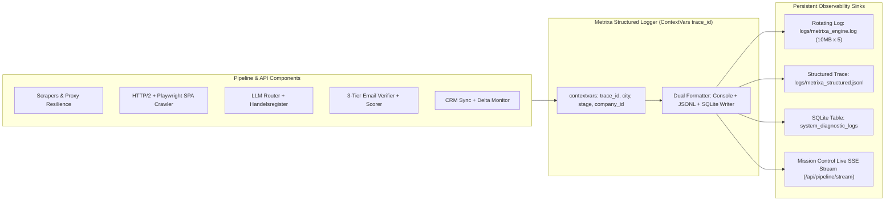

# 05 :  Logging, Debugging, Observability & End-to-End Diagnostics Architecture

**Project Name:** Metrixa Engine (Metrixa Systems B2B PropTech & Submetering Intelligence Platform)
**Document Scope:** Enterprise Structured Logging, Correlation Trace IDs, Rotating File Logs, SQLite Audit Trail & Live Debug Inspector
**Document Order:** `05 of 07`

---

## 1. Why Production Observability & Debugging Are Mandatory

In a real B2B production environment processing thousands of companies across 5 German cities, silent `except Exception: pass` blocks are unacceptable. When a website fails to crawl, an LLM returns malformed JSON, a proxy times out, or a CRM webhook rejects a payload, an operator must be able to see:
1. **Exact Correlation `trace_id`** linking every log event in a pipeline run or API request.
2. **Component & Stage Context** (`scraper`, `crawler_spa`, `handelsregister`, `llm_router`, `email_verifier`, `crm_sync`, `delta_monitor`, `resilience`).
3. **Structured JSON Payloads** persisted both to rotating disk files (`logs/metrixa_engine.log` and `logs/metrixa_structured.jsonl`) and the SQLite `system_diagnostic_logs` table for instant querying in the Cockpit UI.

---

## 2. Unified Telemetry & Logging Architecture (`src/metrixa_engine/telemetry/logger.py`)

### 2.1 Context-Aware Correlation (`contextvars`)
Every API request, CLI execution, or pipeline stage run generates or inherits a UUIDv4 `trace_id` (e.g., `trc-20261108-8f9a2b`) stored in Python `contextvars`:
- `trace_id`: Unique execution trace identifier.
- `active_city`: Current city context (`Berlin`, `München`, `Hamburg`, `Frankfurt am Main`, `Köln`).
- `active_component`: Subsystem name.

### 2.2 Three Persistent Sinks
1. **Human-Readable Rotating File Log (`logs/metrixa_engine.log`)**:
   - Format: `2026-11-08 16:05:12.410 | INFO | [trc-8f9a2b] [Berlin] [crawler_spa] Hydrated SPA /impressum via Playwright in 640ms`
   - `RotatingFileHandler` (`maxBytes=10_485_760`, `backupCount=5`, UTF-8 encoding).
2. **Machine-Parseable JSONL Trace Log (`logs/metrixa_structured.jsonl`)**:
   - Every line is a valid JSON object containing `timestamp`, `level`, `trace_id`, `component`, `city`, `company_id`, `latency_ms`, `message`, and `details`.
3. **Queryable SQLite Diagnostic Table (`system_diagnostic_logs`)**:
   - Enables instant filtering by `level` (`ERROR`, `WARNING`, `INFO`, `DEBUG`), `component`, `city`, or `company_id` via `GET /api/diagnostics/logs`.

---

## 3. Live Debugging & Self-Diagnostics Endpoints (`src/metrixa_engine/api/server.py`)

### 3.1 `GET /api/diagnostics/health`
Performs a deep, real-time subsystem health audit across all components and returns:
- **Database Integrity**: SQLite WAL mode check, table counts across all 12 tables, index health, and file size.
- **Multi-City Territory Readiness**: PLZ lookup table verification for Berlin (`10115-14199`), Munich (`80331-81929`), Hamburg (`20095-22769`), Frankfurt (`60306-65936`), and Cologne (`50667-51149`).
- **Capability 1 (Playwright Headless Renderer)**: Checks whether `playwright` Python package and headless Chromium binary are available (`READY` vs `HTTPX_FALLBACK_MODE`).
- **Capability 2 (Handelsregister Verifier)**: Validates German *Amtsgericht* + `HRB/HRA` parser rules.
- **Capability 3 (3-Tier Email Verifier)**: Tests live DNS `MX` + `TXT` (`SPF`/`DMARC`) resolution speed.
- **Capability 4 (CRM Two-Way Sync)**: Reports `crm_sync_ledger` state and active webhook/CRM configuration.
- **Capability 5 (Proxy & Resilience Manager)**: Reports circuit breaker states (`CLOSED`/`OPEN`/`HALF_OPEN`) and proxy pool health.
- **Capability 6 (Delta Monitor)**: Reports count of active unacknowledged change-trigger alerts.

### 3.2 `GET /api/diagnostics/logs`
Query parameters:
- `level`: `ALL` | `DEBUG` | `INFO` | `WARNING` | `ERROR`
- `component`: Optional subsystem filter
- `city`: Optional city filter
- `limit`: Number of recent structured log entries (default `100`)

Returns the live structured diagnostic logs so developers and reviewers can inspect every internal operation directly from the Cockpit or API without SSHing into a server.
