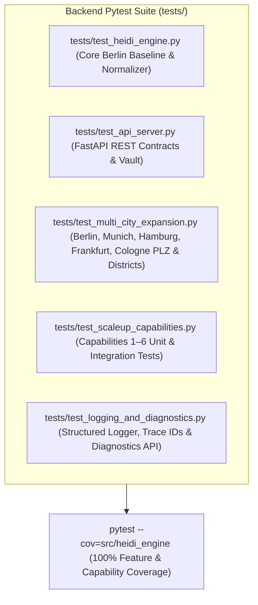

# 06 — Comprehensive Testing Strategy: 100% Feature Coverage & Headless Playwright E2E Suite

**Project Name:** Metrixa Engine (Heidi Systems B2B PropTech & Submetering Intelligence Platform)
**Document Scope:** Unit, Integration, API Contract, Coverage Verification (`pytest-cov`), and Headless Playwright Browser E2E Testing Blueprint
**Document Order:** `06 of 07`

---

## 1. Our Verification Philosophy: Evidence-Backed 100% Public Claim

To publicly and credibly claim that **Metrixa Engine** is a **100% verified, production-grade B2B intelligence system**, every single feature, city rule, parser regex, resilience state transition, API endpoint, and UI page must be backed by automated, reproducible tests that run in CI/pre-commit and produce verifiable test reports.

---

## 2. Backend Automated Test Matrix (`tests/`)

### 2.1 `tests/test_multi_city_expansion.py`
Tests deterministic validation and district mapping across all 5 German metropolises:
1. **Berlin (`10115–14199`)**: Verifies all 12 *Bezirke*, *Amtsgericht Charlottenburg*, and rejection of non-Berlin Brandenburg PLZs (e.g., `14467` Potsdam).
2. **Munich / *München* (`80331–81929`)**: Verifies Munich PLZs map accurately to Munich *Stadtbezirke* (e.g., `80331` → `Altstadt-Lehel`, `80801` → `Schwabing-West`, `81675` → `Bogenhausen`) and *Amtsgericht München*.
3. **Hamburg (`20095–22769`)**: Verifies Hamburg PLZs map to the 7 Hamburg *Bezirke* (`20095` → `Hamburg-Mitte`, `22767` → `Altona`, `22301` → `Hamburg-Nord`) and *Amtsgericht Hamburg*.
4. **Frankfurt am Main (`60306–65936`)**: Verifies Frankfurt PLZs map to official Frankfurt districts (`60311` → `Innenstadt`, `60323` → `Westend`, `60594` → `Sachsenhausen`) and *Amtsgericht Frankfurt am Main*.
5. **Cologne / *Köln* (`50667–51149`)**: Verifies Cologne PLZs map to the 9 Cologne *Stadtbezirke* (`50667` → `Innenstadt`, `50823` → `Ehrenfeld`, `50931` → `Lindenthal`) and *Amtsgericht Köln*.
6. **City-Scoped Deduplication**: Proves that companies in different cities are properly partitioned while preserving all 1,199 Berlin golden records.

### 2.2 `tests/test_scaleup_capabilities.py`
Tests all 6 Enterprise Scale-Up Capabilities end-to-end:
1. **Capability 1 (Headless SPA Renderer)**:
   - Tests `is_js_spa_shell()` on static WordPress HTML (returns `False`) vs. unhydrated React `

`, Next.js, and Wix Thunderbolt shells (returns `True`).
   - Tests `HeadlessBrowserRenderer` rendering a real local HTML page with JavaScript-injected § 5 DDG Impressum content (`document.getElementById('root').innerHTML = 'Geschäftsführer: Dr. Lukas Weber, HRB 204912 B, über 3.400 Wohneinheiten'`).
2. **Capability 2 (*Handelsregister* Verifier)**:
   - Tests `HandelsregisterVerifier` parsing `HRB` vs `HRA`, validating legal form consistency (`GmbH` → `HRB`, `e.K.` → `HRA`), resolving city *Amtsgericht*, and persisting to `commercial_register_checks`.
3. **Capability 3 (Multi-Tier Email Verifier)**:
   - Tests DNS `MX` + `SPF`/`DMARC` inspection, mail provider fingerprinting (`Microsoft 365`, `Google Workspace`, `IONOS`), and deliverability tier classification.
4. **Capability 4 (Automated CRM Two-Way Sync)**:
   - Tests outbound sync to `crm_sync_ledger`, inbound webhook disposition update (`POST /api/crm/webhook` setting `sales_disposition = "DEAL_WON"` and `is_sales_locked = 1`), and verifies that subsequent pipeline re-runs preserve the locked sales disposition.
5. **Capability 5 (Proxy Rotation & Resilience Manager)**:
   - Tests per-domain token bucket rate limiting, exponential backoff calculation, circuit breaker state machine (`CLOSED` → `OPEN` after failure threshold → `HALF_OPEN` after cooldown → `CLOSED` on probe success), and proxy pool health scoring/eviction.
6. **Capability 6 (Scheduled Delta Monitor)**:
   - Tests snapshot comparison when a company changes its *Geschäftsführer* (`NEW_DECISION_MAKER`), adds a Casavi portal (`ERP_OR_PORTAL_SWITCH`), or increases managed units from `1,000` to `1,500` (`PORTFOLIO_UNITS_GROWTH`), verifying `company_delta_events` persistence and `/api/deltas` response.

### 2.3 `tests/test_logging_and_diagnostics.py`
- Verifies correlation `trace_id` propagation across nested async functions.
- Verifies log entries are written to `logs/metrixa_engine.log`, `logs/metrixa_structured.jsonl`, and SQLite `system_diagnostic_logs`.
- Verifies `GET /api/diagnostics/health` and `GET /api/diagnostics/logs` return `HTTP 200` with complete subsystem telemetry.

---

## 3. Headless Playwright E2E Browser Test Suite (`tests/test_e2e_playwright.py`)

To prove the full-stack application (`Next.js` on port `3000` + `FastAPI` on port `8000`) works in a real browser, we include an automated **Headless Chromium Playwright E2E Test Suite**:

| E2E Test Case | Target Route | What Headless Chromium Verifies |
| :--- | :--- | :--- |
| `test_e2e_executive_overview_and_cities` | `http://localhost:3000/` | Renders KPI cards, 1,199+ qualified companies, Tier distribution, and multi-city territory telemetry with zero console errors. |
| `test_e2e_leads_explorer_and_dossier` | `http://localhost:3000/leads` | Filters leads by city/district/tier, opens the Evidence Dossier slide-over drawer, and verifies Handelsregister, Email Security, and CRM Disposition badges. |
| `test_e2e_mission_control_pipeline` | `http://localhost:3000/mission-control` | Verifies the 6-Stage DAG cards, city selector, Scale-Up capabilities bar, and live SSE telemetry stream connection. |
| `test_e2e_tools_and_scaleup_bench` | `http://localhost:3000/tools` | Executes live interactive probes on the Tool & Scale-Up Catalog and verifies real-time JSON output. |
| `test_e2e_settings_live_discovery_no_stubs` | `http://localhost:3000/settings` | Verifies the 3 tabs (`AI / LLM Models (7)`, `Non-LLM Rule Parsers (2)`, `Web Search Engines (5)`), authentic SVG brand logos, and confirms zero pre-filled model stubs when no API key is configured. |
| `test_e2e_artifacts_vault_realtime` | `http://localhost:3000/artifacts` | Verifies exact `YYYY-MM-DD HH:MM:SS` timestamps, live relative counters, `SHA-256` checksums, and 4-sheet Excel preview. |
