# 07 :  Phase-by-Phase Engineering Implementation Plan & Execution Roadmap

**Project Name:** Metrixa Engine (Metrixa Systems B2B PropTech & Submetering Intelligence Platform)
**Document Scope:** Step-by-Step Build Sequence, Zero-Damage Safeguards, and Quality Gate Checklist
**Document Order:** `07 of 07`

---

## 1. Execution Principles & Zero-Damage Safeguards

1. **Preserve the Berlin Case Study Baseline (`1,200` Golden Companies)**:
   - Before touching the SQLite database, create a verified backup snapshot of `data/metrixa_leads.db` and `data/exports/metrixa_berlin_hausverwaltungen.xlsx`.
   - All schema migrations use additive `CREATE TABLE IF NOT EXISTS` and `ALTER TABLE ... ADD COLUMN` with safe defaults (`city = 'Berlin'`).
2. **Modular, Pluggable Architecture**:
   - Every new capability lives in its own clean, typed Python module under `src/metrixa_engine/` and integrates into the existing pipeline and FastAPI server without breaking existing signatures.
3. **Test-Driven Verification at Every Phase**:
   - Every phase ends with automated `pytest` + `mypy` + `ruff` + `black` + `bandit` SAST verification.

---

## 2. Phase-by-Phase Build Plan

```mermaid
flowchart LR
    P1["Phase 1: Structured Logging, Trace IDs & Diagnostics"] --> P2["Phase 2: Multi-City German Territory Engine (5 Cities)"]
    P2 --> P3["Phase 3: Capabilities 1 & 5 (Playwright SPA + Proxy/Circuit Breaker)"]
    P3 --> P4["Phase 4: Capabilities 2 & 3 (Handelsregister + 3-Tier Email Verifier)"]
    P4 --> P5["Phase 5: Capabilities 4 & 6 (2-Way CRM Sync + Delta Monitor)"]
    P5 --> P6["Phase 6: FastAPI Endpoints + Next.js Cockpit UI Integration"]
    P6 --> P7["Phase 7: 100% Test Suite + Headless Playwright E2E + Git Push"]
```

---

### Phase 1: Structured Logging, Debugging & Diagnostics Harness
* **Files to Create / Update:**
  - `src/metrixa_engine/telemetry/logger.py` (New)
  - `src/metrixa_engine/db.py` (Add `system_diagnostic_logs` table + non-destructive schema migration runner)
* **Deliverables:**
  - Context-aware `trace_id` propagation (`contextvars`).
  - Dual output to `logs/metrixa_engine.log` (rotating file), `logs/metrixa_structured.jsonl`, and SQLite `system_diagnostic_logs`.
  - Live `/api/diagnostics/health` and `/api/diagnostics/logs` endpoints.

### Phase 2: Multi-City German Territory Engine (Berlin, Munich, Hamburg, Frankfurt, Cologne)
* **Files to Create / Update:**
  - `src/metrixa_engine/config.py` (Add `CITY_REGISTRY`, `MUNICH_PLZ_TO_DISTRICT`, `HAMBURG_PLZ_TO_DISTRICT`, `FRANKFURT_PLZ_TO_DISTRICT`, `COLOGNE_PLZ_TO_DISTRICT`, `resolve_german_city_and_district(plz, city_hint)`, `get_city_amtsgericht(city)`)
  - `src/metrixa_engine/entity_resolution/deduplicator.py` (City-aware PLZ validation and district assignment)
  - `src/metrixa_engine/scrapers/` (City-parameterized scraping for Gelbe Seiten, 11880, VDIV, OSM Overpass, and Search Discovery, plus curated multi-city seed ingestion for Munich, Hamburg, Frankfurt, and Cologne so all 5 cities have real verified German *Hausverwaltungen* in the database immediately)
* **Deliverables:**
  - Full deterministic support for **Berlin**, **München**, **Hamburg**, **Frankfurt am Main**, and **Köln**.
  - `GET /api/cities` endpoint returning live territory metrics across all 5 German metropolises.

### Phase 3: Capabilities 1 & 5 :  Headless Browser SPA Renderer & Proxy/Rate-Limit Resilience
* **Files to Create / Update:**
  - `src/metrixa_engine/crawler/resilience.py` (New: `ResilienceManager` with per-domain token bucket, exponential backoff with jitter, 3-state circuit breaker `CLOSED`/`OPEN`/`HALF_OPEN`, and health-scored rotating proxy pool)
  - `src/metrixa_engine/crawler/headless_renderer.py` (New: `is_js_spa_shell()` detector + `HeadlessBrowserRenderer` using `playwright.async_api` Headless Chromium with resource blocking and graceful fallback)
  - `src/metrixa_engine/crawler/web_crawler.py` (Integrate `ResilienceManager` and Tier 2 Playwright SPA fallback)

### Phase 4: Capabilities 2 & 3 :  *Handelsregister* Cross-Check & 3-Tier Email Verification
* **Files to Create / Update:**
  - `src/metrixa_engine/enrichment/handelsregister.py` (New: `HandelsregisterVerifier` normalizing `HRB`/`HRA`, resolving city *Amtsgericht*, checking legal form consistency, and persisting to `commercial_register_checks`)
  - `src/metrixa_engine/enrichment/email_verifier.py` (Upgrade `EmailVerifier` with Tier 1 DNS `MX`, Tier 2 DNS `TXT` `SPF`/`DMARC` security posture, mail provider fingerprinting, and Tier 3 non-intrusive SMTP / Catch-All & pluggable API verifier)

### Phase 5: Capabilities 4 & 6 :  Automated 2-Way CRM Sync & Scheduled Delta Monitoring
* **Files to Create / Update:**
  - `src/metrixa_engine/telemetry/crm_sync.py` (New: `CRMSyncEngine` supporting HubSpot, Pipedrive, Salesforce, and Local/Webhook bi-directional sync with `is_sales_locked` protection in `crm_sync_ledger`)
  - `src/metrixa_engine/telemetry/delta_monitor.py` (New: `DeltaMonitor` detecting `NEW_DECISION_MAKER`, `ERP_OR_PORTAL_SWITCH`, `PORTFOLIO_UNITS_GROWTH`, and `METERING_INCUMBENT_CHANGE`, persisting to `company_delta_events`)

### Phase 6: FastAPI Endpoints & Next.js Cockpit UI Integration
* **Files to Create / Update:**
  - `src/metrixa_engine/api/server.py` (Expose `/api/cities`, `/api/scaleup/handelsregister/verify`, `/api/scaleup/email/verify-deep`, `/api/crm/status`, `/api/crm/sync`, `/api/crm/webhook`, `/api/deltas`, `/api/deltas/scan`, `/api/resilience/status`, `/api/diagnostics/health`, `/api/diagnostics/logs`)
  - `web/src/lib/api.ts` (Add typed client functions for multi-city, CRM sync, Handelsregister, deltas, and diagnostics)
  - `web/src/app/leads/page.tsx` (Add 5-City Territory Selector bar, Handelsregister & 3-Tier Email badges, and 1-click CRM Sales Disposition selector in the Evidence Dossier drawer)
  - `web/src/app/mission-control/page.tsx` (Add Target City Selector, 6 Enterprise Capabilities status telemetry bar, and Delta Alerts & Diagnostic Log inspector)
  - `web/src/app/tools/page.tsx` (Add interactive test cards for the 6 Enterprise Scale-Up Capabilities)

### Phase 7: 100% Test Coverage, Headless Playwright E2E Suite & Final Quality Gate
* **Files to Create / Update:**
  - `tests/test_multi_city_expansion.py`
  - `tests/test_scaleup_capabilities.py`
  - `tests/test_logging_and_diagnostics.py`
  - `tests/test_e2e_playwright.py`
* **Final Verification Commands:**
  - `.venv\Scripts\pytest.exe --cov=src/metrixa_engine --cov-report=term-missing`
  - `.venv\Scripts\pre-commit.exe run --all-files` (All 15 hooks passing)
  - Commit and push to `origin/main`.
