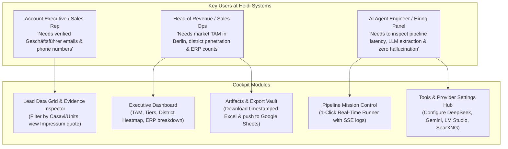

# 01 — Web PRD & Requirements Engineering: Heidi Cockpit

**Project Name:** Heidi Cockpit — Autonomous LeadOps & Metering Intelligence Suite  
**Target Organization:** Heidi Systems GmbH (Berlin, Germany)  
**Parent Pipeline:** `heidi-engine` (Python 3.12, SQLite WAL, Multi-LLM, Async Crawler)  
**Document Order:** `01 of 06` in `docs/Web Plan/`  
**Location:** `C:\Users\Ravin\Projects\Projetcs Alpha\Heidi Systems\docs\Web Plan\01_WEB_PRD_AND_REQUIREMENTS_ENGINEERING.md`

---

## 1. Executive Summary & Product Vision

### 1.1 The Problem
While the backend CLI (`heidi.bat`) successfully discovered, deduplicated, enriched, and scored **1,199 Berlin property management companies (*Hausverwaltungen*)**, terminal commands are unsuited for non-technical sales leaders, GTM operators, and executive hiring panels at Heidi Systems. 

A production B2B intelligence system demands an **interactive, intuitive Web Cockpit** that allows stakeholders to:
1. Visually monitor lead health, tier distribution, district penetration, and PropTech ERP adoption.
2. Trigger and monitor real-time scraping, crawling, and AI enrichment with live status feedback (no terminal windows).
3. Search, filter, and inspect verified company records, verbatim evidence quotes, and decision-maker contact details.
4. Manage API keys, local models (`llama.cpp`, `LM Studio`), search providers, and pipeline parameters via a dedicated UI.
5. Instantly preview and download timestamped audit artifacts (Excel `.xlsx`, CSV, Evaluation Reports) and push to Google Sheets.

### 1.2 Core Product Philosophy: Enterprise Software, NOT an AI Chatbot
> [!IMPORTANT]
> **Heidi Cockpit is a high-performance B2B Operations Software Application, NOT a generic conversational chatbot.**
> - **NO Chat Bubbles:** Operators do not "chat" with their CRM. They manipulate filters, trigger idempotent workflows, drill down into evidence, and export datasets.
> - **Deterministic Controls with AI Enrichment:** AI models (DeepSeek, Gemini, NIM, local models) work behind the scenes to parse complex German *Impressum* structures and synthesize qualification reasoning. The user interface exposes actionable toggles, data grids, metrics, and audit logs.
> - **Complete Grounding & Evidence Traceability:** Every decision-maker name, personal email, and portfolio metric displayed in the UI is tied to an auditable source URL, HTTP status code, and verbatim text quote.

---

## 2. Brand Identity & Design System

### 2.1 Brand Concept: "Heidi Cockpit"
- **Identity:** Smart Metering Intelligence & Autonomous GTM Command Center.
- **Tone:** Professional, Scandinavian/German minimalism, high information density, precise typography, zero fluff.

### 2.2 Color Palette (Designed for Extended Operations)
- **Primary / Corporate Navy:** `#0F172A` (Slate 900) & `#1E293B` (Slate 800)
- **Accent / Metering Cyan:** `#0EA5E9` (Sky 500) & `#0284C7` (Sky 600)
- **Status / Priority Tiers:**
  - 🟢 **Tier A (High Priority):** `#10B981` (Emerald 500) / `#ECFDF5` (Emerald 50)
  - 🟡 **Tier B (Mid-Market):** `#F59E0B` (Amber 500) / `#FFFBEB` (Amber 50)
  - ⚪ **Tier C (Long-Tail):** `#64748B` (Slate 500) / `#F8FAFC` (Slate 50)
  - 🔴 **Disqualified / Inactive:** `#EF4444` (Rose 500) / `#FEF2F2` (Rose 50)
- **Surface / Background:** `#F8FAFC` (Light Slate Surface) with crisp `#FFFFFF` cards, thin borders `#E2E8F0`, and dark mode capability.

---

## 3. User Personas & Use Cases

---

## 4. Functional Requirements (FR)

### FR-W1: Executive Overview & Business Metrics
- **FR-W1.1:** The dashboard MUST display high-level KPI cards:
  - Total Market Size (Discovered Berlin *Hausverwaltungen*)
  - Tier A Leads (High Priority, Score $\ge 70$)
  - Verified Decision-Maker Coverage (%)
  - Direct Personal Email Coverage (%)
  - PropTech / Modern ERP Penetration (%)
- **FR-W1.2:** The dashboard MUST provide interactive charts:
  - **Lead Score Distribution** (Histogram $0–100$)
  - **Berlin District Breakdown** (Horizontal bar chart across 12 *Bezirke*)
  - **Detected ERP Stack Share** (Casavi, Domus, Immoware24, Haufe PowerHaus, etg24, Wodis)
  - **Service Focus Matrix** (WEG vs. Mietverwaltung vs. Gewerbe)

### FR-W2: Live Pipeline Mission Control (Real-Time Execution)
- **FR-W2.1:** Operators MUST be able to trigger pipeline stages individually or end-to-end directly from the UI:
  - `[Run Ingest]` (Scrapes Gelbe Seiten, 11880, VDIV, OSM, SearXNG)
  - `[Run Deduplicate]` (Normalizes and clusters listings via Union-Find)
  - `[Run Crawl]` (Crawls homepages + `/impressum`, `/team`, `/leistungen`)
  - `[Run Extract]` (Runs multi-LLM or deterministic parser)
  - `[Run Enrich & Score]` (Verifies DNS MX, resolves personal emails, scores 0–100)
  - `[Run Full Pipeline]` (Sequential end-to-end execution)
- **FR-W2.2:** The UI MUST stream real-time execution events, stage progress bars, and log entries using **Server-Sent Events (SSE)** without freezing or requiring page refreshes.
- **FR-W2.3:** Operators MUST be able to abort or cancel a running pipeline execution gracefully.

### FR-W3: Master Lead Explorer & Data Grid
- **FR-W3.1:** Display all 1,199+ qualified companies in a high-performance, virtualized data grid with:
  - Column sorting (Score, Units, District, Name)
  - Multi-facet filtering (by Tier A/B/C, Berlin Bezirk, VDIV membership, ERP stack, presence of personal email)
  - Instant text search across Company Name, Managing Director Name, and Street Address
- **FR-W3.2:** Quick actions per row:
  - `[Inspect]` opens the sliding Evidence Drawer
  - `[Copy Email]` copies the verified personal email
  - `[Open Website]` opens the company URL in a new tab

### FR-W4: Lead Detail & Evidence Inspector (Drawer / Modal)
- **FR-W4.1:** Clicking any company MUST open a comprehensive inspection pane displaying:
  - **Scorecard Breakdown:** Pillar-by-pillar point breakdown ($S_{\text{scale}}$, $S_{\text{focus}}$, $S_{\text{digital}}$, $S_{\text{trust}}$, $S_{\text{contact}}$).
  - **Decision-Maker Dossier:** Names, roles, personal email, email verification status (`PUBLIC_DIRECT_VERIFIED` vs. `PATTERN_MX_VERIFIED`), DNS MX mail server host, LinkedIn URL.
  - **Ground-Truth Evidence:** Verbatim *Impressum* quote, verbatim unit count quote, exact URLs crawled, and HTTP status codes.
  - **Technical Footprint:** Detected PropTech ERPs, customer portal URLs, and incumbent metering signals (Techem, Ista, etc.).

### FR-W5: Agentic Tools & Scraper Catalog
- **FR-W5.1:** A dedicated catalog view detailing every tool in the system:
  - Directory Scrapers (Gelbe Seiten, 11880.com, VDIV, OSM Overpass)
  - Web & Search Routers (Local SearXNG, Native Meta-Search, Tavily API)
  - Legal & NLP Parsers (§ 5 DDG Impressum regex engine, Pydantic LLM extractor)
  - Network Verifiers (DNS MX resolver, Cloudflare email decoder)
- **FR-W5.2:** Each tool card MUST display status indicators (Active, Available, Idle), version/endpoint, latency, and a `[Test Tool]` trigger that executes a live health check.

### FR-W6: Artifacts & Export Vault
- **FR-W6.1:** Operators MUST be able to download the current production datasets on demand:
  - `[Download Excel (.xlsx)]` (Formatted 4-tab workbook with corporate styling)
  - `[Download Master CSV]` (Raw RFC-compliant CSV)
  - `[Download Evaluation Report (.md)]` (Ablation study & precision/recall report)
- **FR-W6.2:** Display a **Google Sheets 1-Click Link** with timestamp and direct instructions for sharing with Heidi Systems' hiring team.

### FR-W7: Settings & Provider Configuration Hub
- **FR-W7.1:** Manage active LLM providers via interactive cards:
  - Provider selector (`auto_fallback`, `deepseek`, `gemini`, `nvidia_nim`, `local_llamacpp`, `lm_studio`, `deterministic`)
  - API Key inputs (with show/hide and local persistence)
  - Base URL and Model Name overrides
  - Connection health test button with live ping latency display
- **FR-W7.2:** Manage Search Harness settings:
  - Local SearXNG Base URL
  - Native Meta-Search toggle
  - Tavily API Key and monthly request limits
- **FR-W7.3:** Concurrency and rate limit sliders (Crawl concurrency, HTTP timeout).

---

## 5. Non-Functional Requirements (NFR)

| Category | Requirement | Target Metric |
| :--- | :--- | :--- |
| **NFR-W1: Performance** | Initial page load and navigation | First Contentful Paint (FCP) $< 1.2\text{s}$, Time to Interactive $< 1.8\text{s}$ |
| **NFR-W2: Grid Responsiveness** | Scrolling & filtering 1,200+ leads | 60 FPS smooth rendering via virtualized DOM (TanStack Table / Virtual) |
| **NFR-W3: Real-Time Latency** | SSE pipeline event propagation | $< 100\text{ms}$ delay from Python event emission to UI update |
| **NFR-W4: State Persistence** | User settings, provider keys, active filters | Persisted automatically to `localStorage` & `.env` bridge |
| **NFR-W5: Reliability & Resumability** | Network disconnection during long pipeline run | Pipeline execution runs independently in backend; UI reconnects seamlessly to current state |
| **NFR-W6: Security & Privacy** | Handling of API keys and B2B emails | Keys stored locally; personal contact details strictly tied to public § 5 DDG Impressum sources |

