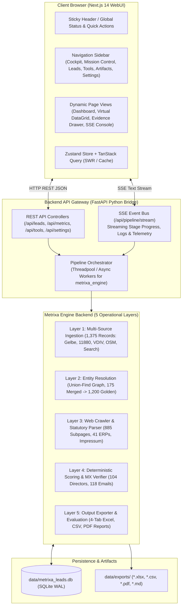
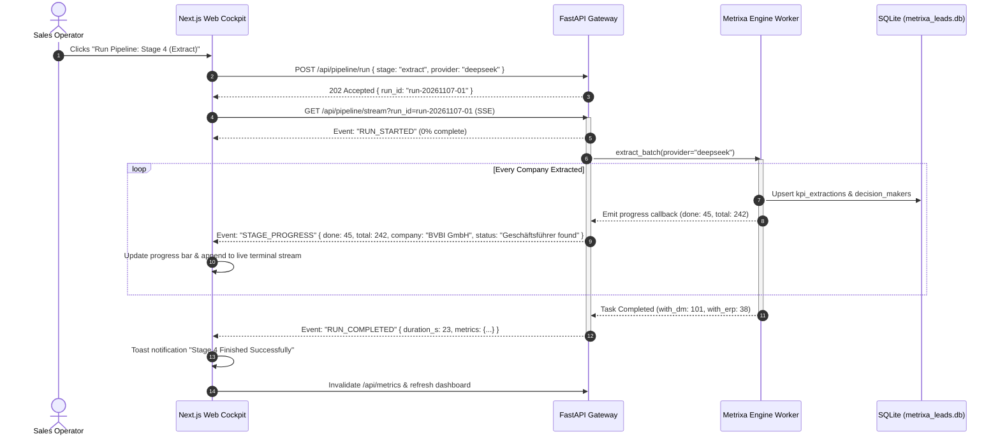

# 02: System Architecture & Full-Stack Tech Stack: Metrixa Cockpit

**Project Name:** Metrixa Cockpit: Automated B2B Lead Intelligence & Metering Suite
**Document Order:** `02 of 06` in `docs/Web Plan/`
**Location:** `C:\Users\Ravin\Projects\Projetcs Alpha\Metrixa Systems\docs\Web Plan\02_SYSTEM_ARCHITECTURE_AND_TECH_STACK.md`

---

## 1. High-Level Full-Stack System Architecture

Metrixa Cockpit utilizes a **Decoupled Modern Full-Stack Architecture**:
- **Frontend Layer:** **Next.js 14+ (App Router)** with **TypeScript**, **Tailwind CSS**, and **shadcn/ui** components. Designed for maximum responsiveness, visual elegance, and accessibility.
- **Backend API Gateway & Process Bridge:** High-performance **FastAPI (Python 3.12)** service that exposes REST endpoints and a **Server-Sent Events (SSE)** event bus. This bridge directly imports and orchestrates the existing `metrixa_engine` modules without subprocess overhead.
- **Data Persistence:** Shared **SQLite 3 (WAL Mode)** database (`data/metrixa_leads.db`), ensuring atomic concurrent reads and writes between the web API and pipeline workers.



---

## 2. Technology Stack Selection & Justification (What & Why)

### 2.1 Frontend Stack

| Technology | Role | Justification |
| :--- | :--- | :--- |
| **Next.js 14+ (App Router)** | Web Framework & SSR/SSG Shell | Industry standard for production web apps. App router offers nested layouts, fast server components, and native API routing if needed. |
| **TypeScript (Strict Mode)** | Programming Language | Complete type safety across all B2B lead models, KPI schemas, API payloads, and pipeline event contracts. Eliminates runtime `undefined` errors. |
| **Tailwind CSS (v3/v4)** | Utility-First Styling | Rapid UI styling with zero CSS bloat. Guarantees consistency in spacing, responsive breakpoints, and dark mode theming. |
| **shadcn/ui (Radix UI Primitives)** | Accessible Component Library | Unstyled, copy-paste accessible components (Buttons, Drawers, Dialogs, Dropdowns, Tabs, Badges, Tooltips). Zero vendor lock-in; full control over styling. |
| **TanStack Table (v8)** | Headless Data Grid | Handles 1,200+ leads with virtualized rendering, multi-column sorting, facet filtering, and column visibility toggles at 60 FPS. |
| **Recharts** | Data Visualization | Composable SVG chart library for React. Renders responsive lead score histograms, district bar charts, and ERP donut charts. |
| **Lucide React** | Iconography System | Consistent, crisp, enterprise-grade vector icons across navigation, status badges, and action toolbars. |
| **Zustand** | Global State Management | Lightweight (1 KB) client state for active filters, table pagination, drawer inspection state, and SSE pipeline logs. |

### 2.2 Backend API & Process Bridge Stack

| Technology | Role | Justification |
| :--- | :--- | :--- |
| **FastAPI (ASGI)** | High-Throughput Web Framework | Native async support, automatic OpenAPI/Swagger documentation (`/docs`), and minimal overhead compared to Flask or Django. |
| **Uvicorn** | ASGI Web Server | Lightweight, ultra-fast Python web server powering the FastAPI gateway on `http://127.0.0.1:8000`. |
| **SSE-Starlette** | Server-Sent Events Protocol | Simple, unidirectional, firewall-friendly event streaming from Python async tasks to the React client without complex WebSocket handshakes. |
| **SQLite (WAL Mode)** | Shared Storage Engine | Zero setup, single-file ACID persistence. Write-Ahead Logging allows concurrent reads from the web API while scrapers write in the background. |

---

## 3. Web Application Directory Structure

The web application is structured cleanly inside `web/` alongside the existing `src/metrixa_engine/`:

```text
Metrixa Systems/
├── src/
│   └── metrixa_engine/                          # Existing Python Core Engine
│       ├── scrapers/                          # Stage 1 Scrapers
│       ├── entity_resolution/                 # Stage 2 Deduplicator
│       ├── crawler/                           # Stage 3 Async Crawler & Tech Detector
│       ├── llm/                               # Stage 4 Multi-LLM Router
│       ├── enrichment/                        # Stage 5 MX Verifier & Scorer
│       ├── telemetry/                         # Stage 6 Exporters & Evaluator
│       ├── api/                               # FastAPI Web Server Bridge (NEW)
│       │   ├── __init__.py
│       │   ├── server.py                      # FastAPI app entrypoint
│       │   ├── routes_leads.py                # Lead search, filter & detail endpoints
│       │   ├── routes_pipeline.py             # SSE pipeline trigger & stream endpoints
│       │   ├── routes_tools.py                # Tool catalog health & ping endpoints
│       │   └── routes_settings.py             # Provider & environment configuration
│       └── ...
│
├── web/                                       # Modern TypeScript Next.js Cockpit (NEW)
│   ├── package.json
│   ├── tsconfig.json
│   ├── tailwind.config.ts
│   ├── postcss.config.js
│   ├── next.config.mjs
│   │
│   ├── public/                                # Static Brand Assets (Logos, SVGs, Favicons)
│   │   ├── metrixa-logo.svg
│   │   └── favicon.ico
│   │
│   ├── src/
│   │   ├── app/                               # Next.js App Router Pages
│   │   │   ├── layout.tsx                     # Global Root Layout (Sidebar + Topbar)
│   │   │   ├── page.tsx                       # Page 1: Executive Dashboard (KPIs, Charts)
│   │   │   ├── mission-control/               # Page 2: Pipeline Mission Control (Live Runner)
│   │   │   │   └── page.tsx
│   │   │   ├── leads/                         # Page 3: Master Lead Explorer & Data Grid
│   │   │   │   └── page.tsx
│   │   │   ├── tools/                         # Page 4: Agentic Tools Catalog
│   │   │   │   └── page.tsx
│   │   │   ├── artifacts/                     # Page 5: Deliverables & Export Vault
│   │   │   │   └── page.tsx
│   │   │   └── settings/                      # Page 6: Provider & LLM Hub
│   │   │       └── page.tsx
│   │   │
│   │   ├── components/                        # UI Components
│   │   │   ├── ui/                            # shadcn/ui base primitives (Button, Dialog, etc.)
│   │   │   ├── layout/                        # Sidebar, Topbar, StatusBadge
│   │   │   ├── dashboard/                     # StatCard, ScoreDistributionChart, DistrictMap
│   │   │   ├── leads/                         # LeadTable, LeadFilters, EvidenceDrawer
│   │   │   ├── mission-control/               # StageRunnerCard, SSERunnerConsole, DAGVisualizer
│   │   │   ├── tools/                         # ToolCard, ToolHealthPingButton
│   │   │   └── settings/                      # LLMProviderCard, SearchConfigCard
│   │   │
│   │   ├── lib/                               # Client Utilities & API Clients
│   │   │   ├── api.ts                         # Fetch wrappers for FastAPI endpoints
│   │   │   ├── sse.ts                         # SSE connection manager
│   │   │   ├── types.ts                       # Shared TypeScript interfaces
│   │   │   └── utils.ts                       # Classnames (cn) & formatting helpers
│   │   │
│   │   └── stores/                            # Zustand Global Stores
│   │       ├── useLeadStore.ts                # Active filters, selected lead
│   │       └── usePipelineStore.ts            # Live run state, streamed logs
│   │
│   └── tests/                                 # Frontend Unit & Integration Tests (Vitest)
│       ├── components/
│       └── e2e/                               # Playwright E2E Tests
│
└── docs/
    └── Web Plan/                              # WebUI Documentation Suite (01 to 06)
```

---

## 4. Communication & Real-Time Event Architecture


