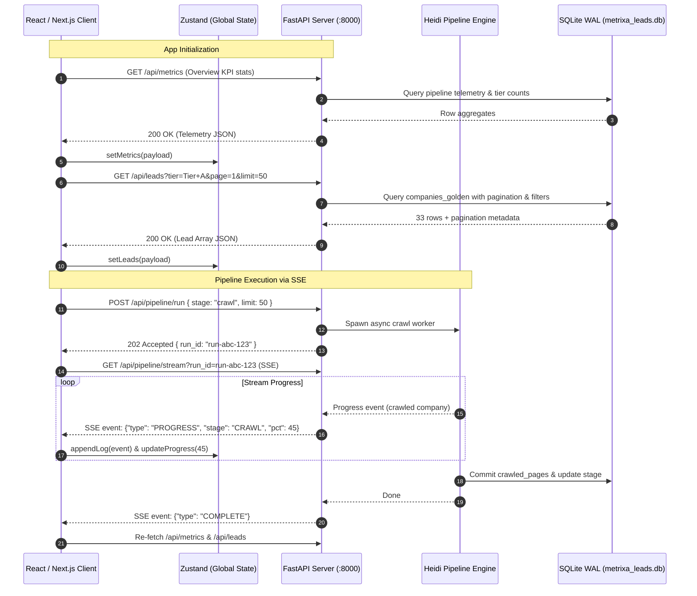

# 04 — Data Flow, API Contracts & State Management: Metrixa Cockpit

**Project Name:** Metrixa Cockpit — Autonomous LeadOps & Metering Intelligence Suite
**Document Order:** `04 of 06` in `docs/Web Plan/`
**Location:** `C:\Users\Ravin\Projects\Projetcs Alpha\Metrixa Systems\docs\Web Plan\04_DATA_FLOW_API_CONTRACTS_AND_STATE_MANAGEMENT.md`

---

## 1. End-to-End Data Flow



---

## 2. REST API Endpoint Specifications (FastAPI Bridge)

All endpoints are hosted at `http://127.0.0.1:8000` with CORS enabled for `http://localhost:3000`.

### 2.1 Metrics & Telemetry
- **`GET /api/metrics`**
  - **Description:** Returns aggregate KPI numbers, tier counts, ERP adoption statistics, and district breakdown.
  - **Response Schema:**
    ```json
    {
      "total_raw": 1371,
      "total_qualified": 1199,
      "tiers": {
        "Tier A (High Priority)": 33,
        "Tier B (Qualified Mid-Market)": 409,
        "Tier C (Long-Tail / Small)": 757
      },
      "coverage": {
        "with_website": 242,
        "with_portal_or_erp": 38,
        "with_decision_maker": 101,
        "with_personal_email": 99,
        "crawled_pages": 866
      },
      "erp_breakdown": {
        "Casavi": 14,
        "Domus": 11,
        "Immoware24": 8,
        "Haufe PowerHaus": 5,
        "etg24": 3
      },
      "district_breakdown": [
        { "district": "Charlottenburg-Wilmersdorf", "count": 218 },
        { "district": "Mitte", "count": 184 },
        { "district": "Pankow", "count": 142 }
      ]
    }
    ```

### 2.2 Leads & Exploration
- **`GET /api/leads`**
  - **Query Parameters:**
    - `q`: string (Search query)
    - `tier`: string (`Tier A (High Priority)`, `Tier B`, `Tier C`)
    - `district`: string (Berlin Bezirk)
    - `has_dm`: boolean
    - `has_email`: boolean
    - `has_erp`: boolean
    - `is_vdiv`: boolean
    - `page`: integer (default: 1)
    - `limit`: integer (default: 50, max: 200)
    - `sort_by`: string (`heidi_lead_score`, `exact_units_managed`, `display_name`)
    - `sort_dir`: string (`asc`, `desc`)
  - **Response:**
    ```json
    {
      "items": [
        {
          "company_id": 1,
          "lead_id": "HEIDI-BER-0001",
          "display_name": "BVBI Berliner Vereinigung für Immobilienmanagement GmbH",
          "legal_form": "GmbH",
          "district": "Charlottenburg-Wilmersdorf",
          "postal_code": "10719",
          "street_address": "Uhlandstraße 165",
          "website_url": "https://www.bvbi.de",
          "heidi_lead_score": 88,
          "lead_tier": "Tier A (High Priority)",
          "exact_units_managed": 4500,
          "estimated_units_tier": "1,000-5,000",
          "manages_weg": true,
          "manages_miet": true,
          "manages_gewerbe": true,
          "has_customer_portal": true,
          "detected_erp_proptech": "Casavi, Domus 4000",
          "is_vdiv_member": true,
          "decision_maker_name": "Max Mustermann",
          "decision_maker_role": "Geschäftsführer",
          "personal_email": "m.mustermann@bvbi.de",
          "email_status": "PUBLIC_DIRECT_VERIFIED",
          "linkedin_url": "https://de.linkedin.com/in/max-mustermann",
          "general_email": "info@bvbi.de",
          "phone_e164": "+49308842100",
          "sources_csv": "vdiv, gelbe_seiten, 11880"
        }
      ],
      "total": 33,
      "page": 1,
      "pages": 1
    }
    ```

- **`GET /api/leads/{id}/evidence`**
  - **Description:** Returns the complete dossier, score radar breakdown, all extracted decision-makers, and crawled pages with verbatim quotes.
  - **Response:**
    ```json
    {
      "company_id": 1,
      "scorecard": {
        "scale_pts": 28,
        "focus_pts": 25,
        "digital_pts": 20,
        "trust_pts": 10,
        "contact_pts": 10,
        "total_score": 88
      },
      "decision_makers": [
        {
          "full_name": "Max Mustermann",
          "role": "Geschäftsführer",
          "personal_email": "m.mustermann@bvbi.de",
          "email_status": "PUBLIC_DIRECT_VERIFIED",
          "mx_valid": true,
          "mx_host": "mail.bvbi.de",
          "evidence_quote": "Vertretungsberechtigter Geschäftsführer: Max Mustermann"
        }
      ],
      "crawled_pages": [
        {
          "page_type": "impressum",
          "url": "https://www.bvbi.de/impressum",
          "http_status": 200,
          "clean_markdown": "IMPRESSUM...",
          "detected_erp": "Casavi"
        }
      ],
      "units_evidence_quote": "Wir verwalten über 4.500 Wohneinheiten in Berlin.",
      "qualification_reasoning": "Qualified Berlin Hausverwaltung (GmbH): Manages 4,500 explicit units, active in both WEG & Mietverwaltung, uses Casavi portal."
    }
    ```

### 2.3 Pipeline Control & SSE Stream
- **`POST /api/pipeline/run`**
  - **Request Body:**
    ```json
    {
      "stage": "full" | "ingest" | "deduplicate" | "crawl" | "extract" | "enrich" | "export",
      "provider": "auto_fallback" | "deepseek" | "gemini" | "local_llamacpp" | "deterministic",
      "limit": 50,
      "reprocess_all": false
    }
    ```
  - **Response:** `202 Accepted` `{ "run_id": "run-20261107-123456", "status": "started" }`

- **`GET /api/pipeline/stream?run_id={run_id}` (Server-Sent Events)**
  - **Event Types:**
    - `EVENT_LOG`: `{ "timestamp": "17:45:01", "level": "INFO", "message": "Crawling https://www.bvbi.de" }`
    - `EVENT_PROGRESS`: `{ "stage": "CRAWL", "completed": 45, "total": 242, "pct": 18.5 }`
    - `EVENT_COMPLETE`: `{ "run_id": "run-20261107-123456", "duration_seconds": 32, "summary": {...} }`
    - `EVENT_ERROR`: `{ "error": "Connection timeout", "code": 500 }`

- **`POST /api/pipeline/abort`**
  - Cancels current running task.

### 2.4 Artifacts & Exports
- **`GET /api/artifacts/download/excel`** — Streams `metrixa_berlin_hausverwaltungen.xlsx`.
- **`GET /api/artifacts/download/csv`** — Streams `metrixa_berlin_leads_master.csv`.
- **`GET /api/artifacts/evaluation-report`** — Returns Markdown text of `evaluation_ablation_report.md`.

### 2.5 Settings & Provider Hub
- **`GET /api/settings`** — Returns current runtime configuration (safe fields, masked API keys).
- **`POST /api/settings`** — Updates `.env` and runtime configuration.
- **`POST /api/settings/test-provider`** — Tests connection to LLM or Search endpoint with live ping latency.

---

## 3. TypeScript Type Definitions (`web/src/lib/types.ts`)

```typescript
export type LeadTier =
  | 'Tier A (High Priority)'
  | 'Tier B (Qualified Mid-Market)'
  | 'Tier C (Long-Tail / Small)'
  | 'Disqualified';

export type EmailStatus =
  | 'PUBLIC_DIRECT_VERIFIED'
  | 'PATTERN_MX_VERIFIED'
  | 'GENERIC_ONLY'
  | 'NONE';

export interface LeadItem {
  company_id: number;
  lead_id: string;
  display_name: string;
  legal_form: string | null;
  district: string;
  postal_code: string | null;
  street_address: string | null;
  website_url: string | null;
  heidi_lead_score: number;
  lead_tier: LeadTier;
  exact_units_managed: number | null;
  estimated_units_tier: string;
  manages_weg: boolean;
  manages_miet: boolean;
  manages_gewerbe: boolean;
  has_customer_portal: boolean;
  detected_erp_proptech: string | null;
  is_vdiv_member: boolean;
  decision_maker_name: string | null;
  decision_maker_role: string | null;
  personal_email: string | null;
  email_status: EmailStatus;
  linkedin_url: string | null;
  general_email: string | null;
  phone_e164: string | null;
  sources_csv: string;
}

export interface DecisionMaker {
  full_name: string;
  role: string;
  personal_email: string | null;
  email_status: EmailStatus;
  mx_valid: boolean;
  mx_host: string | null;
  direct_phone: string | null;
  linkedin_url: string | null;
  evidence_quote: string;
}

export interface CrawledPage {
  page_type: string;
  url: string;
  http_status: number;
  clean_markdown: string;
  detected_erp: string | null;
}

export interface LeadEvidenceDossier {
  company_id: number;
  scorecard: {
    scale_pts: number;
    focus_pts: number;
    digital_pts: number;
    trust_pts: number;
    contact_pts: number;
    total_score: number;
  };
  decision_makers: DecisionMaker[];
  crawled_pages: CrawledPage[];
  units_evidence_quote: string | null;
  qualification_reasoning: string;
}

export interface PipelineEvent {
  type: 'LOG' | 'PROGRESS' | 'COMPLETE' | 'ERROR';
  stage?: string;
  level?: 'INFO' | 'WARN' | 'ERROR' | 'SUCCESS';
  message?: string;
  completed?: number;
  total?: number;
  pct?: number;
  timestamp: string;
}
```
