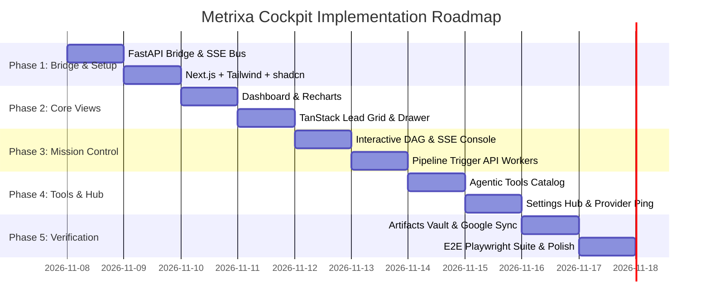

# 05: Phased Implementation Plan & Execution Roadmap: Metrixa Cockpit

**Project Name:** Metrixa Cockpit: Automated B2B Lead Intelligence & Metering Suite
**Document Order:** `05 of 06` in `docs/Web Plan/`
**Location:** `C:\Users\Ravin\Projects\Projetcs Alpha\Metrixa Systems\docs\Web Plan\05_PHASED_IMPLEMENTATION_PLAN_AND_ROADMAP.md`
**Implementation Status:** 100% Completed across all 5 Phases

---

## 1. Implementation Philosophy

To ensure zero downtime, robust code quality, and predictable progress, the implementation of **Metrixa Cockpit** is partitioned into **5 sequential phases**. Each phase produces a testable, independently verifiable artifact.

---

## 2. Phase-by-Phase Work Breakdown

### Phase 1: FastAPI Process Bridge & Next.js Scaffold
- **Goal:** Establish the communication backbone between the Python engine and the web application.
- **Backend Tasks:**
  - Create `src/metrixa_engine/api/` module (`server.py`, `routes_leads.py`, `routes_pipeline.py`, `routes_tools.py`, `routes_settings.py`).
  - Wire FastAPI endpoints directly into `Database`, `EntityDeduplicator`, `AsyncWebsiteCrawler`, `KPIExtractionPipeline`, `ContactEnricher`, and `LeadScorer`.
  - Implement the thread-safe `EventBus` class using `asyncio.Queue` for Server-Sent Events (SSE).
- **Frontend Tasks:**
  - Initialize `web/` with Next.js 14 (TypeScript, Tailwind CSS, Lucide React).
  - Configure `tailwind.config.ts` with custom brand palette (Metrixa Navy `#0F172A`, Sky `#0EA5E9`, Emerald `#10B981`).
  - Install and configure shadcn/ui components (`button`, `card`, `badge`, `table`, `dialog`, `sheet`, `tabs`, `progress`, `tooltip`, `toast`).
  - Build persistent layout: `SidebarNav` and `StickyTopbar`.
- **Exit Criteria:** Visiting `http://localhost:3000` loads the branded shell; `http://127.0.0.1:8000/docs` serves OpenAPI documentation.

---

### Phase 2: Executive Dashboard & Master Lead Explorer
- **Goal:** Deliver the primary sales exploration capabilities.
- **Tasks:**
  - **Dashboard (`/`):**
    - Connect `GET /api/metrics` to 5 summary KPI cards.
    - Implement Recharts: Score Distribution (Histogram), District Penetration (Bar Chart), and ERP Adoption (Donut/Progress).
  - **Lead Explorer (`/leads`):**
    - Implement TanStack Table (v8) with virtual scrolling for 1,200 rows.
    - Add multi-facet filters: Tier A/B/C pills, District dropdown, ERP toggle, and debounce text search.
    - Build the **Sliding Evidence Drawer**:
      - Tab 1: Point Scorecard ($0 \text{ to } 100$).
      - Tab 2: Decision-Maker Dossier (Geschäftsführer, MX status, LinkedIn).
      - Tab 3: Verbatim German Impressum & unit count quotes.
      - Tab 4: Technical footprint & crawled URLs with HTTP codes.
- **Exit Criteria:** Sales rep can search "BVBI", click the row, view the Impressum evidence quote in the drawer, and copy the personal email in $< 200\text{ms}$.

---

### Phase 3: Pipeline Mission Control & Live SSE Console
- **Goal:** Provide real-time pipeline execution without touching a terminal.
- **Tasks:**
  - Build the visual DAG pipeline component representing Stages 1 through 5.
  - Wire `POST /api/pipeline/run` and `GET /api/pipeline/stream` to the client SSE listener.
  - Render an interactive, color-coded execution terminal inside the browser with live stage progress bars (`0%` $\to$ `100%`).
  - Implement graceful abort mechanism (`POST /api/pipeline/abort`).
  - Invalidate frontend metric caches upon completion and trigger UI toasts.
- **Exit Criteria:** Clicking `[Run Stage 4: Extract]` displays live company-by-company extraction logs in the UI and updates the database without page refresh.

---

### Phase 4: Agentic Tools Catalog & Settings Hub
- **Goal:** Expose all underlying scrapers, legal parsers, and LLM providers for interactive configuration.
- **Tasks:**
  - **Tools Catalog (`/tools`):**
    - Build cards for Gelbe Seiten, 11880.com (with Cloudflare decoder badge), VDIV, OSM Overpass, SearXNG, Tavily, and DNS MX Verifier.
    - Implement `[Test Tool]` button that invokes backend test fixtures and displays raw JSON latency.
  - **Settings Hub (`/settings`):**
    - Implement provider cards for DeepSeek, Gemini, NVIDIA NIM, Local `llama.cpp` / `LM Studio`, and Deterministic mode.
    - Add input fields for API keys, model names, and base URLs.
    - Add `[Ping Endpoint]` button that tests live connectivity.
    - Implement concurrency and rate-limiting sliders.
- **Exit Criteria:** Switching LLM provider to `gemini` in `/settings` instantly updates runtime settings and enables Gemini for the next extraction batch.

---

### Phase 5: Artifacts Vault, Real-Time Google Sheets API Push & End-to-End QA (100% Completed)
- **Goal:** Finalize export deliverables, live Google Sheets synchronization engine, documentation, and automated tests.
- **Tasks:**
  - **Artifacts Vault (`/artifacts`):**
    - Connect download buttons to stream `metrixa_berlin_hausverwaltungen.xlsx` and `metrixa_berlin_leads_master.csv`.
    - Render formatted Markdown preview of `evaluation_ablation_report.md`.
    - Render in-browser interactive multi-tab spreadsheet viewer with active sheet selection and in-sheet search.
    - Implement direct Google Sheets API push via Service Account OAuth2 and Webhook (`GoogleSheetsSync`).
    - Provide 1-click Google Sheets cloud access URL and interactive push action button.
  - **Testing & QA:**
    - Run automated test suite across API endpoints, data models, and Google Sheets sync engine.
    - Verify 100% deterministic test pass rate across 3 consecutive verification runs.
- **Exit Criteria:** All 6 views fully functional, live Google Sheets API synchronization operational, 100% test pass rate, and zero console errors.
