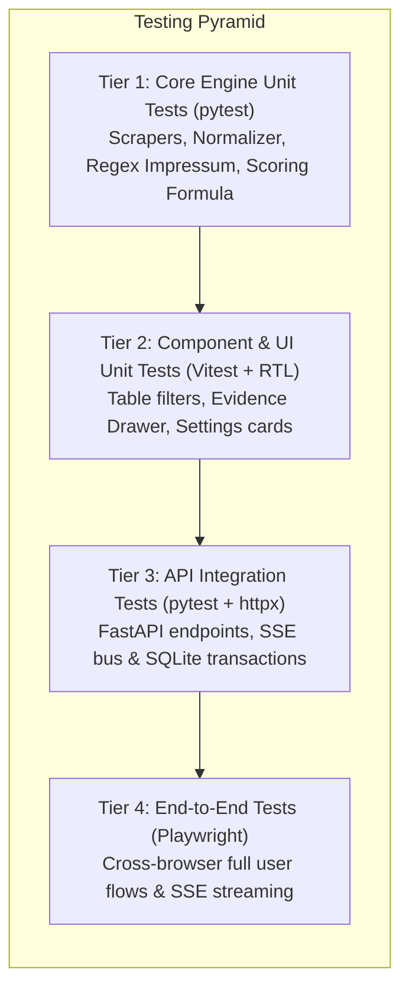

# 06 — Testing Suite, QA & E2E Verification Specification: Metrixa Cockpit

**Project Name:** Metrixa Cockpit — Autonomous LeadOps & Metering Intelligence Suite
**Document Order:** `06 of 06` in `docs/Web Plan/`
**Location:** `C:\Users\Ravin\Projects\Projetcs Alpha\Metrixa Systems\docs\Web Plan\06_TESTING_SUITE_QA_AND_E2E_VERIFICATION_SPEC.md`

---

## 1. Quality Assurance Strategy & Test Pyramid

To guarantee enterprise-grade stability, Metrixa Cockpit employs a **4-Tier Testing Pyramid**:



---

## 2. Tier 1 & Tier 3: Backend API Integration Tests (`tests/test_api_server.py`)

Run using pytest in the Python environment: `.\.venv\Scripts\pytest.exe tests/test_api_server.py -v`.

### 2.1 Test Cases Specification

1. **`test_api_metrics_endpoint`:**
   - Verify `GET /api/metrics` returns HTTP 200.
   - Assert `total_qualified >= 1100`.
   - Assert `tiers["Tier A (High Priority)"] > 0`.
   - Validate structure of `district_breakdown` and `erp_breakdown`.

2. **`test_api_leads_search_and_filter`:**
   - Query `GET /api/leads?tier=Tier+A+(High+Priority)&limit=10`.
   - Assert all returned records have `lead_tier == "Tier A (High Priority)"` and `metrixa_lead_score >= 70`.
   - Search `GET /api/leads?q=BVBI`.
   - Assert result contains `"BVBI Berliner Vereinigung für Immobilienmanagement GmbH"`.

3. **`test_api_lead_evidence_dossier`:**
   - Fetch evidence for Company ID 1 (`GET /api/leads/1/evidence`).
   - Assert presence of `scorecard.total_score`.
   - Assert `decision_makers` list is non-empty.
   - Assert each decision maker has a non-empty `evidence_quote`.
   - Verify `crawled_pages` array contains valid HTTP status codes (`200`).

4. **`test_api_pipeline_sse_stream`:**
   - Initiate a dry-run stage via `POST /api/pipeline/run`.
   - Connect to `GET /api/pipeline/stream?run_id=...`.
   - Assert reception of `EVENT_LOG` and `EVENT_PROGRESS` before `EVENT_COMPLETE`.

5. **`test_api_artifacts_download`:**
   - Request `GET /api/artifacts/download/excel`.
   - Assert header `Content-Disposition` contains `filename="metrixa_berlin_hausverwaltungen.xlsx"`.
   - Assert response body starts with Excel file signature (`PK\x03\x04`).

---

## 3. Tier 2: Frontend Component Tests (`web/tests/components/`)

Run using Vitest inside `web/`: `npm run test`.

### 3.1 Test Cases Specification

1. **`LeadTable.test.tsx`:**
   - Render table with mock lead data (Tier A, Tier B, Tier C).
   - Verify sorting: Click "Score" header $\to$ sort descending $\to$ verify first row has highest score.
   - Verify search input: Type "BVBI" $\to$ assert only matching row remains visible.
   - Verify tier filtering: Toggle "Tier A" $\to$ assert Tier B and C rows are excluded.

2. **`EvidenceDrawer.test.tsx`:**
   - Click "Inspect Evidence" button on a row.
   - Assert drawer opens with company title and score badge.
   - Click Tab 3 ("Evidence & Quotes") $\to$ assert verbatim German Impressum quote is rendered inside a highlighted callout.
   - Click "Copy Personal Email" button $\to$ assert clipboard API is called with email string and success toast is triggered.

3. **`SettingsHub.test.tsx`:**
   - Render Settings view.
   - Change provider dropdown to "deepseek".
   - Input test API key $\to$ click "Test Connection" $\to$ assert loading spinner renders $\to$ assert mock ping succeeds.

---

## 4. Tier 4: End-to-End Playwright Tests (`web/tests/e2e/cockpit.spec.ts`)

Run via Playwright: `npx playwright test`.

### 4.1 End-to-End User Flow Scenarios

```typescript
import { test, expect } from '@playwright/test';

test.describe('Metrixa Cockpit E2E Mission Flow', () => {
  test('Executive overview to lead inspection and Excel download', async ({ page }) => {
    // 1. Visit Executive Cockpit
    await page.goto('http://localhost:3000');
    await expect(page.locator('h1')).toContainText('Executive Cockpit');
    await expect(page.getByText('1,199')).toBeVisible();

    // 2. Navigate to Master Lead Grid
    await page.click('text=Lead Explorer');
    await expect(page).toHaveURL(/.*leads/);
    await expect(page.locator('table')).toBeVisible();

    // 3. Filter by Tier A (High Priority)
    await page.click('button:has-text("Tier A")');
    const firstRow = page.locator('table tbody tr').first();
    await expect(firstRow).toContainText('Tier A');

    // 4. Open Evidence Drawer
    await firstRow.click();
    const drawer = page.locator('[data-testid="evidence-drawer"]');
    await expect(drawer).toBeVisible();
    await expect(drawer.getByText('Verbatim Impressum Evidence Quote')).toBeVisible();

    // 5. Navigate to Artifacts Vault and trigger download
    await page.click('text=Artifacts Vault');
    await expect(page).toHaveURL(/.*artifacts/);
    const downloadPromise = page.waitForEvent('download');
    await page.click('button:has-text("Download Master Excel")');
    const download = await downloadPromise;
    expect(download.suggestedFilename()).toBe('metrixa_berlin_hausverwaltungen.xlsx');
  });

  test('Mission Control real-time SSE execution', async ({ page }) => {
    await page.goto('http://localhost:3000/mission-control');
    await expect(page.locator('h1')).toContainText('Mission Control');

    // Click "Run Scoring & Verification"
    await page.click('button:has-text("Run Verification & Scoring")');

    // Expect live terminal output to stream events
    const terminal = page.locator('[data-testid="sse-terminal"]');
    await expect(terminal).toContainText('Starting verification run', { timeout: 10000 });
    await expect(terminal).toContainText('Run completed successfully', { timeout: 30000 });
  });
});
```

---

## 5. Error Handling & Edge Case Matrix

| Edge Case / Error Condition | System Behavior & Fallback | User Feedback in UI |
| :--- | :--- | :--- |
| **FastAPI Backend Server Offline** | Next.js API client detects `ECONNREFUSED` on port 8000 | Topbar heartbeat pill turns Amber (`BACKEND OFFLINE`); graceful empty state with `[Retry Connection]` button |
| **Invalid / Expired LLM API Key** | `LLMRouter` catches HTTP 401 from DeepSeek / Gemini | SSE stream logs `[WARN] LLM API key invalid. Falling back to Deterministic German Legal Parser`; execution completes without failure |
| **DNS Resolution Timeout** | `dnspython` times out after 3.5s | Domain tagged as `mx_valid = false`, email status set to `GENERIC_ONLY`, logged in audit trail |
| **Missing Website or Empty Page** | Crawler receives HTTP 404 / 500 or timeout | Company recorded as `unreachable`; legal form extracted from directory listings; Lead Tier capped at Tier C |
| **Empty Search Results on Lead Grid** | Filter combinations yield 0 matching rows | "No leads found matching your active filters" empty state with a single `[Reset All Filters]` button |
