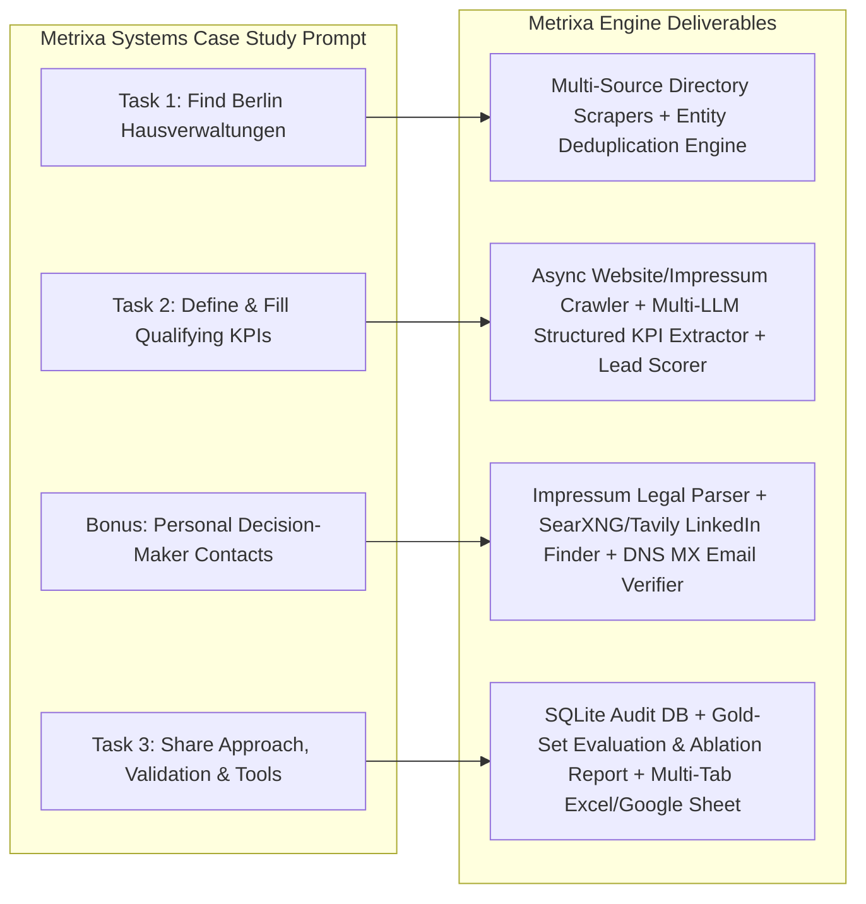

# 01: Product Requirements Document (PRD) & Requirements Engineering

**Project Name:** Metrixa Engine: Automated B2B Lead Discovery, Enrichment & Qualification System
**Target Case Study:** AI Agent Builder Application @ Metrixa Systems GmbH
**Target Market:** Property Management Companies (*Hausverwaltungen*) in Berlin, Germany
**Document Order:** `01 of 06` (Start Here)

---

## 1. Executive Summary & Business Context

### 1.1 Who is Metrixa Systems?
**Metrixa Systems** is a modern **metering service provider (*Messdienstleister*)** operating in the German property sector. In Germany, under the **Heating Costs Ordinance (*Heizkostenverordnung, HeizkV*)** and the **Energy Efficiency Directive (EED)**, multi-unit buildings must be equipped with remotely readable submetering hardware (heat cost allocators, hot/cold water meters, thermal energy meters) and provide transparent monthly consumption information plus annual heating/operating cost billing (*Heiz- und Betriebskostenabrechnung*).

### 1.2 Why Property Management Companies (*Hausverwaltungen*) Are the Core Buyer
Individual apartment owners or landlords rarely buy submetering infrastructure unit-by-unit. Instead, **property management companies (*Hausverwaltungen*)** act as the central B2B multiplier:
* A single *Hausverwaltung* manages anywhere from **200 to 50,000+ residential and commercial units (*Wohneinheiten / Gewerbeeinheiten*)** across dozens or hundreds of buildings.
* Winning **one** mid-sized *Hausverwaltung* in Berlin (managing e.g. 2,500 units) gives Metrixa Systems recurring multi-year hardware rental and billing contracts across their entire building portfolio.
* *Hausverwaltungen* suffer heavily from legacy metering incumbents (e.g., Techem, Ista, Brunata-Metrona, Kalorimeta) due to slow customer support, billing errors, and outdated portals. A modern, digital-first *Hausverwaltung* is prime for switching to Metrixa Systems.

### 1.3 Why We Are Building a Production-Grade Software System (Not a Toy Script)
The role is **AI Agent Builder**. A manual spreadsheet or fragile notebook fails to demonstrate production agentic engineering. Our objective is to build **Metrixa Engine**: an auditable, deterministic-plus-agentic Python pipeline backed by SQLite, multi-source scrapers, an async website/*Impressum* crawler, a multi-provider LLM extraction harness (`llama.cpp`, `LM Studio`, `NVIDIA NIM`, `DeepSeek`, `Gemini`), and a search enrichment layer (`Local SearXNG` + `Tavily API`).

---

## 2. Case Study Requirements Mapping

The case study prompt from Metrixa Systems defines **three core tasks** and **one bonus task**. Below is how each requirement maps to concrete engineering deliverables.

| Case Study Requirement | What It Asks For | Why It Matters to Metrixa Systems | Where It Is Specified |
| :--- | :--- | :--- | :--- |
| **Task 1: Market Discovery** | Find as many property management companies (*Hausverwaltungen*) in Berlin as possible. | Sales needs high market coverage across all 12 Berlin districts (*Bezirke*), deduplicated so reps never call the same company twice. | `03_TASK1_INGESTION_SCRAPERS_AND_DEDUPLICATION.md` |
| **Task 2: Qualifying KPIs** | Define relevant criteria that make a *Hausverwaltung* a good customer, add them as columns, and populate them. | Not all property managers are equal. Sales must prioritize multi-family residential (*WEG* / *Mietverwaltung*) managers with 500+ units and modern digital workflows. | `04_TASK2_KPI_BLUEPRINT_CRAWLER_AND_SCORING_ENGINE.md` |
| **Bonus: Decision Makers** | Find the right contact person with a **personal email address** (not `info@`) and LinkedIn profile. | Generic `info@` emails get ignored by front-desk receptionists. Reaching the *Geschäftsführer* (Managing Director) or *Leiter Immobilienverwaltung* directly drives conversion. | `04_TASK2_KPI_BLUEPRINT_CRAWLER_AND_SCORING_ENGINE.md` |
| **Task 3: Methodology & Validation** | Explain sources, tools, automations, and how data was validated in a presentation/doc. | Proves engineering rigor, anti-hallucination guardrails, reproducibility, and cost-efficiency. | `06_TASK3_VALIDATION_EVALUATION_ABLATION_AND_PRESENTATION_BLUEPRINT.md` |

---

## 3. Functional Requirements (FR)

### FR-1: Multi-Source Berlin Discovery & Ingestion (Task 1)
* **FR-1.1:** The system MUST ingest property management listings in Berlin from at least **4 distinct, complementary data sources**:
  1. **Gelbe Seiten** (`gelbeseiten.de`): Broad commercial directory coverage.
  2. **11880.com** (`11880.com`): Secondary German business directory for cross-coverage.
  3. **VDIV Berlin-Brandenburg** (`vdiv.de` / regional association directory): High-value certified professional property managers.
  4. **OpenStreetMap (Overpass API)** & **Search Discovery (`SearXNG` / `Tavily`)**: Geographic and long-tail web discovery.
* **FR-1.2:** Every raw scraped record MUST be stored immutably in a staging table (`raw_listings`) with its source URL, scrape timestamp, and raw payload before deduplication.
* **FR-1.3:** The system MUST filter out non-Berlin companies (verifying Berlin postal codes `10115`-`14199` or explicit Berlin locality/branch presence) and non-property-management businesses (e.g., pure real estate brokers/*Immobilienmakler* who do not manage properties, facility cleaners, or construction firms).

### FR-2: Entity Resolution & Deduplication (Task 1)
* **FR-2.1:** The system MUST normalize company names (stripping legal suffixes like `GmbH`, `UG (haftungsbeschränkt)`, `GmbH & Co. KG`, `AG`, `e.K.`, and standardizing German umlauts `ä/ö/ü/ß`).
* **FR-2.2:** The system MUST deduplicate listings across all sources using deterministic blocking keys (**Canonical Website Domain**, **Normalized E.164 Phone Number**, **Normalized Street + PLZ**) combined with fuzzy name similarity (`rapidfuzz` token sort ratio ≥ 88%).
* **FR-2.3:** Merged records MUST preserve provenance (e.g., `sources_matched = ["gelbe_seiten", "11880", "vdiv"]`).

### FR-3: Website & German *Impressum* Crawling (Task 2 & Bonus)
* **FR-3.1:** For every deduplicated company with a website (or discovered website via SearXNG/Tavily), the async crawler MUST fetch the homepage and automatically discover and crawl high-signal subpages:
  * Legal notice: `/impressum`, `/rechtliches`, `/kontakt`
  * Company & Team: `/ueber-uns`, `/team`, `/unternehmen`, `/ansprechpartner`
  * Services & Portfolio: `/leistungen`, `/verwaltung`, `/weg-verwaltung`, `/mietverwaltung`, `/referenzen`, `/objekte`
* **FR-3.2:** The crawler MUST inspect raw HTML/DOM prior to text stripping to detect embedded **PropTech / ERP / Customer Portal signatures** (links or scripts pointing to `casavi`, `etg24`, `facilioo`, `domus`, `wodis`, `haufe`, `immoware24`, `homeday`, etc.).

### FR-4: Multi-Provider LLM KPI & Contact Extraction (Task 2 & Bonus)
* **FR-4.1:** The extraction engine MUST support a pluggable **Multi-Provider LLM Router** capable of running against:
  1. **Local Models** via `llama.cpp` server (`http://localhost:8080/v1`) or `LM Studio` (`http://localhost:1234/v1`).
  2. **NVIDIA NIM API** (`https://integrate.api.nvidia.com/v1`).
  3. **DeepSeek API** (`https://api.deepseek.com/v1`: `deepseek-chat` / `deepseek-reasoner`).
  4. **Google Gemini API** (`gemini-2.5-flash` / `gemini-2.5-pro`).
* **FR-4.2:** Every LLM extraction call MUST enforce a strict **Pydantic JSON Schema** and require an explicit **`evidence_quote`** and **`source_url`** for extracted KPIs to prevent hallucination. If a metric (like exact unit count) is not stated on the website, the LLM MUST return `null` for `exact_units` and provide an evidence-based `estimated_size_tier` with clear reasoning.

### FR-5: Decision-Maker & Personal Email Enrichment (Bonus)
* **FR-5.1:** The system MUST extract legally mandated leadership names (*Geschäftsführer*, *Inhaber*, *Vorstand*, *Prokurist*) from the German *Impressum* (§ 5 DDG) and team pages.
* **FR-5.2:** The system MUST classify all emails into:
  * `PERSONAL_DIRECT` (e.g., `m.mueller@hv-berlin.de`, `mueller@hv-berlin.de`)
  * `ROLE_SPECIFIC` (e.g., `geschäftsführung@...`, `verwaltung@...`)
  * `GENERIC_INFO` (e.g., `info@...`, `kontakt@...`, `office@...`, `mail@...`)
* **FR-5.3:** When a decision-maker's name and company domain are known, but only an `info@` email is listed on the website, the system MUST search via **Local SearXNG / Tavily** for public personal emails and LinkedIn profiles (`site:linkedin.com/in`), and optionally generate standard German corporate email candidates verified against the domain's **DNS MX records** (clearly flagging `VERIFIED_PUBLIC` vs. `PATTERN_INFERRED_MX_VALID` so sales knows the exact provenance).

### FR-6: Deterministic Lead Scoring & Tiering (Task 2)
* **FR-6.1:** Every company MUST receive a deterministic, reproducible **Metrixa Lead Score (`0-100`)** and a **Qualification Tier (`Tier A`, `Tier B`, `Tier C`, or `Disqualified`)** based on a transparent weighted formula combining Portfolio Scale, Residential/WEG Focus, Digital Maturity, and Contact Reachability.

### FR-7: Auditable Export & Evaluation Suite (Task 3)
* **FR-7.1:** The system MUST export a formatted multi-tab `.xlsx` workbook (ready for instant upload to Google Sheets) and CSV files without requiring any frontend web application.
* **FR-7.2:** The system MUST include an automated **Evaluation & Ablation Module** that evaluates extraction precision, recall, coverage across pipeline stages, and cost/latency metrics against a curated 30-company Gold Standard validation set.

---

## 4. Non-Functional Requirements (NFR)

| Category | Requirement | Engineering Implementation |
| :--- | :--- | :--- |
| **Resumability & Idempotency** | If a crawl or LLM batch is interrupted at company #450, restarting the CLI must resume from #451 without re-scraping or re-billing already completed companies. | SQLite state machine with per-company stage statuses (`SCRAPED`, `CRAWLED`, `EXTRACTED`, `ENRICHED`, `SCORED`). |
| **Zero-Hallucination Policy** | Never invent fake phone numbers, fake unit counts, or fake decision-maker names. | Mandatory `evidence_quote` validation: if the LLM claims a *Geschäftsführer* name or unit count, the pipeline verifies tokens against the crawled text or search snippets. |
| **Rate Limiting & Politeness** | Respect target servers and avoid IP bans during directory scraping and website crawling. | Async token-bucket rate limiter per domain, randomized jitter, concurrent semaphore limits, and automatic exponential backoff (`tenacity`). |
| **Cost & Resource Efficiency** | Minimize paid API usage (`Tavily`, commercial LLMs) by prioritizing direct HTML scraping, local `SearXNG`, and low-cost/local LLMs. | Tiered cascading architecture: Regex/DOM rules first -> Local/DeepSeek LLM on crawled text -> Local SearXNG -> Tavily API only as high-priority fallback. |
| **German Data Privacy (GDPR / DSGVO) Awareness** | B2B contact data comes exclusively from publicly mandated business disclosures (§ 5 DDG *Impressum*, commercial registries, public corporate team pages, and public LinkedIn profiles). | Full source URL attribution stored for every company and contact record. |

---

## 5. Complete Documentation Roadmap (Follow in Order `01` → `06`)

To avoid confusion or scattered notes, our entire system is documented across **6 strictly ordered Markdown files** inside `docs/`:

1. **`01_PRD_AND_REQUIREMENTS_ENGINEERING.md`** *(This file)*: Business context, requirements mapping, functional/non-functional specs.
2. **`02_SYSTEM_ARCHITECTURE_AND_TECH_STACK.md`**: End-to-end architecture blueprints, multi-LLM & search harness design, complete tech stack explanation, and repository directory structure.
3. **`03_TASK1_INGESTION_SCRAPERS_AND_DEDUPLICATION.md`**: Detailed scraper designs for Gelbe Seiten, 11880, VDIV, OSM, and SearXNG, plus the Entity Resolution & Deduplication algorithm.
4. **`04_TASK2_KPI_BLUEPRINT_CRAWLER_AND_SCORING_ENGINE.md`**: Systematic KPI definitions for Metrixa Systems, async Website/*Impressum* crawler, LLM prompt & Pydantic schema, Decision-Maker/Email/LinkedIn enrichment, and the `0-100` Lead Scoring formula.
5. **`05_DATABASE_SCHEMA_DATA_STRUCTURES_AND_EXPORT_SPEC.md`**: SQLite ER diagram, SQL table schemas, core data structures, and exact Google Sheet / Excel column & tab layout.
6. **`06_TASK3_VALIDATION_EVALUATION_ABLATION_AND_PRESENTATION_BLUEPRINT.md`**: 4-layer data validation rules, Gold-Set evaluation metrics, ablation study tables, native local SearXNG setup (no Docker), and the slide-by-slide blueprint for your Task 3 presentation.
