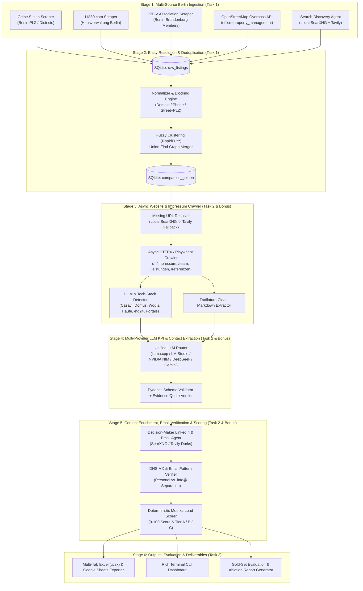
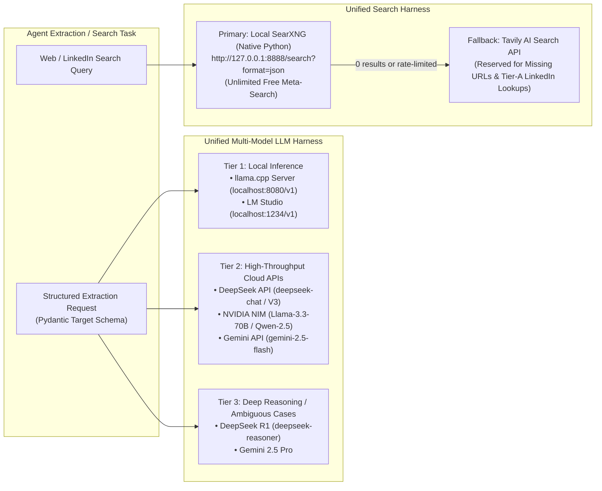

# 02 — System Architecture, Tech Stack & Codebase Blueprint

**Project Name:** Metrixa Engine — Autonomous B2B Lead Discovery, Enrichment & Qualification System
**Document Order:** `02 of 06`
**Purpose:** Complete end-to-end production system design, multi-provider LLM & search harness architecture, technology stack justification (*what* each tool is and *why* we use it), and exact repository directory layout.

---

## 1. High-Level End-to-End System Architecture

Metrixa Engine is designed as a **6-Stage Stateful Agentic Pipeline** backed by a local **SQLite Database (`metrixa_leads.db`)**. Every stage reads from and writes to SQLite so that the pipeline is 100% resumable, deterministic where possible, and auditable at every step.



---

## 2. Multi-Provider LLM & Search Harness Architecture

A key requirement of our production system is **zero vendor lock-in** and **maximum cost/throughput control**. We implement two unified abstraction layers:
1. **`LLMRouter`** — Seamlessly switches or falls back across local models (`llama.cpp`, `LM Studio`) and cloud APIs (`NVIDIA NIM`, `DeepSeek API`, `Gemini API`).
2. **`SearchRouter`** — Prioritizes your **local self-hosted SearXNG** (native Python, no Docker required, unlimited free searches) and uses **Tavily API** strictly as a high-precision fallback when local search returns insufficient results.



### 2.1 How the Unified LLM Router Works (`src/heidi_engine/llm/router.py`)
Because `llama.cpp`, `LM Studio`, `NVIDIA NIM`, and `DeepSeek` all support the **OpenAI-compatible `/v1/chat/completions` specification**, and `Gemini` also provides an OpenAI-compatible endpoint alongside `google-genai`, our `LLMRouter` wraps all 5 providers behind a single async interface:

| Provider | Base URL / Endpoint | Recommended Model | Best Use Case in Pipeline |
| :--- | :--- | :--- | :--- |
| **`llama.cpp` (Local)** | `http://127.0.0.1:8080/v1` | `Qwen2.5-14B-Instruct-GGUF` or `Llama-3.1-8B-Instruct` | Zero-cost bulk *Impressum* parsing & initial KPI extraction on local GPU/CPU. |
| **`LM Studio` (Local)** | `http://127.0.0.1:1234/v1` | Any loaded local GGUF model | Interactive local testing, zero API cost, complete offline privacy. |
| **`DeepSeek API`** | `https://api.deepseek.com/v1` | `deepseek-chat` (DeepSeek-V3) | Ultra-low cost (~$0.14/1M input tokens), state-of-the-art German comprehension & JSON extraction. |
| **`NVIDIA NIM`** | `https://integrate.api.nvidia.com/v1` | `meta/llama-3.3-70b-instruct` or `qwen/qwen2.5-72b-instruct` | High-speed cloud inference using free/developer NVIDIA NIM credits. |
| **`Google Gemini API`** | `https://generativelanguage.googleapis.com/v1beta/openai/` | `gemini-2.5-flash` | Massive context window, fast structured JSON schema enforcement, free tier / low cost. |

---

## 3. Complete Technology Stack (What & Why)

Every library in this stack has a specific engineering purpose. We include **no bloated frameworks** (no LangChain bloat, no heavy React frontend, no Docker requirement).

### 3.1 Core Language & Runtime
* **Python `3.11+` (`asyncio`)**
  * **What it is:** Modern asynchronous Python runtime.
  * **Why we use it:** Crawling 1,000+ Berlin company websites sequentially would take 6+ hours; with `asyncio` + `httpx` (concurrency = 25), it completes in **under 12 minutes**.

### 3.2 Web Scraping, Crawling & HTML Parsing Stack (Task 1 & Task 2)
* **`httpx` (with `http2=True`)**
  * **What it is:** High-performance async HTTP client.
  * **Why we use it:** Used for 95% of directory requests (`Gelbe Seiten`, `11880`, `Overpass API`, `SearXNG`) and company website crawling (`Impressum`, `Team`, `Leistungen`). Supports HTTP/2 and connection pooling.
* **`playwright` (Async Chromium)**
  * **What it is:** Headless browser automation library.
  * **Why we use it:** Used selectively (only when `httpx` hits JavaScript-rendered SPAs, VDIV dynamic member lists, or anti-bot protections). Keeping Playwright as a fallback keeps the pipeline fast and lightweight.
* **`selectolax` (Lexbor C-engine) + `beautifulsoup4`**
  * **What it is:** Ultra-fast HTML/CSS selector parser (`selectolax` is 10–30x faster than BeautifulSoup).
  * **Why we use it:** Extracts structured listing cards from `Gelbe Seiten` and `11880.com`, parses internal navigation links (`/impressum`, `/team`), and inspects raw DOM for PropTech ERP scripts (`casavi`, `etg24`, `domus`).
* **`trafilatura`**
  * **What it is:** Specialized web text & boilerplate removal library.
  * **Why we use it:** Strips navigation bars, cookie banners, CSS, and scripts from company websites, converting raw HTML into clean, compact Markdown. This reduces LLM prompt token usage by **75–85%** while preserving headings, lists, and tables.

### 3.3 Entity Resolution, Data Validation & Email Verification Stack
* **`rapidfuzz`**
  * **What it is:** C++-accelerated fuzzy string matching library (Levenshtein, Jaro-Winkler, Token Sort Ratio).
  * **Why we use it:** Deduplicates company names across `Gelbe Seiten`, `11880`, `VDIV`, and `OSM` (e.g., matching *"Müller Hausverwaltung GmbH"* with *"Hausverwaltung Mueller GmbH Berlin"*).
* **`phonenumbers` & `tldextract`**
  * **What it is:** Google's `libphonenumber` port for Python and canonical domain extractor.
  * **Why we use it:** Normalizes messy German phone numbers (`030 / 123 45-0` → `+4930123450`) and URLs (`https://www.hv-berlin.de/kontakt` → `hv-berlin.de`) so we can deterministically match duplicate companies.
* **`dnspython` & `email-validator`**
  * **What it is:** DNS resolver and RFC-compliant email syntax/deliverability checker.
  * **Why we use it:** Queries live **DNS `MX` (Mail Exchange)** records for every company domain to verify that inferred or extracted personal emails (`vorname.nachname@domain.de`) can actually receive mail, and detects custom email gateways.
* **`pydantic` (`v2`)**
  * **What it is:** Strict data validation and schema definition library.
  * **Why we use it:** Forces every LLM output and scraper record to conform to strict types, enums, and value bounds.

### 3.4 Storage, CLI, Reporting & Export Stack (Deliverables without a Frontend)
* **`sqlite3` (Built-in Python with WAL Mode enabled)**
  * **What it is:** Embedded relational SQL database (`data/metrixa_leads.db`) running in Write-Ahead Logging (`WAL`) mode for concurrent reads/writes.
  * **Why we use it:** Zero server setup, single portable file, full SQL query power, complete audit logging, and instant resuming if interrupted.
* **`typer` & `rich`**
  * **What it is:** Modern CLI framework and terminal dashboard renderer.
  * **Why we use it:** Gives you live progress bars, color-coded terminal tables, real-time stage metrics, and clean commands (`ingest`, `dedupe`, `crawl`, `enrich`, `score`, `export`, `evaluate`).
* **`openpyxl`**
  * **What it is:** Excel `.xlsx` workbook generator with full styling support.
  * **Why we use it:** Automatically builds the final multi-tab, color-coded, filter-enabled Excel workbook (`.xlsx`) with frozen headers, column widths, hyperlinks, and KPI summary tabs—ready for direct upload to Google Sheets.

---

## 4. Production Codebase Directory Structure

Below is the exact folder structure we will build inside `c:\Users\Ravin\Projects\Projetcs Alpha\Metrixa Systems`. Every file has a single, clear responsibility:

```text
Metrixa Systems/
├── README.md                                  # Quickstart, CLI commands & Architecture overview
├── pyproject.toml                             # Dependencies & project configuration
├── .env.example                               # Template for API keys & local endpoints
│
├── docs/                                      # Complete Engineering Documentation (01 to 06)
│   ├── 01_PRD_AND_REQUIREMENTS_ENGINEERING.md
│   ├── 02_SYSTEM_ARCHITECTURE_AND_TECH_STACK.md
│   ├── 03_TASK1_INGESTION_SCRAPERS_AND_DEDUPLICATION.md
│   ├── 04_TASK2_KPI_BLUEPRINT_CRAWLER_AND_SCORING_ENGINE.md
│   ├── 05_DATABASE_SCHEMA_DATA_STRUCTURES_AND_EXPORT_SPEC.md
│   └── 06_TASK3_VALIDATION_EVALUATION_ABLATION_AND_PRESENTATION_BLUEPRINT.md
│
├── data/                                      # Runtime Persistence (Git-ignored except gold set)
│   ├── metrixa_leads.db                         # Central SQLite database (all stages & audit logs)
│   ├── gold_set_berlin_30.json                # 30 hand-verified Berlin companies for Task 3 evaluation
│   └── exports/                               # Generated deliverables
│       ├── metrixa_berlin_hausverwaltungen.xlsx # Main multi-tab Excel / Google Sheets deliverable
│       ├── metrixa_berlin_leads_master.csv      # Clean CSV export
│       └── evaluation_ablation_report.md      # Auto-generated Task 3 metrics & ablation tables
│
├── src/
│   └── heidi_engine/
│       ├── __init__.py
│       ├── cli.py                             # Typer + Rich CLI entrypoint (`python -m heidi_engine ...`)
│       ├── config.py                          # Settings loader (.env, LLM endpoints, concurrency limits)
│       ├── models.py                          # All Pydantic v2 schemas (RawListing, GoldenCompany, KPIExtraction, Contact)
│       ├── db.py                              # SQLite WAL connection manager, schema init & state queries
│       │
│       ├── scrapers/                          # STAGE 1: Task 1 Multi-Source Berlin Discovery
│       │   ├── base.py                        # BaseAsyncScraper with rate limiting, retries & polite headers
│       │   ├── gelbe_seiten.py                # Gelbe Seiten Berlin scraper (by PLZ / District pagination)
│       │   ├── dir_11880.py                   # 11880.com Berlin Hausverwaltung scraper
│       │   ├── vdiv.py                        # VDIV Berlin-Brandenburg member directory scraper
│       │   ├── osm_overpass.py                # OpenStreetMap Overpass API Berlin property managers
│       │   └── search_discovery.py            # SearXNG + Tavily targeted Berlin query discovery
│       │
│       ├── entity_resolution/                 # STAGE 2: Task 1 Cleaning & Deduplication
│       │   ├── normalizer.py                  # Legal form extractor, name cleaner, phone/domain/PLZ normalizer
│       │   └── deduplicator.py                # Blocking keys + RapidFuzz similarity + Union-Find merging
│       │
│       ├── crawler/                           # STAGE 3: Task 2 Website & Impressum Crawler
│       │   ├── url_resolver.py                # Finds missing company websites via SearXNG / Tavily
│       │   ├── web_crawler.py                 # Async crawler for /, /impressum, /team, /leistungen, /referenzen
│       │   └── tech_detector.py               # Regex/DOM scanner for Casavi, Domus, Wodis, Haufe, Customer Portals
│       │
│       ├── llm/                               # STAGE 4: Multi-Provider LLM Extraction Harness
│       │   ├── router.py                      # Unified client for llama.cpp, LM Studio, NIM, DeepSeek, Gemini
│       │   ├── prompts.py                     # German Impressum & Hausverwaltung KPI extraction prompts
│       │   └── extractor.py                   # Structured JSON extraction + Evidence Quote anti-hallucination check
│       │
│       ├── enrichment/                        # STAGE 5: Bonus Contact Discovery, Verification & Scoring
│       │   ├── search_router.py               # Local SearXNG primary + Tavily API fallback client
│       │   ├── contact_finder.py              # LinkedIn profile & decision-maker personal email enricher
│       │   ├── email_verifier.py              # DNS MX record lookup, info@ filter & pattern generator
│       │   └── scorer.py                      # Deterministic 0-100 Metrixa Lead Score & Tier A/B/C calculator
│       │
│       └── telemetry/                         # STAGE 6: Task 3 Export, Evaluation & Ablation
│           ├── excel_exporter.py              # Formatted multi-tab .xlsx & CSV builder
│           └── evaluator.py                   # Gold-set Precision/Recall/F1 & Stage-by-Stage Ablation calculator
│
└── tests/                                     # Unit & Integration Tests
    ├── test_normalizer_and_dedupe.py
    ├── test_tech_detector.py
    ├── test_scorer.py
    └── test_email_verifier.py
```

---

## 5. Execution Pipeline Flow & CLI Commands

Because there is no web frontend to maintain, the entire system is operated via clean, self-documenting CLI commands that can be run all at once or stage-by-stage:

| Step | CLI Command | What Happens Under the Hood |
| :--- | :--- | :--- |
| **1. Initialize DB** | `python -m heidi_engine init` | Creates `data/metrixa_leads.db` with all SQLite tables and indexes. |
| **2. Scrape Berlin** | `python -m heidi_engine ingest --all` | Runs `Gelbe Seiten`, `11880`, `VDIV`, `OSM Overpass`, and `SearXNG` discovery in Berlin; saves to `raw_listings`. |
| **3. Deduplicate** | `python -m heidi_engine deduplicate` | Normalizes names/domains/phones, filters out non-Berlin or non-Hausverwaltung noise, clusters duplicates into `companies_golden`. |
| **4. Crawl Websites** | `python -m heidi_engine crawl` | Resolves missing URLs via SearXNG, crawls homepage + `/impressum` + `/team` + `/leistungen`, detects ERP/portal signatures (`Casavi`, `Domus`, etc.). |
| **5. Extract KPIs** | `python -m heidi_engine extract --provider deepseek` *(or `local`, `nim`, `gemini`)* | Runs the LLM extraction harness over crawled pages to populate portfolio units, WEG/Miet focus, and *Geschäftsführer* names with evidence quotes. |
| **6. Enrich Contacts** | `python -m heidi_engine enrich-contacts` | Searches SearXNG/Tavily for decision-maker LinkedIn URLs and personal emails; verifies DNS `MX` records. |
| **7. Score & Export** | `python -m heidi_engine export` | Computes the `0–100` Metrixa Lead Score, assigns Tiers (`A`, `B`, `C`), and generates `data/exports/metrixa_berlin_hausverwaltungen.xlsx`. |
| **8. Evaluate (Task 3)** | `python -m heidi_engine evaluate` | Runs precision/recall evaluation and stage ablation metrics, writing `data/exports/evaluation_ablation_report.md`. |
