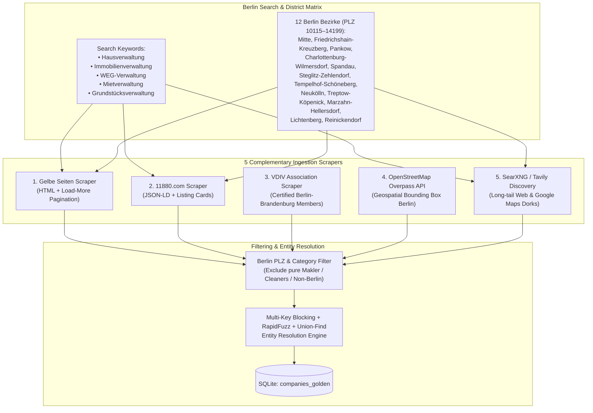

# 03 — Task 1 Specification: Multi-Source Berlin Scrapers & Entity Deduplication

**Project Name:** Metrixa Engine — Autonomous B2B Lead Discovery, Enrichment & Qualification System
**Document Order:** `03 of 06`
**Purpose:** Complete technical specification for **Task 1** (*"Create an overview of as many property management companies (Hausverwaltungen) in Berlin as possible"*), detailing our 5 ingestion sources, Berlin geographic sharding strategy, noise filtering rules, and the Entity Resolution & Deduplication algorithm.

---

## 1. Why Single-Source Scraping Fails in Berlin (And How We Solve It)

A naive scraper that runs a single query (`"Hausverwaltung Berlin"`) on one directory or search engine will cap out at 100–300 results because:
1. Directories paginate up to a maximum depth per query.
2. Many Berlin property managers register under specific sub-terms:
   * *Hausverwaltung* (General Property Management)
   * *WEG-Verwaltung* (Condominium Association Management)
   * *Mietverwaltung* / *Zinshausverwaltung* (Rental Building Management)
   * *Immobilienverwaltung* / *Grundstücksverwaltung* (Real Estate / Land Management)
3. Boutique or high-end property managers may only appear in the **VDIV professional association**, while traditional local managers appear in **Gelbe Seiten** and **11880.com**.

To achieve **maximum market recall across Berlin**, we combine **5 orthogonal sources** and shard our queries across **all 12 Berlin districts (*Bezirke*)** and search terms.



---

## 2. Detailed Specification of Each Scraper (`src/heidi_engine/scrapers/`)

### 2.1 Scraper 1: Gelbe Seiten (`gelbeseiten.de`)
* **File:** `src/heidi_engine/scrapers/gelbe_seiten.py`
* **Why we include it:** Gelbe Seiten is Germany's largest commercial directory (~700–1,000+ Berlin property management entries) with high website URL and phone number completeness.
* **How it works:**
  1. Queries `/suche/{keyword}/berlin` across our 5 core keywords (`hausverwaltung`, `immobilienverwaltung`, `weg-verwaltung`, `mietverwaltung`, `grundstuecksverwaltung`) and optionally per Berlin district.
  2. Parses `<article class="mod mod-Treffer">` listing blocks using `selectolax`.
  3. Handles Gelbe Seiten's AJAX pagination (`POST /ajaxsuche` with `position` offset increments of 10/50 until `gesamtanzahl` is reached).
  4. Extracts:
     * `company_name` (`h2[data-wipe-name="Titel"]`)
     * `street_address`, `postal_code` (`PLZ`), `city`, `district` (`Ortsteil`)
     * `phone` (from `data-phone` / `tel:` link)
     * `website_url` (decoded from base64 `data-webseitelink` or direct external anchor)
     * `detail_page_url` & `rating` / `review_count`

### 2.2 Scraper 2: 11880.com (`11880.com`)
* **File:** `src/heidi_engine/scrapers/dir_11880.py`
* **Why we include it:** 11880.com indexes thousands of German SMBs and often contains direct email addresses (`mailto:`) and secondary websites not listed in Gelbe Seiten.
* **How it works:**
  1. Queries `https://www.11880.com/suche/{keyword}/berlin?page={n}` until pagination terminates.
  2. Extracts structured `application/ld+json` (`LocalBusiness` schema) embedded in each page alongside HTML card attributes (`.result-list-entry`).
  3. Captures `name`, `streetAddress`, `postalCode`, `addressLocality`, `telephone`, `url`, and summary description.

### 2.3 Scraper 3: VDIV Berlin-Brandenburg (`vdiv.de` / Regional Member Directory)
* **File:** `src/heidi_engine/scrapers/vdiv.py`
* **Why we include it:** The *Verband der Immobilienverwalter (VDIV)* is the premier German industry association for professional property managers. VDIV members are **Tier-A targets** for Metrixa Systems because membership requires professional certification, insurance, and typically indicates an established portfolio (`500–20,000+` units).
* **How it works:**
  1. Queries the VDIV / VDIV Berlin-Brandenburg member directory (`verwaltersuche` filtered to `Berlin` / PLZ `10...–14...`).
  2. Uses `httpx` (with `playwright` fallback if dynamic JS filtering is active) to extract member company names, addresses, phone numbers, websites, and stated management specialties (*WEG-Verwaltung*, *Mietverwaltung*, *Gewerbeverwaltung*).
  3. Sets a boolean flag `is_vdiv_member = True` on all matched records (which boosts their Lead Qualification Score in Task 2).

### 2.4 Scraper 4: OpenStreetMap Overpass API (`osm_overpass.py`)
* **File:** `src/heidi_engine/scrapers/osm_overpass.py`
* **Why we include it:** OpenStreetMap contains community-verified geospatial nodes for offices in Berlin with tags `office=property_management`, `office=estate_agent` (filtered by `"Hausverwaltung"` in name/description). It costs 0 API credits and finishes in 3 seconds.
* **How it works:**
  Executes a single Overpass QL query against `https://overpass-api.de/api/interpreter` covering the administrative boundary of Berlin (`ISO3166-2 = DE-BE`):
  ```ql
  [out:json][timeout:60];
  area["ISO3166-2"="DE-BE"][admin_level=4]->.berlin;
  (
    node["office"="property_management"](area.berlin);
    way["office"="property_management"](area.berlin);
    node["name"~"Hausverwaltung|Immobilienverwaltung|WEG-Verwaltung",i](area.berlin);
    way["name"~"Hausverwaltung|Immobilienverwaltung|WEG-Verwaltung",i](area.berlin);
  );
  out center tags;
  ```
  Extracts `name`, `addr:street`, `addr:housenumber`, `addr:postcode`, `contact:website` / `website`, `contact:phone` / `phone`, `contact:email` / `email`, and exact `lat`/`lon` coordinates.

### 2.5 Scraper 5: Search Discovery via Local SearXNG & Tavily (`search_discovery.py`)
* **File:** `src/heidi_engine/scrapers/search_discovery.py`
* **Why we include it:** Modern digital-first property managers (launched in the last 3–5 years) may not pay for yellow-page directory listings, but rank on Google/Bing/DuckDuckGo for queries like `"WEG Verwaltung Berlin GmbH Impressum"`.
* **How it works:**
  Runs systematic search dorks across Berlin districts using our **Local SearXNG** instance (`http://127.0.0.1:8888/search?format=json`) with **Tavily API** fallback:
  * `"Hausverwaltung" "Berlin" "Impressum" "Geschäftsführer"`
  * `"WEG-Verwaltung" "Berlin" "Wohneinheiten"`
  * `"Mietverwaltung" "Berlin" ("Casavi" OR "etg24" OR "Kundenportal")`

---

## 3. Noise Filtering & Berlin Boundary Validation

Before deduplicating, every raw listing passes through a deterministic **Eligibility Filter**:

1. **Geographic Validation (Berlin Check):**
   * Valid Berlin postal codes (`PLZ`) must lie in the range **`10115` to `14199`** OR `city` must explicitly match `Berlin` (accounting for companies whose headquarters are in adjacent Potsdam/Brandenburg only if they explicitly list a Berlin branch office).
2. **Category Exclusion Filter (Removing Non-*Hausverwaltungen*):**
   * Directories often mix *Immobilienmakler* (pure real estate agents/brokers), *Gebäudereinigung* (cleaning services), *Hausmeisterservice* (janitorial services), or *Umzugsunternehmen* (moving companies) into `"Hausverwaltung"` searches.
   * **Rule:** If a company name or category contains exclusion terms (`Gebäudereinigung`, `Reinigungsservice`, `Umzüge`, `Schlüsseldienst`, `Containerdienst`, `Steuerberater`, `Rechtsanwalt`) AND does **not** explicitly mention `Hausverwaltung`, `Immobilienverwaltung`, `WEG-Verwaltung`, `Mietverwaltung`, or `Grundstücksverwaltung`, it is flagged as `DISQUALIFIED_CATEGORY` and excluded from the golden sheet.

---

## 4. Algorithm & Data Structures: Entity Resolution & Deduplication

When scraping 5 sources, a major company like *"Dussmann Hausverwaltung GmbH"* or *"BVBI Berliner Vereinigung für Immobilienmanagement GmbH"* will appear 4 to 8 times with slight variations in punctuation, legal suffixes, phone formatting, or URL paths.

We solve this using a **3-Step Entity Resolution Algorithm** (`Normalizer` → `Multi-Key Blocking` → `Weighted Similarity + Disjoint-Set Union-Find Clustering`).

### 4.1 Step 1: Canonical Normalization (`normalizer.py`)
For every raw listing $r_i$, we compute four canonical attributes:

1. **Canonical Domain ($D_i$):**
   * Strip protocol (`http://`, `https://`), `www.`, paths, and query parameters using `tldextract`.
   * Exclude directory/social domains (`gelbeseiten.de`, `11880.com`, `facebook.com`, `linkedin.com`, `immobilienscout24.de`) and generic email providers (`gmx.de`, `web.de`, `t-online.de`, `gmail.com`) from acting as company website domains.
2. **Canonical Phone ($P_i$):**
   * Parse with `phonenumbers.parse(raw_phone, "DE")`.
   * Format to E.164 standard (e.g., `030 / 88 42 10 - 0` → strip extension `-0` or normalize trunk → `+4930884210`).
3. **Canonical Name ($N_i$) & Extracted Legal Form ($L_i$):**
   * Lowercase, replace German umlauts (`ä→ae`, `ö→oe`, `ü→ue`, `ß→ss`).
   * Extract and strip legal suffixes via regex into a separate column `legal_form`:
     * `GmbH & Co. KG`, `GmbH & Co. OHG`, `UG (haftungsbeschränkt)`, `GmbH`, `AG`, `SE`, `e.K.`, `e.Kfm.`, `e.G.`, `GbR`, `OHG`, `KG`.
   * Strip generic stop-tokens for fuzzy comparison (`berlin`, `mbh`, `gesellschaft`, `fuer`) while keeping core distinguishing tokens.
4. **Canonical Address Key ($A_i$):**
   * Standardize `straße` / `str.` → `str`, extract 5-digit `postal_code` + normalized street name + house number (e.g., `10789_kurfuerstendamm_21`).

### 4.2 Step 2: Multi-Key Blocking & Pairwise Similarity Scoring (`deduplicator.py`)
Comparing $N \times N$ records naively is $O(N^2)$. Using **Blocking Keys**, we only compare records that share at least one of:
* **Block 1:** Exact Canonical Domain ($D_i = D_j \neq \text{null}$)
* **Block 2:** Exact Canonical Phone ($P_i = P_j \neq \text{null}$)
* **Block 3:** Same 5-digit Berlin `postal_code` (`PLZ`)
* **Block 4:** Same first 4 characters of Canonical Name ($N_i[:4] = N_j[:4]$)

Within each block, two records $(r_i, r_j)$ are merged as the **same real-world company** if any of the following deterministic or fuzzy rules hold:

$$\text{Match}(r_i, r_j) = \begin{cases} \text{True} & \text{if } D_i = D_j \text{ and } \text{TokenSortRatio}(N_i, N_j) \ge 65 \\ \text{True} & \text{if } P_i = P_j \text{ and } \text{TokenSortRatio}(N_i, N_j) \ge 70 \\ \text{True} & \text{if } A_i = A_j \text{ and } \text{TokenSortRatio}(N_i, N_j) \ge 80 \\ \text{True} & \text{if } \text{PLZ}_i = \text{PLZ}_j \text{ and } \text{TokenSortRatio}(N_i, N_j) \ge 90 \\ \text{False} & \text{otherwise} \end{cases}$$

### 4.3 Step 3: Disjoint-Set (Union-Find) Data Structure & Golden Record Survival
If Record A matches Record B (via phone), and Record B matches Record C (via website domain), then `{A, B, C}` belong to the same connected component.
* **Data Structure:** Path-compressed **Union-Find (Disjoint Set)** structure (`O(N α(N))` time complexity).
* **Golden Record Survivorship Rules:** For each connected cluster, we synthesize one `GoldenCompany` row by selecting the highest-trust attribute across the cluster:
  * **Name:** Prefer `VDIV` > `Impressum Legal Name` > `Gelbe Seiten` > `11880` > `OSM`.
  * **Website URL:** Prefer valid non-redirect corporate domain.
  * **Address & Phone:** Prefer complete address with valid 5-digit Berlin PLZ (`10115–14199`) and valid E.164 phone.
  * **Provenance Tracking:** Populate `source_list` (e.g., `"gelbe_seiten, 11880, vdiv"`) and `source_count` (e.g., `3`).
