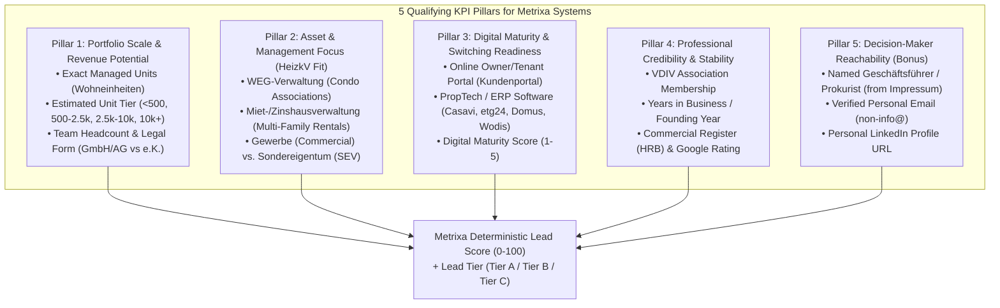

# 04: Task 2 & Bonus Specification: Qualifying KPIs, Website/Impressum Crawler, LLM Extraction & Lead Scoring

**Project Name:** Metrixa Engine: Automated B2B Lead Discovery, Enrichment & Qualification System
**Document Order:** `04 of 06`
**Purpose:** Complete specification for **Task 2** (*"Define and fill in qualifying KPIs"*) and the **Bonus Task** (*"Find the right contact person including their personal email address and LinkedIn profile"*).

---

## 1. Business Logic: Why These Qualifying KPIs Matter to Metrixa Systems

Task 2 explicitly states: *"Think about which criteria are relevant for us to qualify a property management company as a potential customer (e.g. is this a good lead for us or not?). Which KPIs you choose, and why, is part of the task."*

As a **metering service provider (*Messdienstleister*)**, Metrixa Systems installs remotely readable submetering hardware (heat cost allocators, water meters, heat meters) and performs annual heating & operating cost billing (*Heizkostenabrechnung*). Therefore, an ideal *Hausverwaltung* customer is defined by **5 Strategic Qualification Pillars**:



### 1.1 Complete Qualifying KPI Blueprint Table

| Pillar | Column / KPI Name | Data Type | Why This KPI Qualifies a Lead for Metrixa Systems | Extraction Method |
| :--- | :--- | :--- | :--- | :--- |
| **1. Scale** | `exact_units_managed` | `Integer \| Null` | Submetering revenue scales directly per apartment unit (*Wohneinheit*). Many proud *Hausverwaltungen* state on their site: *"Wir verwalten über 3.500 Wohneinheiten"*. | Website Crawler (`/`, `/ueber-uns`, `/referenzen`) + LLM Extractor |
| **1. Scale** | `estimated_units_tier` | `Enum` (`<250`, `250-1,000`, `1,000-5,000`, `5,000+`) | When exact units aren't stated, sales still needs a reliable size bracket inferred from employee count, reference buildings, and legal structure. | Deterministic Heuristic + LLM Evidence Inference |
| **1. Scale** | `employee_count_est` | `Integer \| String` | In Germany, 1 property manager (*Objektbetreuer*) typically manages ~300-500 residential units. A team of 10 employees implies ~3,000-5,000 units. | `/team` page photo/name count + LinkedIn company size |
| **1. Scale** | `legal_form` | `Enum` (`GmbH`, `GmbH & Co. KG`, `AG`, `UG`, `e.K.`, `GbR`) | Corporations (`GmbH`, `AG`, `GmbH & Co. KG`) have institutional portfolios; sole proprietors (`e.K.`, `GbR`) typically manage smaller portfolios. | Regex + *Impressum* Parser (`HRB` / `HRA` check) |
| **2. Focus** | `manages_weg` | `Boolean` | **WEG-Verwaltung** (Homeowner Associations) vote on changing metering providers at annual owners' meetings (*Eigentümerversammlung*). Huge volume driver. | Website `/leistungen` analysis |
| **2. Focus** | `manages_miet` | `Boolean` | **Mietverwaltung / Zinshaus** (Multi-family rental buildings) have a single landlord decision-maker, fastest sales cycle for submetering installation! | Website `/leistungen` analysis |
| **2. Focus** | `manages_gewerbe` | `Boolean` | Commercial multi-tenant buildings require complex thermal/electricity submetering. | Website `/leistungen` analysis |
| **2. Focus** | `manages_sev` | `Boolean` | *Sondereigentumsverwaltung* (single apartments inside a WEG managed by someone else). Note: A company doing *only* SEV cannot switch the whole building's metering provider! | Website `/leistungen` analysis |
| **3. Digital** | `has_customer_portal` | `Boolean` | If a *Hausverwaltung* offers a digital tenant/owner portal (*Kundenportal / Eigentümerportal*), they value digital automation and EED monthly consumption apps. | DOM Link Scanner + Website Text |
| **3. Digital** | `detected_erp_proptech` | `String (CSV)` | Detecting **Casavi, etg24, Facilioo, Domus, Wodis Sigma, Haufe PowerHaus, Immoware24, Karthago** proves tech adoption and allows Metrixa Systems to pitch seamless billing data integration! | Raw HTML/Script/Subdomain Regex Scanner + LLM |
| **3. Digital** | `incumbent_metering_signal` | `String \| Null` | Mentions of legacy providers (*Techem, Ista, Brunata, Kalorimeta, Minol*) in tenant downloads/service pages reveal who Metrixa Systems is displacing. | DOM/PDF link & text scanner |
| **3. Digital** | `digital_maturity_score` | `Integer (1-5)` | Composite score of website modernity, SSL, portal presence, PropTech stack, and online service forms. | Deterministic Formula |
| **4. Trust** | `is_vdiv_member` | `Boolean` | VDIV Berlin-Brandenburg members are vetted, professional property managers with high compliance needs. | VDIV Scraper + Website Badge Detection |
| **4. Trust** | `founding_year` | `Integer \| Null` | Established companies (e.g., founded 1995) have large legacy building stocks due for submetering hardware replacement (every 5-6 years under *Eichfrist*). | Website `/ueber-uns` + LLM Extractor |
| **5. Contact** | `decision_maker_name` | `String` | Full name of *Geschäftsführer* (Managing Director), *Inhaber* (Owner), or *Leiter Hausverwaltung*. | *Impressum* (§ 5 DDG) + `/team` + LinkedIn |
| **5. Contact** | `decision_maker_role` | `String` | Exact title (`Geschäftsführer`, `Vorstand`, `Inhaber`, `Prokurist`, `Teamleitung`). | *Impressum* + `/team` + LinkedIn |
| **5. Contact** | `personal_email` | `String \| Null` | Direct decision-maker email (strictly excluding `info@`, `kontakt@`, `service@`). | `/team`, `/impressum`, SearXNG/Tavily, or MX-verified pattern |
| **5. Contact** | `email_status` | `Enum` | `VERIFIED_PUBLIC_DIRECT` (found on web), `PATTERN_INFERRED_MX_VALID` (derived from name + verified MX), or `GENERIC_ONLY` (only `info@` found). | Email Verification Engine |
| **5. Contact** | `linkedin_url` | `URL \| Null` | Direct LinkedIn profile of the decision-maker or company page. | Website social links + SearXNG / Tavily LinkedIn search |
| **6. Score** | `metrixa_lead_score` | `Integer (0-100)` | Final weighted qualification score ranking every company from `0` to `100`. | Scoring Engine (`scorer.py`) |
| **6. Score** | `lead_tier` | `Enum` (`Tier A`, `Tier B`, `Tier C`) | Actionable sales bucket (`Tier A`: ≥70 Immediate Outreach, `Tier B`: 45-69 Nurture, `Tier C`: <45 Low Priority). | Scoring Engine (`scorer.py`) |

---

## 2. Stage 3 Design: Async Website & German *Impressum* Crawler (`src/metrixa_engine/crawler/`)

### 2.1 Why Crawling the *Impressum* is a Superpower in Germany
Under **§ 5 Digitale-Dienste-Gesetz (DDG)** (formerly § 5 TMG), **every commercial website in Germany is legally required** to publish an easily accessible **Impressum** (Legal Notice) containing:
1. Full legal company name and legal form (e.g., *Muster Hausverwaltung GmbH*).
2. Full physical business address in Berlin.
3. **Full names of all authorized representatives (*Vertretungsberechtigte Geschäftsführer / Vorstand / Inhaber*)**.
4. Commercial register court (*Amtsgericht Charlottenburg*) and registration number (*HRB 123456 B*).
5. Direct contact telephone and email address.

### 2.2 Smart Subpage Discovery & Priority Queue (`web_crawler.py`)
Instead of crawling 50 random blog posts per website, our async crawler fetches the **Homepage (`/`)** first, extracts all internal `<a href="...">` links, scores them by keyword relevance, and crawls up to **5 high-signal subpages concurrently**:

| Priority | Subpage Category | URL / Anchor Text Matching Patterns | What We Extract From It |
| :--- | :--- | :--- | :--- |
| **P1 (Mandatory)** | **Legal Notice (*Impressum*)** | `/impressum`, `/imprint`, `/rechtliches`, `Impressum` | Exact legal entity name, `HRB` number, **Geschäftsführer names**, direct email/phone. |
| **P2 (High)** | **Team & Contacts** | `/team`, `/ansprechpartner`, `/ueber-uns`, `/unternehmen`, `/kontakt` | Personal emails (`vorname.nachname@...`), employee headcount, decision-maker photos/roles, founding year. |
| **P3 (High)** | **Services (*Leistungen*)** | `/leistungen`, `/verwaltung`, `/weg-verwaltung`, `/mietverwaltung`, `/zinshaus` | Confirmation of `manages_weg`, `manages_miet`, `manages_gewerbe`, `manages_sev`. |
| **P4 (Medium)** | **Portfolio & References** | `/referenzen`, `/objekte`, `/bestand`, `/portfolio` | Explicit unit counts (*"über 4.200 verwaltete Einheiten"*) or count of reference buildings in Berlin. |
| **P5 (Medium)** | **Digital Portal / Service** | `/kundenportal`, `/service`, `/eigentuemerportal`, `/login`, `/schadensmeldung` | Detection of digital tenant/owner portals and ERP software links. |

### 2.3 Deterministic DOM & Regex Tech-Stack Scanner (`tech_detector.py`)
Before stripping HTML tags with `trafilatura`, `tech_detector.py` scans the raw HTML, `<script src>`, `<iframe src>`, and external `<a href>` tags of every crawled page for deterministic PropTech, ERP, and Metering signatures:

```python
PROPTECH_ERP_SIGNATURES = {
    "Casavi": [r"casavi\.de", r"mycasavi\.com", r"casavi-portal"],
    "etg24": [r"etg24\.de", r"etg24\.com"],
    "Facilioo": [r"facilioo\.de", r"facilioo"],
    "Domus": [r"domus-software\.de", r"domus\s*4000", r"domus\s*erp", r"homeday-domus"],
    "Wodis Sigma / Aareon": [r"wodis", r"aareon\.de", r"aareon"],
    "Haufe PowerHaus / axera": [r"powerhaus", r"haufe-axera", r"axera"],
    "Immoware24": [r"immoware24\.de", r"immoware24"],
    "Karthago": [r"karthago-software"],
    " Scopeland / WinCASA": [r"wincasa", r"software24\.com"],
}

METERING_INCUMBENT_SIGNATURES = {
    "Techem": [r"techem\.de", r"techem"],
    "Ista": [r"\bista\.com", r"\bista\.de", r"ista\s+deutschland"],
    "Brunata-Metrona": [r"brunata", r"metrona"],
    "Kalorimeta (Kalo)": [r"kalorimeta", r"\bkalo\.de"],
    "Minol": [r"minol\.de", r"\bminol\b"],
}
```
Why this is awesome: Even if an LLM misses a hidden login button linking to `https://hv-berlin.mycasavi.com`, our deterministic DOM scanner catches it 100% of the time!

---

## 3. Stage 4 Design: Multi-Provider LLM Structured Extraction (`src/metrixa_engine/llm/`)

Once the homepage and up to 5 subpages are converted into compact Markdown (capped at ~12,000 characters with `/impressum` and `/team` prioritized first), the combined document is sent to `LLMRouter` (`llama.cpp` / `LM Studio` / `NVIDIA NIM` / `DeepSeek` / `Gemini`).

### 3.1 Strict Pydantic Extraction Schema (`models.py`)
Every LLM response is validated against this exact Pydantic model:

```python
class DecisionMakerExtracted(BaseModel):
    full_name: str = Field(description="Full name of Geschäftsführer, Inhaber, Vorstand, or Team Lead")
    role: str = Field(description="Exact German role, e.g., Geschäftsführer, Inhaber, Prokurist, Objektbetreuer")
    direct_email: Optional[str] = Field(default=None, description="Direct email if explicitly written on page")
    direct_phone: Optional[str] = Field(default=None, description="Direct phone extension if explicitly written")
    source_quote: str = Field(description="Exact verbatim substring from text proving this person's name and role")

class CompanyKPIExtraction(BaseModel):
    is_actual_hausverwaltung: bool = Field(description="True if company offers property management (WEG/Miet/Gewerbe), False if pure broker/cleaner")
    legal_entity_name: Optional[str] = Field(default=None, description="Official legal name from Impressum")
    legal_form: Optional[str] = Field(default=None, description="GmbH, UG, AG, GmbH & Co. KG, e.K., GbR, etc.")
    commercial_register_id: Optional[str] = Field(default=None, description="e.g., HRB 123456 B")
    founding_year: Optional[int] = Field(default=None, description="4-digit founding year if explicitly mentioned")
    exact_units_managed: Optional[int] = Field(default=None, description="Explicit number of managed units (Wohneinheiten/Einheiten) if stated, else null")
    units_evidence_quote: Optional[str] = Field(default=None, description="Verbatim quote stating the unit count, else null")
    reference_buildings_count: Optional[int] = Field(default=None, description="Number of reference properties listed on website if any")
    employee_count_mentioned: Optional[int] = Field(default=None, description="Explicit employee count or number of team members listed on /team page")
    manages_weg: bool = Field(default=False, description="True if WEG-Verwaltung / Wohnungseigentumsverwaltung is offered")
    manages_miet: bool = Field(default=False, description="True if Mietverwaltung / Zinshausverwaltung is offered")
    manages_gewerbe: bool = Field(default=False, description="True if Gewerbeverwaltung is offered")
    manages_sev: bool = Field(default=False, description="True if Sondereigentumsverwaltung is offered")
    has_online_portal: bool = Field(default=False, description="True if website offers a digital Kundenportal / Eigentümerportal / Mieter-App")
    software_mentioned: List[str] = Field(default_factory=list, description="Any ERP/PropTech or metering providers mentioned in text")
    decision_makers: List[DecisionMakerExtracted] = Field(default_factory=list, description="All Geschäftsführer, Inhaber, and key contacts extracted")
    general_emails: List[str] = Field(default_factory=list, description="General emails like info@, kontakt@, verwaltung@")
    qualification_reasoning: str = Field(description="1-2 sentence factual summary of why this company is a strong/weak lead for a metering provider")
```

### 3.2 Anti-Hallucination Verification Rule (`extractor.py`)
After the LLM returns `CompanyKPIExtraction`:
1. **Unit Count Verification:** If `exact_units_managed` is not `None`, our validator checks that `units_evidence_quote` is non-empty and that the number (or its German formatted string like `3.500` or `3500`) actually appears in the crawled website text. If not, `exact_units_managed` is reset to `None` and logged as a blocked hallucination!
2. **Decision-Maker Name Verification:** For each extracted `DecisionMakerExtracted`, we verify that the last name of `full_name` exists as a case-insensitive substring in the crawled website text or search snippet.

---

## 4. Stage 5 Design: Bonus Task: Decision-Maker LinkedIn & Personal Email Enrichment (`src/metrixa_engine/enrichment/`)

The Bonus prompt asks: *"Find the right contact person including their email address, meaning not an info@ address but a personal and relevant one. LinkedIn profiles or similar are also very welcome."*

Here is our **4-Step Waterfall Algorithm** to achieve high personal contact coverage without hallucinating:

```mermaid
flowchart TD
    START["Golden Company + Crawled Impressum/Team Pages"] --> STEP1["Step 1: Direct Website & Impressum Extraction\nExtract Geschäftsführer / Inhaber names + any direct emails on /team"]
    STEP1 --> CHECK_LI{"Missing Decision-Maker\nor LinkedIn URL?"}
    CHECK_LI -- "Yes" --> STEP2["Step 2: SearXNG (Primary) / Tavily (Fallback) Dork\nQuery: site:linkedin.com/in \"<Company Name>\" \"Berlin\" OR \"<Director Name>\""]
    CHECK_LI -- "No" --> CHECK_EM{"Has Personal Direct Email\n(non-info@)?"}
    STEP2 --> CHECK_EM
    CHECK_EM -- "Yes" --> STEP4["Step 4: DNS MX Record & Syntax Verification\nMark status = VERIFIED_PUBLIC_DIRECT"]
    CHECK_EM -- "No, only info@ + Known Director Name" --> STEP3["Step 3: Web Email Dork + German Corporate Pattern Generator\n1) Search SearXNG: \"@<domain>\" \"<Director Lastname>\"\n2) If valid MX exists on <domain>, generate primary pattern:\n   vorname.nachname@<domain> / nachname@<domain>\nMark status = PATTERN_INFERRED_MX_VALID (clearly labeled!)"]
    STEP3 --> STEP4
```

### 4.1 Strict Separation of `info@` vs. Personal Emails
We maintain **two separate columns** in the database and final Excel/Google Sheet so there is zero ambiguity:
1. **`general_email`**: The company's main inbox (e.g., `info@hv-muster.de`, `kontakt@hv-muster.de`).
2. **`decision_maker_personal_email`**: Strictly non-generic personal email (e.g., `t.schmidt@hv-muster.de` or `thomas.schmidt@hv-muster.de`), accompanied by **`personal_email_confidence`**:
   * `PUBLIC_DIRECT_VERIFIED`: Found verbatim on `/team`, `/impressum`, VDIV, or web search + valid DNS `MX`.
   * `PATTERN_MX_VERIFIED`: Decision-maker name confirmed via *Impressum*/LinkedIn + company uses custom corporate domain with active DNS `MX` servers + standard German B2B format (`vorname.nachname@domain.de`).
   * `NONE`: Only generic or freemail (`gmx.de`/`t-online.de`) exists.

---

## 5. Mathematical Lead Scoring & Tiering Algorithm (`scorer.py`)

To make the spreadsheet immediately actionable for Metrixa Systems' sales team, every company is scored from **`0` to `100` points** using a transparent, deterministic formula across our 5 pillars:

$$\text{MetrixaLeadScore} = S_{\text{scale}} (35) + S_{\text{focus}} (25) + S_{\text{digital}} (20) + S_{\text{trust}} (10) + S_{\text{contact}} (10)$$

### 5.1 Point Breakdown Table (`Max = 100 Points`)

| Component | Max Points | Exact Scoring Logic |
| :--- | :---: | :--- |
| **1. Portfolio Scale ($S_{\text{scale}}$)** | **35 pts** | • `exact_units_managed >= 2500` or `estimated_units_tier == "5,000+"` → **35 pts**<br>• `exact_units_managed >= 1000` or `estimated_units_tier == "1,000-5,000"` → **28 pts**<br>• `exact_units_managed >= 300` or `estimated_units_tier == "250-1,000"` or `employee_count >= 5` → **20 pts**<br>• Corporate legal form (`GmbH`, `AG`, `GmbH & Co. KG`) with active website → **14 pts**<br>• Small / Sole proprietor (`e.K.`, `GbR`, `<250` units) → **6 pts** |
| **2. Asset Focus ($S_{\text{focus}}$)** | **25 pts** | • Both `manages_weg == True` AND `manages_miet == True` → **25 pts** *(Sweet spot for submetering!)*<br>• Either `manages_weg == True` OR `manages_miet == True` → **20 pts**<br>• `manages_gewerbe == True` only → **10 pts**<br>• Pure `manages_sev == True` only → **2 pts** *(Cannot switch whole-building metering)* |
| **3. Digital Maturity ($S_{\text{digital}}$)** | **20 pts** | • Detected modern PropTech ERP/Portal (`Casavi`, `etg24`, `Facilioo`, `Domus`, `Wodis`, `Immoware24`, `Haufe`) → **+12 pts**<br>• Has online tenant/owner portal (`has_customer_portal == True`) → **+5 pts**<br>• Has modern HTTPS corporate website → **+3 pts** |
| **4. Credibility & Stability ($S_{\text{trust}}$)** | **10 pts** | • Official **VDIV Member** (`is_vdiv_member == True`) → **+5 pts**<br>• Verified Commercial Register (`HRB` / `HRA` extracted) or `founding_year <= 2020` → **+3 pts**<br>• Matched across $\ge 2$ directory sources → **+2 pts** |
| **5. Contact Reachability ($S_{\text{contact}}$)** | **10 pts** | • Named Decision Maker (*Geschäftsführer* / *Inhaber*) extracted → **+4 pts**<br>• Personal email (`PUBLIC_DIRECT_VERIFIED` or `PATTERN_MX_VERIFIED`) → **+4 pts**<br>• Decision-maker or Company LinkedIn URL found → **+2 pts** |

### 5.2 Qualification Tiers
* **🟢 `Tier A: High-Priority Target` (`Score 70 - 100`):** Mid-to-large Berlin *Hausverwaltung* (`GmbH`/`AG`), manages multi-family *WEG* + *Mietverwaltung*, digitally mature (or VDIV member), with named decision-maker & direct contact. **Action:** Immediate personalized sales outreach by Metrixa Systems Account Executives.
* **🟡 `Tier B: Qualified Mid-Market` (`Score 45 - 69`):** Solid residential property manager in Berlin with verified operations and decision-maker name, moderate size or moderate digital footprint. **Action:** Automated outbound sequence + LinkedIn outreach.
* **⚪ `Tier C: Long-Tail / Small Portfolio` (`Score 20 - 44`):** Very small local manager, missing website, or limited portfolio data. **Action:** Low-touch marketing nurture.
* **🔴 `Disqualified` (`Score < 20` or `is_actual_hausverwaltung == False`):** Pure real estate broker, facility cleaner, or non-Berlin entity. Excluded from main sales sheet.
