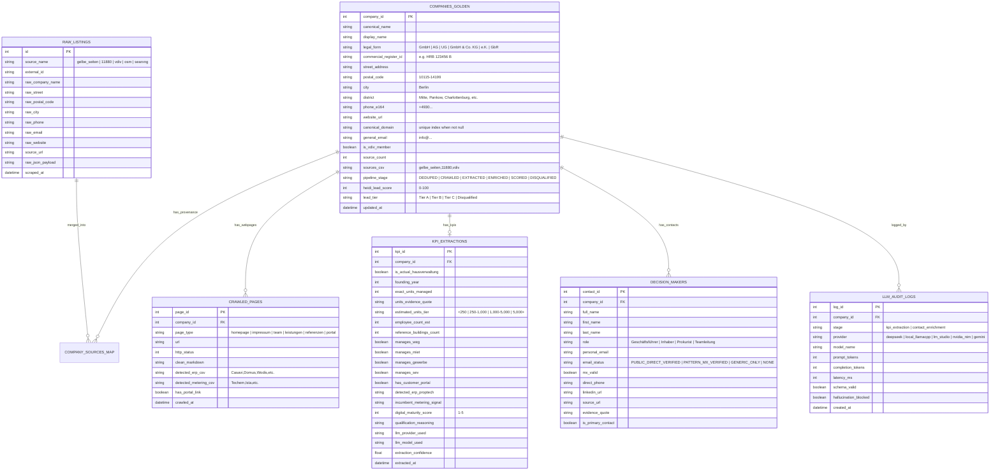
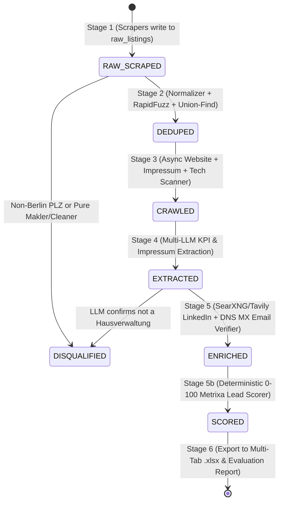

# 05 — Database Schema, Pipeline State Machine & Excel/Google Sheets Deliverable Spec

**Project Name:** Metrixa Engine — Autonomous B2B Lead Discovery, Enrichment & Qualification System
**Document Order:** `05 of 06`
**Purpose:** Complete relational database design (`SQLite WAL`), pipeline state transitions, and the exact column-by-column structure of the final multi-tab Excel (`.xlsx`) / Google Sheets deliverable.

---

## 1. Entity-Relationship (ER) Diagram (`data/metrixa_leads.db`)

All data across every stage of Metrixa Engine is persisted in a single, portable SQLite database (`data/metrixa_leads.db`) configured with `PRAGMA journal_mode=WAL;` and `PRAGMA foreign_keys=ON;`.

---

## 2. Pipeline State Machine & Crash Recovery

Every record in `companies_golden` has a `pipeline_stage` column that acts as a finite state machine (FSM). If your internet drops or an API key hits a rate limit mid-run, re-running any CLI command picks up **only** the records waiting for that stage:

---

## 3. Exact Specification of the Final Excel (`.xlsx`) & Google Sheets Deliverable

Since we have no web frontend, the **Excel / Google Sheet workbook (`data/exports/metrixa_berlin_hausverwaltungen.xlsx`)** is the centerpiece visual deliverable that Metrixa Systems will inspect.

Our `ExcelExporter` (`src/heidi_engine/telemetry/excel_exporter.py`) automatically builds a **4-Tab Workbook** with corporate styling (dark navy headers `#1B365D`, frozen top row, auto-fitted column widths, color-coded `Tier A/B/C` badges, and clickable URLs):

### 3.1 Tab 1: `Qualified_Berlin_Leads` (Primary Master Table)
Sorted by `Metrixa Lead Score (0–100)` descending so the very best leads appear at the top.

| Col # | Column Header in Sheet | Source / Calculation | Example Value |
| :---: | :--- | :--- | :--- |
| **A** | `Lead ID` | Formatted Golden ID | `HEIDI-BER-0001` |
| **B** | `Lead Tier` | Color-coded badge (`Tier A`, `Tier B`, `Tier C`) | `Tier A (High Priority)` |
| **C** | `Metrixa Lead Score (0-100)` | Deterministic formula (`scorer.py`) | `88` |
| **D** | `Company Name` | Official display/legal name | `BVBI Berliner Vereinigung für Immobilienmanagement GmbH` |
| **E** | `Legal Form` | Extracted legal entity type | `GmbH` |
| **F** | `District (Bezirk)` | Mapped from Berlin PLZ | `Charlottenburg-Wilmersdorf` |
| **G** | `Postal Code (PLZ)` | 5-digit Berlin PLZ | `10719` |
| **H** | `Street Address` | Street + House Number | `Uhlandstr. 165` |
| **I** | `Website URL` | Clickable hyperlink | `https://www.bvbi.de` |
| **J** | `Reported Units (Wohneinheiten)` | Explicit units stated on website | `4500` |
| **K** | `Estimated Portfolio Size Tier` | Size bracket (`<250`, `250-1,000`, `1,000-5,000`, `5,000+`) | `1,000-5,000` |
| **L** | `Est. Team Size (Employees)` | Extracted from `/team` or company profile | `18` |
| **M** | `Manages WEG (Condos)` | `Yes` / `No` | `Yes` |
| **N** | `Manages Mietverwaltung (Rentals)` | `Yes` / `No` | `Yes` |
| **O** | `Manages Commercial (Gewerbe)` | `Yes` / `No` | `Yes` |
| **P** | `Has Online Customer Portal` | `Yes` / `No` | `Yes` |
| **Q** | `Detected ERP / PropTech Stack` | DOM + text signatures | `Casavi, Domus 4000` |
| **R** | `Incumbent Metering Signal` | Mentioned metering provider if any | `Techem` |
| **S** | `Digital Maturity Score (1-5)` | `1` to `5` | `5` |
| **T** | `VDIV Certified Member` | `Yes` / `No` | `Yes` |
| **U** | `Commercial Register (HRB)` | Extracted from *Impressum* | `HRB 98412 B` |
| **V** | `Founding Year` | Extracted from website | `1998` |
| **W** | `Primary Decision Maker Name` | *Geschäftsführer* / *Inhaber* | `Max Mustermann` |
| **X** | `Decision Maker Role` | Role title | `Geschäftsführer` |
| **Y** | `Personal / Direct Email (Bonus)` | Strictly non-`info@` personal email | `m.mustermann@bvbi.de` |
| **Z** | `Email Verification Status` | `PUBLIC_DIRECT_VERIFIED` \| `PATTERN_MX_VERIFIED` \| `GENERIC_ONLY` | `PUBLIC_DIRECT_VERIFIED` |
| **AA** | `Decision Maker / Company LinkedIn` | Clickable LinkedIn URL | `https://de.linkedin.com/in/...` |
| **AB** | `General Company Email` | Fallback `info@` / `kontakt@` inbox | `info@bvbi.de` |
| **AC** | `Company Phone` | E.164 / Formatted Berlin phone | `+49 30 8842100` |
| **AD** | `AI Qualification Summary` | 1-sentence reason why this lead fits Heidi | `Large VDIV-certified WEG & Miet manager (4,500 units) using Casavi portal.` |
| **AE** | `Data Sources Matched` | Provenance across scrapers | `vdiv, gelbe_seiten, 11880` |

### 3.2 Tab 2: `All_Decision_Makers_Contacts` (Bonus Task Deep-Dive)
Many medium-to-large *Hausverwaltungen* have **2 or 3 *Geschäftsführer*** plus a *Leiter WEG-Verwaltung* or *Prokurist*. While Tab 1 shows the primary contact per company, Tab 2 lists **every single extracted decision-maker row-by-row** with:
* `Company ID`, `Company Name`, `Lead Tier`, `Full Name`, `Role`, `Personal Email`, `Email Verification Status`, `DNS MX Server`, `Direct Phone`, `LinkedIn URL`, `Source Page URL`, and `Verbatim Evidence Quote`.

### 3.3 Tab 3: `Evidence_And_Audit_Trail` (Anti-Hallucination Proof)
Shows the exact URLs crawled (`impressum_url`, `team_url`, `services_url`), HTTP status codes, raw DOM tech signals detected, and the verbatim `units_evidence_quote` and `contact_evidence_quote` for full transparency.

### 3.4 Tab 4: `KPI_Methodology_And_Summary` (Executive Dashboard inside the Sheet)
Automatically populated summary table right inside Excel/Google Sheets explaining:
1. Why each KPI was chosen for Metrixa Systems and how the `0–100` Lead Score is weighted.
2. Live dataset statistics (Total Raw Scraped → Total Deduplicated Berlin Companies → Tier A / B / C counts → % with Verified Website → % with Named Decision Maker → % with Personal Email / LinkedIn).
